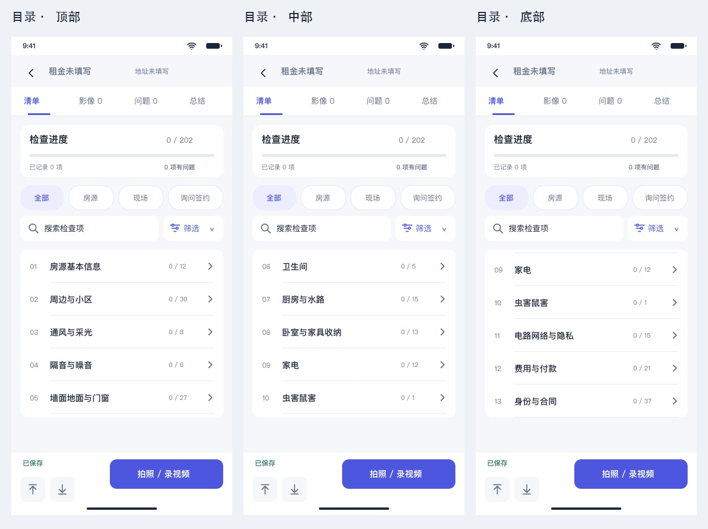

# 清单设计交付

更新：2026-10-11。范围：完整目录、控件与关键状态、字段映射。重复业务字段复用控件，不单独绘制 303 个画面。

## Figma 入口

- [完整目录与数据口径](https://www.figma.com/design/IcJzmxGcnzi4icPgrdBjYA/Untitled?node-id=145-38097)
- [控件类型与状态](https://www.figma.com/design/IcJzmxGcnzi4icPgrdBjYA/Untitled?node-id=145-38208)
- [条件分支与异常状态](https://www.figma.com/design/IcJzmxGcnzi4icPgrdBjYA/Untitled?node-id=145-38385)

- [新增房源后清单](https://www.figma.com/design/IcJzmxGcnzi4icPgrdBjYA/Untitled?node-id=107-2386)
- [已有房源清单](https://www.figma.com/design/IcJzmxGcnzi4icPgrdBjYA/Untitled?node-id=106-155)
- [归档只读详情](https://www.figma.com/design/IcJzmxGcnzi4icPgrdBjYA/Untitled?node-id=106-209)

## 数据来源与覆盖

原型来源：http://127.0.0.1:8876/recovered-checklist.html。当前快照校验 SHA-256：`4b2ee3b06bcc9469c74efb1d6cebac1ac5e54919724cbe3cc42a2605032fd638`。

`checklist-source.json` 包含原字段 ID、选项、层级、条件、来源阶段及 App 阶段；`checklist-source.html` 保留来源快照；`field-control-map.csv` 将全部字段映射到 Figma 控件示例。

| 分类 | 原始字段数 | 新建时当前有效项 |
|---|---:|---:|
| 房源基本信息 | 12 | 12 |
| 周边与小区 | 33 | 30 |
| 通风与采光 | 8 | 8 |
| 隔音与噪音 | 6 | 6 |
| 墙面地面与门窗 | 32 | 27 |
| 卫生间 | 17 | 5 |
| 厨房与水路 | 24 | 15 |
| 卧室与家具收纳 | 34 | 13 |
| 家电 | 45 | 12 |
| 虫害鼠害 | 7 | 1 |
| 电路网络与隐私 | 18 | 15 |
| 费用与付款 | 21 | 21 |
| 身份与合同 | 46 | 37 |

## 计数规则

303 为原始字段全集。页面分母取当前有效项，包含组存在性/许可/不涉及等控制项，并排除隐藏的条件明细。它不是原始字段数，也不固定为旧版 295。

| 设计样例 | 已记录 | 当前有效项 | 问题 |
|---|---:|---:|---:|
| 新建 | 0 | 202 | 0 |
| 已有 | 86 | 212 | 3 |
| 归档A | 122 | 212 | 2 |
| 归档B | 96 | 212 | 1 |

上述数据是可复算的设计样例，保存在 `count-fixtures.json`，并非用户真实看房记录。空房源当前有效项为 202，确认存在空调后示例为 212；其他选择也会改变分母。不要在实现中硬编码这些数值。

## 阶段与过滤

- 房源：房源基本信息；现场：其他来源阶段为现场看房的字段；询问签约：来源阶段为询问与签约的字段；全部：三者合并。
- 阶段和分类是两个维度，保留逐字段映射，不按整类推断阶段。
- 筛选下拉框实时更新，多条件按 OR；选择全部清除条件。先按适用性、阶段和搜索限定范围，再做条件匹配。
- Figma 现有筛选交互用 5 条真实字段演示组合结果，不代表 303 字段的完整运行时命中列表。

## 条件与状态

- 未填写与否/没有分开。组存在性未选择或没有时收起明细；重新选择存在后保留原模型中的历史输入。
- 空调的正常/有问题/没有同行显示。正常可批量记录；有问题保留逐项确认；没有不视为问题。
- 宽带有/无切换实测项目与自装许可、运营商多选。
- 二房东和中介按签约方条件显示；允许转租时展开附属问题；许可字段不重复计数。
- 只有源数据标注 skippable 的组显示不涉及；切换时保留隐藏答案。
- 数字、文本、单选、其他补充、多选、是/否、检查结果、许可和地址共 9 类控件。字段文案与选项以完整映射为准。
- 备注与照片为检查项通用附加内容；左滑操作保持紧凑；长内容换行，保存失败保留输入。
- 归档复用正常详情结构，允许浏览、筛选、展开、查看备注/影像；编辑与保存禁用。还原入口为归档列表长按菜单，且还原不占新增额度。

## 原型与实现边界

- 13 个分类在目录组件中完整保留；画板还给出完整目录用于核对。手机视口只显示当前可见区域。
- Figma 目录用首/中/尾三个位置的拖动过渡说明长列表；它是分段交互示例，不是已验证的原生连续滚动。正式 App 使用连续纵向滚动。
- 控件与条件画板是交付说明，位于手机画板之外，不作为 App 新页面。
- 未要求把所有重复字段制作成独立 Figma 可输入页面。完整字段定义由源数据交付，不能自行删减或以示例文案替换。
- 验证范围：数据结构、字段映射、Figma 节点和反应配置回读、导出画面。未声称完成 App 运行测试或 Figma 全量手势回放。

## 目录状态预览

核对结果：13 类顺序一致、303 个字段 ID 唯一并全部映射；3 个已有/只读入口在中部变体保留检查项链接；52 个手机画板回读无旧版 295、18/30 或滤网文案残留。证据见 `figma-readback-validation.json`。
