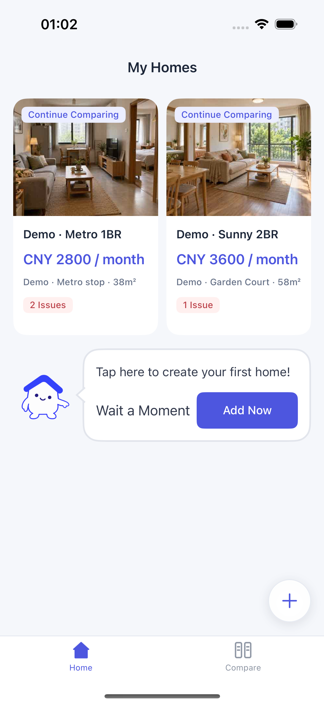
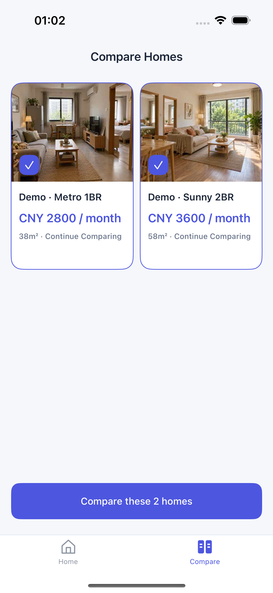
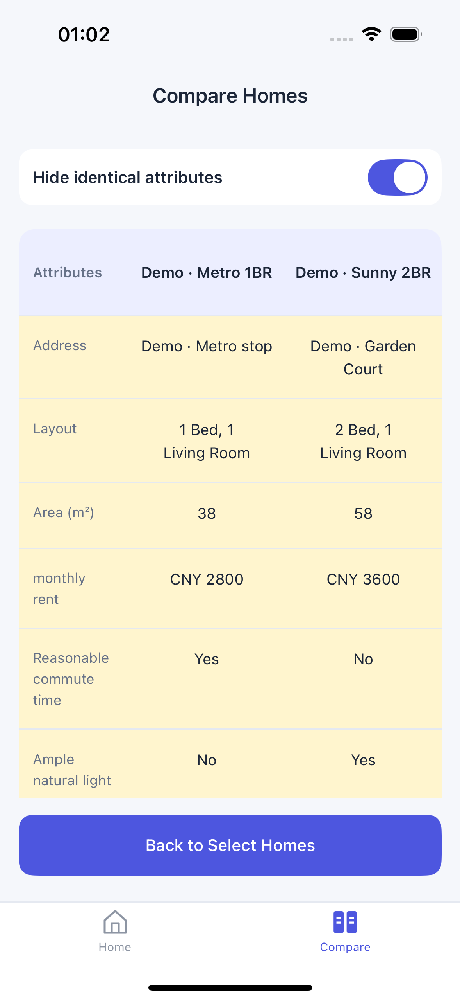

# 英文示例房源评审

> 后续状态：用户已确认效果。正式启动接入及与主线组合后的回归见 [2026-10-31 集成验收](INTEGRATION_20261031.md)。以下保留当时的评审快照。

状态：REVIEW_READY，待用户确认效果。正式首次启动仍默认关闭；本轮继续更新 Draft PR #104，未合并、未发布。工作树为 `/private/tmp/rent-room-first-launch-examples-20261030`，由当前 agent 直接实现与审查，没有 worker 或子 agent。

iOS 首次生成示例时采用当前应用语言（含跟随系统）：英文环境生成 `Demo · Metro 1BR` 与 `Demo · Sunny 2BR`，同时提供英文地址、总结、通勤/噪音备注和照片说明。两套仍为精简模板，沿用相同室内照片、CNY 2800/3600 租金及 38/58 m² 面积。标准户型、选项和决策继续保存原有规范值，通过既有 iOS 显示翻译呈现。

只本地化创建时的示例内容。切换语言或升级后不会重写已保存示例、用户房源及修改过的文字；删除后不补回。既有空文件、旧账号与恢复副本保护条件未改变。微信当前没有英文界面或语言设置，继续使用中文示例。本次英文文案直接在示例工厂维护，没有改写既有 agy 翻译目录或来源回执。

## 修复与回归

- `exampleHouses.test.js` 的新增英文断言在修复前真实失败：传 `exampleLanguage: 'en'` 仍返回中文名称。[失败输出](evidence-en-20261031/js-before.log)。加入语言透传后，名称、地址、备注、总结、图片说明及旧记录字节保护断言通过。
- 首轮英文真实截图发现单个问题显示 `1 Issues`。新增 `AppCopyTests/testEnglishIssueCountUsesSingularOnlyForOne` 在修改显示逻辑前失败，实际为 `1 Issues`、预期为 `1 Issue`。[失败结果](evidence-en-20261031/summary-singular-before.json)、[断言日志](evidence-en-20261031/test-singular-before.log)。最终只修正英文规范标签的单数形式，中文和用户原文不变；单测与真实卡片断言通过。

## 验证范围和证据

| 变更边界 | 实际验证 |
| --- | --- |
| 示例工厂和共享存储 | 3 个相关 Vitest 文件共 30 项通过：英文内容、中文默认、新安装、旧/空/损坏记录、语言变化后用户编辑与媒体保留。[结果](evidence-en-20261031/js-after.log) |
| iOS 桥接与货币/评价兼容 | 8 项 Node 测试通过。[结果](evidence-en-20261031/bridge-tests.log) |
| iOS 语言透传和数据保护 | SHA `a1aa43175391d055b8953f06f92ecae9249dfe56`，run `rent-room-examples-en-20261031-a`，6 UT + 2 UI 通过、0 失败、0 跳过。包括英文设置生成、保留用户修改、照片解码及备份字节、中英文真实选择/差异对比/重启、双列卡片边界。[计划及精确选择器](evidence-en-20261031/ios-plan-a.json)、[结果](evidence-en-20261031/summary-a.json)、[收据](evidence-en-20261031/receipt-a.json) |
| 最终英文显示 | SHA `a8b97b1e96b17d6fd7fe25ef3a8ef463cc05120e`，run `rent-room-examples-en-20261031-b`，3 UT + 1 UI 通过、0 失败、0 跳过。覆盖单复数、规范文案与用户原文边界；英文首页、选择两套、差异开关及重启重新通过。[计划及精确选择器](evidence-en-20261031/ios-plan-b.json)、[结果](evidence-en-20261031/summary-b.json)、[收据](evidence-en-20261031/receipt-b.json) |
| 微信构建 | 15 页、2,086,070 字节；官方 wcc 20 WXML / wcsc 22 WXSS 均退出 0。[构建](evidence-en-20261031/wechat-build.log)、[检查](evidence-en-20261031/wechat-check.log) |
| 微信界面证据复用 | 固定时钟和随机数后，新工厂不传语言的完整输出与 `0b51e76` 完全一致：[比较结果](evidence-en-20261031/wechat-default-equivalence.log)。微信调用仍使用默认中文，页面、照片资源和媒体路径无变化；沿用 [照片评审记录](PHOTOS_20261031.md) 的真实微信交互截图，不声称本轮重新执行微信 UI |

两个成功 iOS run 均使用共享 Simulator Management runner 和仓库 `scripts/run-xcodebuild.sh`，XcodeGen 2.45.4，iPhone 14 Pro / iOS 18.3.1 (22D8075)，UDID `8F178971-C203-4690-A83B-253046EACBB1`。实际构建缓存由 runner 管理，租约和执行槽均已释放。run a 启动时工作树干净；run b 除未跟踪的本轮证据目录外，应用和测试源码已提交。

完整日志与 `.xcresult` 均保留在 `/private/tmp/rent-room-examples-en-20261031/`：`ios-a.log`、`ios-a.xcresult`、`ios-singular-before.log`、`ios-singular-before.xcresult`、`ios-b.log`、`ios-b.xcresult`。仓库保存摘要、回执、计划、执行入口和原图。实际操作使用按钮、卡片和开关；仅用 UUID 隔离评审数据，不修改用户存档，没有通过 handler/setData 或成功 mock 替代点击。

`a1aa431` 到 `a8b97b1` 仅增加英文 `1 个问题` 的单数显示处理及对应回归断言，初始化、存储、备份、照片、布局与中文路径未改。已检查差异，复用 run a 的数据与中文界面结果，run b 重新验证受影响英文显示和流程。后续证据文档提交不改变执行输入。这里是隔离评审验收，未验证与新 main 组合后的正式启动、真机、小屏、深色模式或 iPad，也不代表远端 CI 通过。

## 最终英文原图

以下均来自 `a8b97b1` 的 `ios-b.xcresult`，1178 × 2556 px，未裁切、改字或合成。[导出附件清单](evidence-en-20261031/attachments-b-manifest.json)、[图片哈希与尺寸](evidence-en-20261031/images-b.json)。主 agent 已逐张检查：名称、租金、地址与面积完整，照片与双列间距正常，`1 Issue` / `2 Issues` 正确；选择状态和差异开关与实际操作一致。对比表截图仅包含当前可见区域，未声称展示表格全部行。

中文复验原图和英文修正前原图保留于本证据目录，均标注 `-a`，避免与最终英文图混用。

主 agent 已审查最终语言透传、规范选项不变、旧记录写入边界、所有新增断言、生成 JS 来源和图片证据。用户尚未批准视觉效果；按照 ios-ui-component-review-gate 的 “Stop before full-page integration and downstream business work while approval is absent.”，正式首次启动接入、同步主线后的组合验收、合并及发布仍未执行。
