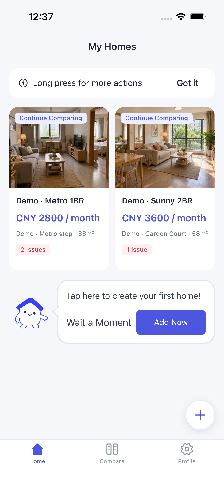
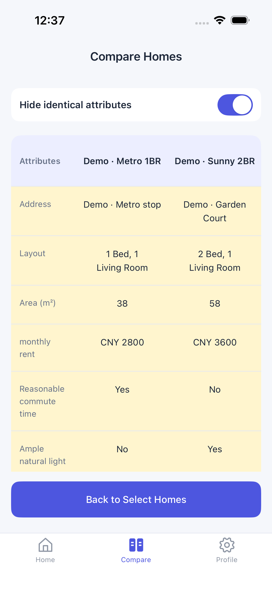
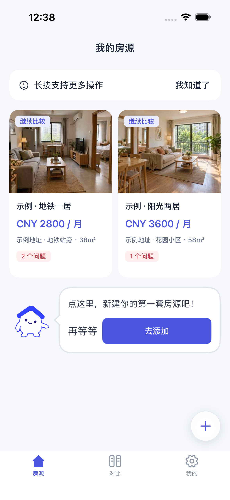
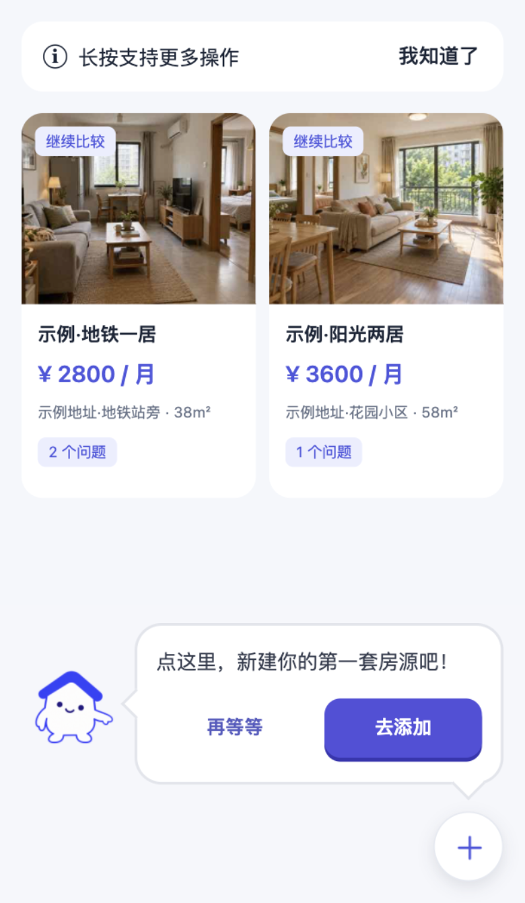
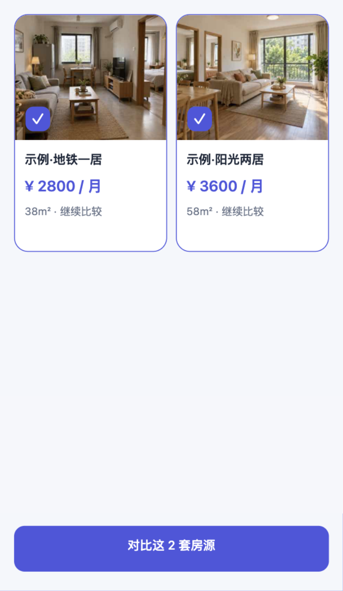
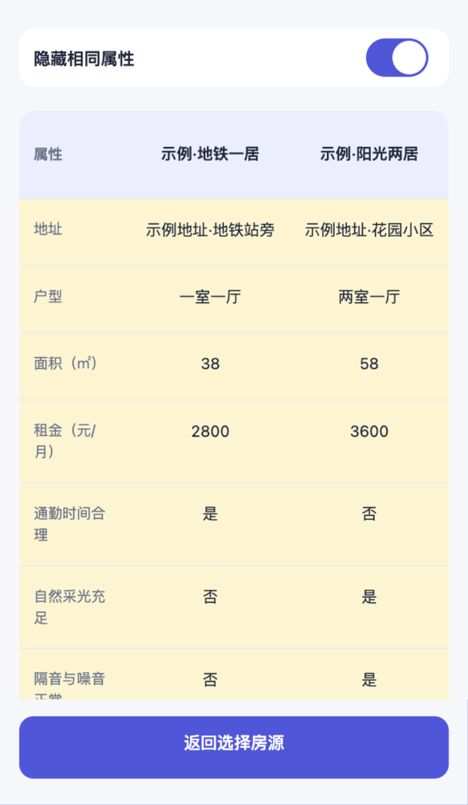
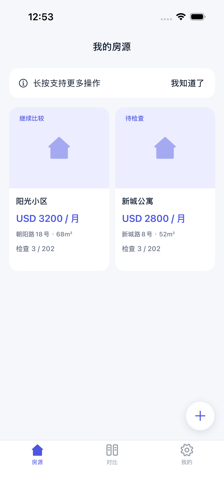
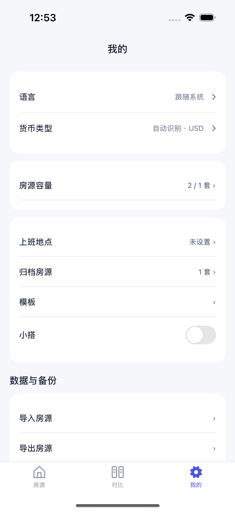

# 首次启动示例房源集成验收

> 最新进展：已合入房源点数、删除文案和震动规则主线，中文显示“元/月”，英文保持 USD 1500/月、USD 1900/月。当前结果、原图及微信重载验收限制见[主线合入与人民币单位](YUAN_MAIN_20261031.md)。以下保留历史集成结果与截图。

用户在英文原图评审后回复“可以的”，批准当前两套带照片示例的效果与正式启动接入。此记录取代此前评审文档中“默认关闭、待确认”的当前状态；此前文档和失败证据保留为历史。用户还明确要求 iOS 与微信一起调整、使用精简模板、老用户升级不受影响，并允许恢复微信实例池第 3 槽。容量和房源点数规则按用户要求保持不变。

## 最终行为

- iOS 与微信正常首次启动创建两套精简示例，附随包离线室内照片，可直接选择比较。iOS 按创建时应用语言提供中英文名称、地址、备注、总结和照片说明；微信保持现有中文界面。
- 仅确认全新安装时创建。旧安装目录、旧账号、已有空文件、旧房源、恢复副本和删除后的空列表均不补入示例；升级或切换语言不重写存档。图片使用普通本地媒体目录，沿用现有预览、备份和删除机制。
- 正式入口已启用；临时示例评审页面及微信示例开关已移除。UUID 隔离测试目录与长期回归用例保留，测试不使用用户目录。

## 版本和审查边界

在独立 worktree `/private/tmp/rent-room-first-launch-examples-20261030` 工作，保护原主工作区。已合并本轮开始时的 `origin/main` `1f26f8e04088fa8865431e5c590dd1179ab98c84`，保留主线的安静引导和首页长按提示。组合提交 `58c9451`，正式入口提交 `abaea1dfd078d61bfbd9030ea52eea12907376da`。

最终应用源码提交 `a5d1dafc1728def93edfc985b4af858fe50ea9cc` 与上述正式入口相比，只修正老用户 UI 测试中的外部 StoreKit 评分窗口隔离。仅 DEBUG、显式老用户夹具、有效隔离 UUID 和 `--stub-system-review` 同时成立时不调用外部评分窗口；评分资格和请求状态仍真实写入。Release 与中英文首次启动路径不受影响。最终证据提交只改变文档、日志和原图，不改变应用或测试输入。

主 agent 直接实现并审查：首次安装判断在创建目录之前；存档必须为缺失值才创建；恢复副本和旧 Keychain 排除；示例照片复制与备份路径；规范选项与用户文本边界；卡片尺寸；主线合并；所有回归断言与原图。未启动 worker 或子 agent。

## 自动化验证

| 范围 | 命令和结果 |
| --- | --- |
| 微信首次启动、存储与相邻引导 | Node 24.19.0 执行 Vitest 精确选择 8 个文件，131 项通过。包括实际构建 app.js 首启、照片、重启、删除后不补回，以及旧目录、空存档、旧房源、归档和恢复副本原始字节保护。[输出](evidence-integration-20261031/wechat-tests.txt) |
| iOS 桥接 | Node `--test` 选择 currency-review、app-review、currency-localization、quiet-guidance，12 项通过。[输出](evidence-integration-20261031/bridge-tests.txt) |
| 微信正式构建 | 无评审开关、无测试目录环境变量，15 页、2,087,659 字节；官方 wcc 20 WXML、wcsc 22 WXSS 均退出 0。[构建](evidence-integration-20261031/wechat-build-production.txt)、[检查](evidence-integration-20261031/wechat-check-production.txt) |
| iOS 真源检查 | `bash scripts/check-xcodegen.sh` 通过；XcodeGen 2.45.4，67 个规范 JS 来源，337516 字节，AppCopy 1343 / Regional 190；生成 xcodeproj 不提交。 |
| iOS 数据与正式新用户 UI | SHA `abaea1d`，campaign a：14 UT + 中英文 2 UI 通过；老用户 1 UI 因外部评分窗口断言失败。[精确计划](evidence-integration-20261031/ios-plan-a.json)、[结果](evidence-integration-20261031/ios-summary-a.json)、[回执](evidence-integration-20261031/ios-receipt-a.json) |
| iOS 老用户针对性恢复 | SHA `a5d1daf`，campaign c：1 UT + 唯一失败的老用户 UI 均通过，0 失败、0 跳过；真实恢复原两套活动房源和一套归档，无示例补入，后台恢复和重启正常。[计划](evidence-integration-20261031/ios-plan-c.json)、[结果](evidence-integration-20261031/ios-summary-c.json)、[回执](evidence-integration-20261031/ios-receipt-c.json) |
| 微信原生交互 | run `2cd25ad5691848f2a742d9f64164006e` 通过；真实欢迎页、两张照片、两卡选择、差异开关、Compile 重载全部完成，同目录、同 IDs、全部房源字段完全相同；槽 3 归还 idle。[回执](evidence-integration-20261031/wechat-final-receipt.json)、[断言](evidence-integration-20261031/wechat-final-assertions.json)、[操作阶段](evidence-integration-20261031/wechat-final-test.txt) |

微信精确选择：`tests/example-houses.test.js tests/example-session.test.js tests/example-launch-runtime.test.js tests/platform.test.js tests/runtime.test.js tests/house-long-press-hint.test.js tests/onboarding.test.js tests/onboarding-wait-position.test.js --no-file-parallelism`。先构建再运行依赖构建产物的用例。

iOS 通过共享 Simulator Management runner 和仓库 `scripts/run-xcodebuild.sh` 执行，iPhone 16 / iOS 26.5 (23F77)，UDID `5FC4A20B-AF44-4A92-BF91-B0096BEBF1D9`。完整原始日志和 xcresult 位于 `/private/tmp/rent-room-examples-integration-20261031/`。本次 campaign 共选择 3 个不同 UI 场景，未扩大为全量套件；后续只重跑失败老用户用例及其修改过的隔离守卫单测。

按以上最终源码等价边界，14 个不同 UT 和 3 个不同 UI 场景均已有通过证据，修改过的守卫单测在最终源码再次通过。所有测试结束后租约已归还。

原始 campaign a 的失败不能算通过：老用户夹具触发不受应用控制的系统评分窗口，原测试要求该窗口必须出现。`6f34488` 的可选窗口观察修正仍失败，原始视频、截图与层级显示货币提示按钮的点击受到外部窗口干扰。最终使用已有业务测试的显式评分隔离方式，保留完整旧房源、货币选择、页面操作、后台恢复和重启断言。[a 失败原图](evidence-integration-20261031/returning-failure.png)、[b 失败原图](evidence-integration-20261031/returning-failure-b.png)、[b 收据](evidence-integration-20261031/ios-receipt-b.json)。未修改生产行为或放宽存档断言。

微信早期三个 run 在工具健康阶段失败，业务回调未开始：`bd2e0f4afe1646e8b729da8d576f84c3`、`81f9b9c206ee493390ebc66efa93857f`、`6e3f03c09dab45599401b9ea432be56b`。第 3 槽按既有用户授权使用内置 recover，保留登录与失败记录，未碰其他槽。诊断包装仅记录 SDK 调用耗时和错误，不改变健康条件或超时。随后 `4cb273483ef040ddb4aef62d7bb9143e` 健康检查成功并完成欢迎流程，但原生截图确认未在 120 秒内完成而失败，正常归还 idle。失败收据和日志均保留，不能当作通过证据。`04706c217e4f422990b03d1886bf24ce` 在其他任务占用槽位期间排队 300 秒超时，没有取得租约或执行应用操作；随后继续正常排队，未接管其他任务。

最终微信池命令（完整绝对路径，SDK 诊断不改变就绪条件）：

```sh
WECHAT_POOL_UI_REVIEW=1 \
WECHAT_NODE=/Users/pc/.cache/codex-runtimes/codex-primary-runtime/dependencies/node/bin/node \
WECHAT_AUTOMATOR_MODULE=/private/tmp/rent-room-examples-integration-20261031/automator-diagnostics.cjs \
python3 /Volumes/mac2/codex-builds/wechat-instance-pool/runner/pool.py \
  --root /Volumes/mac2/codex-builds/wechat-instance-pool run \
  --project /private/tmp/rent-room-first-launch-examples-20261030/apps/wechat/dist \
  --wait 600 --timeout 600 -- \
  /Users/pc/.cache/codex-runtimes/codex-primary-runtime/dependencies/node/bin/node \
  /private/tmp/rent-room-first-launch-examples-20261030/apps/wechat/tests/e2e/example-houses.cjs
```

## 正式启动原图

以下来自 campaign a 的真实启动、欢迎页、卡片选择和差异开关操作，原始图片未裁切、改字或合成。主 agent 已逐张检查照片、双列边界、英文内容和 `1 Issue` / `2 Issues`。





微信最终原图来自上述成功 run；主 agent 已核验实际渲染后才让只读观察器保存原图。WeChat DevTools 2.01.2510290，基础库 3.17.3，模拟器 iPhone 12/13；点击使用原生 CUA，SDK 仅读取状态和截图，没有 setData、调用 handler 或成功 mock。构建只设置 `WECHAT_TEST_DATA_ROOT=xunju-test-examples-integration-20261031`，正式启动代码与生产构建一致。冻结 SHA `a5d1daf`，snapshotHash `03f4dc17cd8fb1f48d820ca28ae0dd01bcd13d522a389f419282a802f0de507a`；源码状态仅包含本轮证据文档修改。






iOS 老用户真实恢复截图（保留原两套活动房源，设置页仍显示一套归档）：




## 交付范围

本轮是用户批准后的正式入口接入与分支回归；PR #104 尚未合并，没有上传体验版、TestFlight、提审或发布。模拟器、官方编译、VM 测试与微信开发者工具分别报告，未把它们当作真机或线上结果。未验证小屏、深色模式、iPad、微信 Android 真机，也不声称远端 CI 通过。
