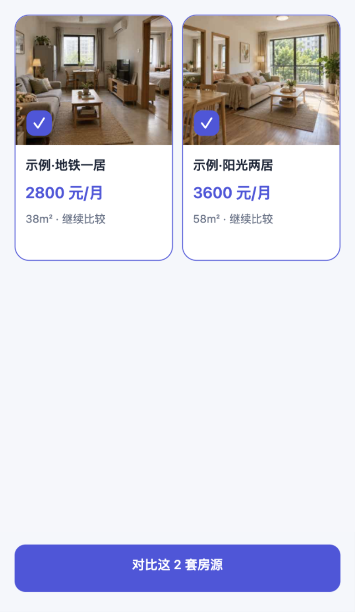
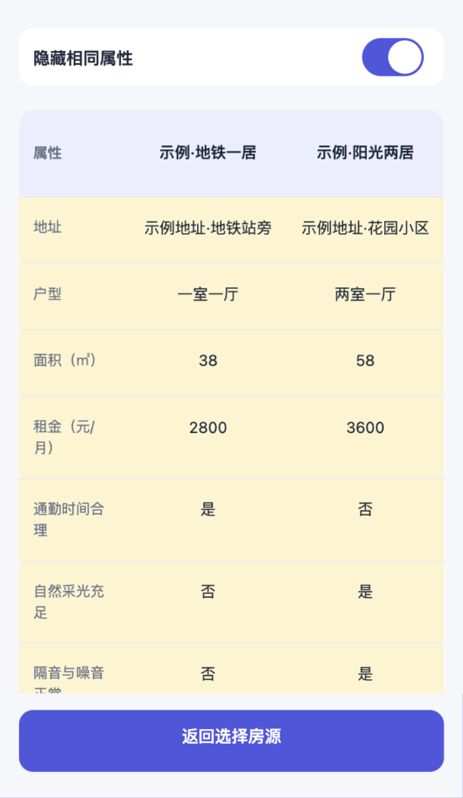
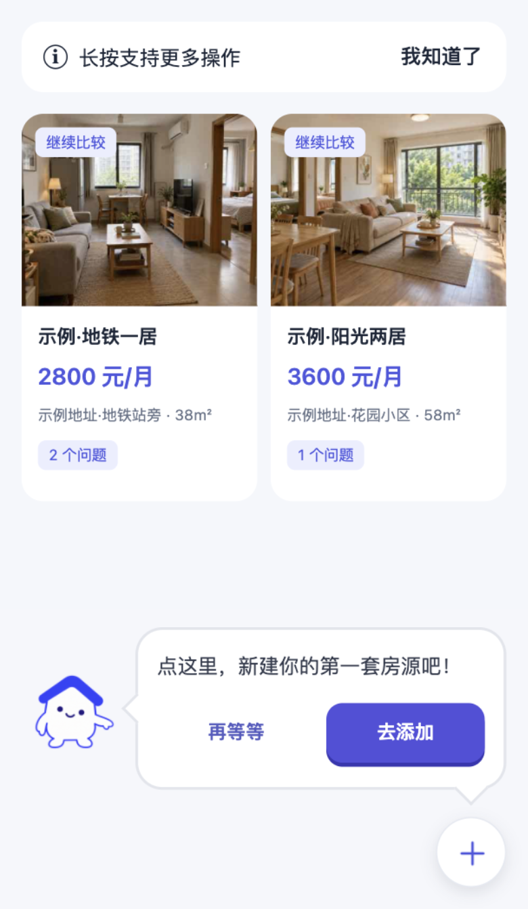

# PR #104 合并前补验

2026-11-02 用户明确要求“合入到主线”，确认本次效果并授权合并 PR。补齐此前微信完整重载流程的验收缺口；本轮没有应用、测试、配置或资源代码修改。

## 冻结版本和证据等价

- 本次微信验证 head：`c6cac1231724df79ebda57070d9e794d2e20b352`，启动时工作区干净。
- 2026-11-02 重新 fetch 的 main 仍为 `f23b50a2152d9073f0aff0ddd4fecfcc8716882d`；该主线已在 PR 历史中。`git merge-tree --write-tree HEAD f23b50a` 成功，树为 `82e971ed37ea283ef5fe3a1159b484c25a45aa7e`，无冲突或人工处理。
- 已通过的 iOS / JS 验证源码为 `98422b64881bba09375f371520a74bcd7e0a483e`。逐路径核对 `98422b6..c6cac12` 只改变 `docs/first-visit-examples/` 的文档、日志、回执与原图；`apps`、`ios`、`scripts`、生成输入、测试与依赖没有差异。
- 因此复用 [34 UT + 3 个精确 UI 场景](evidence-yuan-main-20261031/ios-latest-main-summary.json)、[184 项 JavaScript](evidence-yuan-main-20261031/js-latest.txt)、[20 项桥接](evidence-yuan-main-20261031/bridge-latest.txt)和[微信官方编译](evidence-yuan-main-20261031/wechat-check-latest.txt)通过证据。方法与风险映射见[原计划](evidence-yuan-main-20261031/ios-latest-main-plan.json)，未扩大为全量套件。本轮后续证据提交仍仅文档，不影响上述等价性。

## 微信缺口已补齐

run **`bd2016fd02c84e39b5c24fa6880ee4e3`** 全部通过：[回执](evidence-merge-20261102/receipt.json)、[断言](evidence-merge-20261102/assertions.json)、[完整测试日志](evidence-merge-20261102/test.txt)、[构建日志](evidence-merge-20261102/build.txt)、[清理记录](evidence-merge-20261102/reset-after.txt)。此前失败记录保留于旧文档，本次通过没有将其改写。

真实操作依次完成首次欢迎、精简模式、两张示例选择、比较、隐藏相同属性及开发者工具 Compile。重载后回到首页，同目录、同房源 ID、全部房源字段完全一致，照片和 2800 / 3600 元/月保留；两示例初始化不消耗点数，重载后点数不变。SDK 仅读取状态和保存截图，未调用 handler、setData 或成功 mock。当前 agent 直接操作并检查原图。

工具为 WeChat DevTools 2.01.2510290，基础库 3.17.3，iPhone 12/13 模拟器。通过共享实例池领用槽 1，PID 31114，完成后清理并归还 idle，保留常驻工具与登录，未操作其他槽。快照 hash `cb742fc5699a964d464c97dc8c5ebb792c7fa2bd3c86e5423a35ddfd74636f5b`。构建仅指定隔离数据根 `WECHAT_TEST_DATA_ROOT=xunju-test-examples-merge-20261102`；沿用已提交观察器，未修改源码、断言或等待期限。原始完整运行目录：`/Volumes/mac2/codex-builds/wechat-instance-pool/runs/bd2016fd02c84e39b5c24fa6880ee4e3/`。

## 最终审查

当前 agent 重新读取 GitHub PR diff，检查首次安装判定、旧空/损坏/恢复数据保护、照片文件路径、双卡边界、中文元/英文美元、点数初始化与消费账本。未发现新的可执行审查问题。用户本轮已授权合并；GitHub 检查接口没有返回 workflow run 或 commit status，不能称为远端 CI 通过。

本记录只覆盖合并门禁。没有上传体验版、TestFlight、提审或发布；真机支付、Android 真机、小屏、深色模式、iPad 保留原验收边界。合并结果以 GitHub PR 状态和主线提交回读为准。
