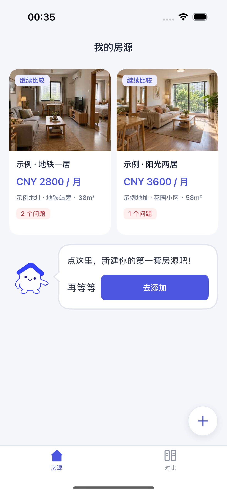
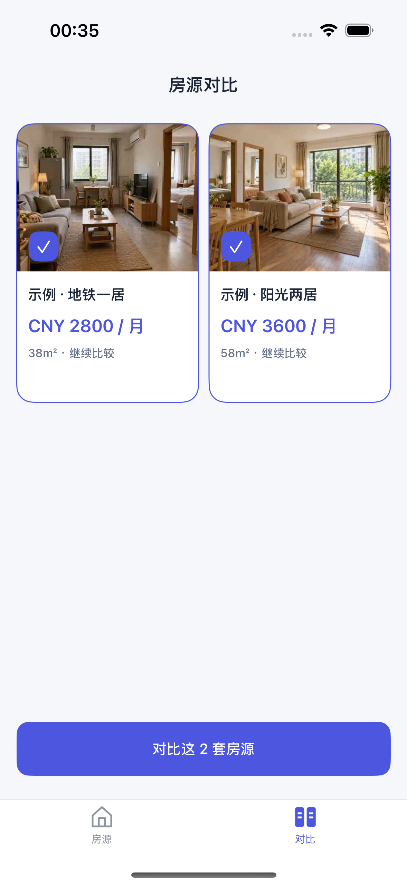
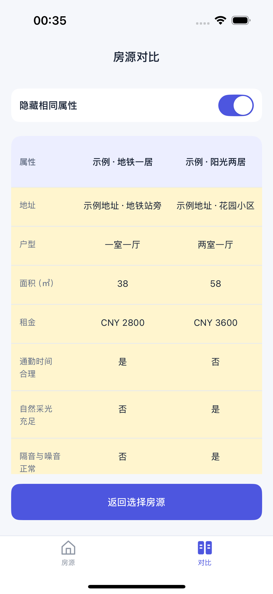
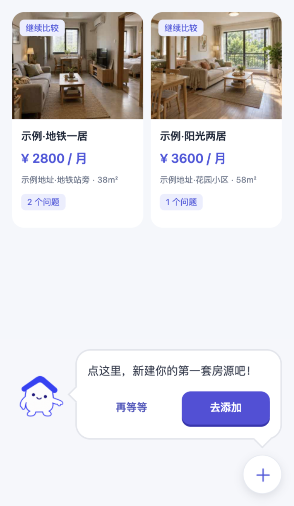
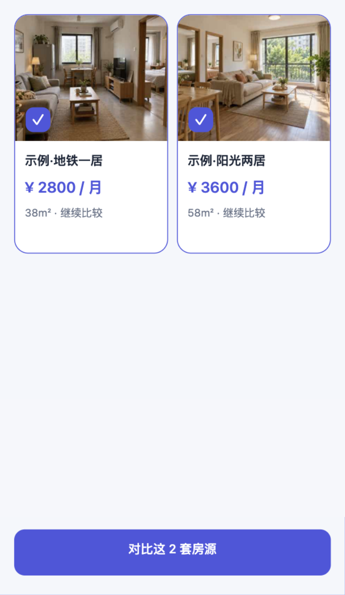
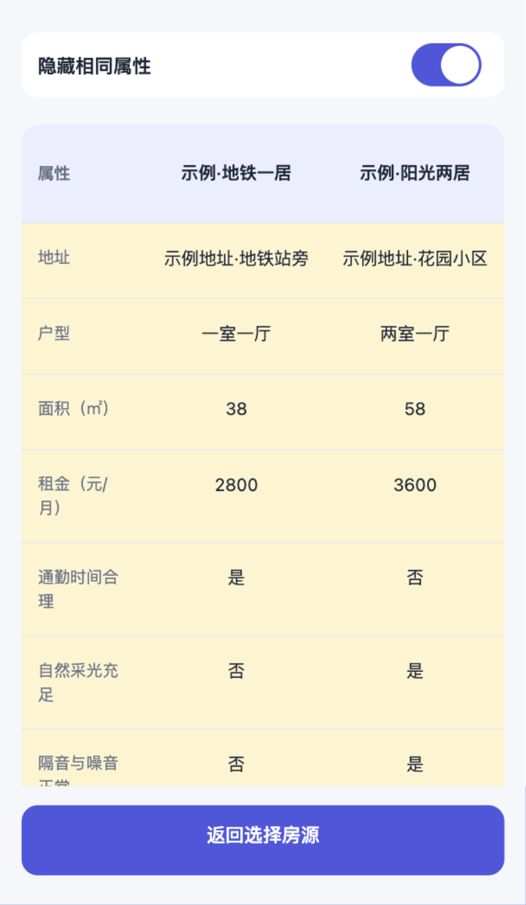

# 示例房源补充室内照片

> 后续状态：用户已确认效果。正式启动接入及与主线组合后的回归见 [2026-10-31 集成验收](INTEGRATION_20261031.md)。以下保留当时的评审快照。

英文示例内容、最新中英文复验及最终英文截图见 [英文评审补充](ENGLISH_20261031.md)。本文保留此前两端中文照片验收的原始来源版本。

状态：两端照片版本的隔离评审验证已完成（REVIEW_READY，尚非用户效果批准）。iOS 模拟器与微信开发者工具均完成真实选择、对比及重启/重载验证，原图已逐张检查。正式首次启动仍默认关闭，Draft PR #104 未合入、未发布。

两套精简示例各有一张虚构室内照片：地铁一居为紧凑客厅，阳光两居为明亮客厅。使用内置 image_gen 生成，完整提示词、资源位置和编码参数见 [照片来源](PHOTO_ASSETS_20261031.md)。照片随应用离线提供，首次创建示例时复制到普通本地媒体目录，支持现有封面、预览、删除和备份流程。老安装不会补示例或补照片，容量和房源点数规则没有改动。

## 代码与保护边界

- `prepareExamples` 仅在确认首次安装且存档原始值为 null 时执行，准备照片成功后才写入示例状态。已有空文件、旧记录、损坏文件与恢复副本继续排除。
- 两端使用同一组 JPEG，480 × 360，两张共 31,465 字节；iOS 通过 project.yml 打包资源，生成 JS 从 canonical source 重建。
- 真实照片暴露了 iOS 卡片原有的图片宽度溢出。首页、对比选择及对应复用卡片现将照片约束在既有封面尺寸内，避免撑宽网格或扩大交互边界。

## 验证及来源

工作树：`/private/tmp/rent-room-first-launch-examples-20261030`。本次直接实现、测试与审查，无 worker 或子 agent。主工作区原有改动未触碰。

| 层次 | 证据 |
| --- | --- |
| 微信定向测试 | 3 文件、28 测试通过；[实际输出](evidence-20261031/wechat-unit.txt)。覆盖新安装、旧安装保护、本地照片复制与导出 ZIP 图片字节一致 |
| iOS JS 桥接 | 9 测试通过；[实际输出](evidence-20261031/ios-bridge.txt) |
| 微信官方编译/包检查 | 15 页、2,085,361 字节，20 WXML / 22 WXSS 退出 0；[结果](evidence-20261031/wechat-compile.json) |
| iOS 数据与备份 | SHA `31192ba80803b9e8397391d2792164163a25c364`，4 UT + 1 UI 通过；[结果](evidence-20261031/ios-data-summary.json)、[收据](evidence-20261031/ios-data-receipt.json)。验证照片可解码为封面、重启保留、删除不补回、旧用户保护、导出再导入照片字节一致 |
| iOS 最终布局 | SHA `4460bb5857b2d418e33ce4a77c6f0caf57a8c98d`，run `rent-room-example-photos-20261031-e`，1 UI 通过 / 0 失败 / 0 跳过，21.406 秒；[结果](evidence-20261031/ios-layout-summary.json)、[收据](evidence-20261031/ios-layout-receipt.json)、[计划](evidence-20261031/ios-layout-plan.json)、[执行入口](evidence-20261031/run-ios-layout.py) |
| 微信照片实际界面 | SHA `1b4877d9aed833ed3506c73214d0a2304f06e0ea`，run `ff1738fbf4b54b41836443a2f7819d54` 通过，槽 3 归还 idle；真实完成引导、两张卡片选择、差异对比、Compile 重载。重载后同目录、同 IDs、全部房源字段一致，原图中照片仍显示；[收据](evidence-20261031/wechat-native-receipt.json)、[断言](evidence-20261031/wechat-native-assertions.json) |

共享模拟器 runner 配置：`/Volumes/mac2/projects/git_repo/run_self/Simulator Management/config/runner.json`。iPhone 14 Pro / iOS 18.3.1 (22D8075)，UDID `8F178971-C203-4690-A83B-253046EACBB1`。所有 UI 操作通过实际按钮、卡片及开关执行；每轮使用 UUID 隔离数据，不修改用户记录。未验证真机、小屏、深色模式或 iPad。

本次数据单测后仅变更三个 SwiftUI 卡片文件及对应 UI 断言，媒体准备、存储、桥接与备份代码未变；复用 4 项数据单测与微信/JS 结果，针对变化重跑 1 项真实 UI 流程。后续纯证据提交不冒充截图的源码 SHA。

## 实际 iOS 截图

主 agent 已逐张检查首页、选中两套和差异表：两张照片清晰可识别，双列间距及边距恢复，两套勾选和差异开关状态正确。回归同时断言首页与选择页的卡片可访问性边界至少间隔 9 pt、左右各至少 15 pt；完整对比操作及重启不重复通过。当前源码工作树除证据文档外无未提交修改。

原始 `.xcresult`：`/private/tmp/rent-room-example-photos-20261031/ios-e.xcresult`。原图 1178 × 2556 px，未经裁切、拼接或修改；[原附件清单](evidence-20261031/ios-attachments-manifest.json)、[复制哈希](evidence-20261031/ios-image-manifest.json)。共享 runner 退出 0 并完成收尾。

## 实际微信截图与恢复

用户明确授权“允许恢复第 3 槽并继续验证”后，使用固定池内置 recover --slot 3。维护记录 `467b90ac9d404bdc90d4eafc26490b5c` 确认旧 run `84d37f2e999e48be8e21674c772e9fd5` 的 runtime 与 profile 均保留；[恢复收据](evidence-20261031/wechat-recovery-authorized.json)。没有操作槽 1/2，没有清除登录或改写旧失败收据。

重新构建本任务隔离评审包后提交。通过 run `ff1738fbf4b54b41836443a2f7819d54` 的 sourceStatus 为空，快照 SHA-256 为 `f1a552cbd6d850038eee6793d2ec133d9d09fc4396bb8c88ed673941aa5e546f`。工具 2.01.2510290，基础库 3.17.3，automator 0.12.1，Node 24.19.0，设备选择 iPhone 12/13 (Pro)，槽 3 / PID 25563。仅使用 `xunju-test-examples-photos-20261031` 的可丢弃数据。

所有业务操作均由原生 DevTools 控件执行。观察脚本只读取真实 App/Page 状态和截图；未调用 handler、未 setData、未以 mock 替代点击。实际依次点击排好啦、选好啦、对比 tab、两张房源卡片、对比这 2 套、隐藏相同属性，再点击工具 Compile。每次截图前先观察当前真实画面，然后写入本 run 的 `.ready` 标记；这些标记不改业务数据。[执行阶段日志](evidence-20261031/wechat-native-test.txt)。

主 agent 已逐张检查四张原图：两套室内照片、两个选中勾、开启差异开关、重载后两张照片。SDK 原图为 780 × 1342 px 的页面区域，不含原生导航和 tab 外壳；没有裁切、拼接或重绘，[清单及复制哈希](evidence-20261031/wechat-image-manifest.json)。首页与重载原图 SHA-256 完全相同。该证据来自开发者工具，未扩张为 iPhone/Android 真机或正式首次启动验证。

## 保留的诊断

- 微信 `77748a5b0c1844a0acdaf7ff39b18080`：恢复授权前排队 600 秒后失败，No free slot，业务回调未执行；[原收据](evidence-20261031/wechat-no-slot-receipt.json) 保留，不改记为通过。

- `rent-room-example-photos-20261031`：新增备份测试将 Array 误传给 Set 参数，编译失败；已修正测试参数。原 [失败记录](evidence-20261031/ios-build-failure.txt) 与 [收据](evidence-20261031/ios-build-failure-receipt.json) 保留。
- `rent-room-example-photos-20261031-b`：5 项断言通过，但截图发现照片撑宽卡片、视觉间距消失；[修复前原图](evidence-20261031/ios-before-card-width-fix.png)。不把测试通过当作视觉验收完成。
- `rent-room-example-photos-20261031-c`：overlay 恢复视觉间距，但新回归测得可访问性边界仍重叠 3.67 pt；[失败收据](evidence-20261031/ios-layout-failure-receipt.json)、[断言](evidence-20261031/ios-layout-failure.txt)、[原图](evidence-20261031/ios-overlay-before-frame-fix.png) 保留。
- `rent-room-example-photos-20261031-d`：明确图片宽高后，同一边界断言仍失败（-3.67 pt），不是截图无间距；[收据](evidence-20261031/ios-frame-failure-receipt.json)、[断言](evidence-20261031/ios-frame-failure.txt)。两轮未满足断言后先研究官方机制再修复，没有放宽断言。

## 交互边界研究

2026-10-31 查阅 [Apple contentShape interaction](https://developer.apple.com/documentation/swiftui/contentshapekinds/interaction) 与 [Apple accessibility shape](https://developer.apple.com/documentation/swiftui/contentshapekinds/accessibility?changes=latest_major)：interaction 同时控制 hit-testing 和 accessibility；只改 accessibility 不约束点击。Apple 页面没有明确发布日期。本机 Xcode SDK 接口确认 interaction 可用于 iOS 15+，兼容本项目 iOS 18 最低目标。

[Ole Begemann 的原始复现](https://oleb.net/2022/clipped-hit-testing/) 发布于 2022-11-24，在 iOS 16.1 / macOS 13.0 证明 clipped 和 clipShape 不同步裁切点击范围。该旧版本复现只用于解释机制，本任务必须在自己的 iOS 18.3.1 运行验证。最终为卡片设置与圆角外观一致的 contentShape(.interaction, …)，保留图片、标签、按钮行为及原断言，没有通过隐藏可访问性元素规避测试。

## 主线与交付边界

2026-10-31 实时读取并 fetch 远端 main 为 `1f26f8e04088fa8865431e5c590dd1179ab98c84`。本分支仍以 `9d37a6f0410ba074f40a8e5f6acf8e3a17db490b` 为基线。主线 #102/#103 涉及首页和评审路由，#106 还调整 iOS 检查引导及生成 JS。当前截图属于本评审分支，尚未验证与这些提交组合后的结果。获得效果确认后，正式接入前需同步主线、处理组合变化、复验受影响流程并完成合并门禁。

主 agent 已复核本轮媒体路径、资源打包、旧用户保护、备份字节断言、卡片布局修复及实际原图。本轮微信通过后两端隔离评审证据齐全，状态为 REVIEW_READY；这不代表用户效果确认、正式入口集成或合并批准。微信来源 SHA 在 iOS 最终布局 SHA 后仅包含文档和图片证据；本轮也仅增加文档与原图，不改变已验证应用或测试，无需重复运行无关测试。
