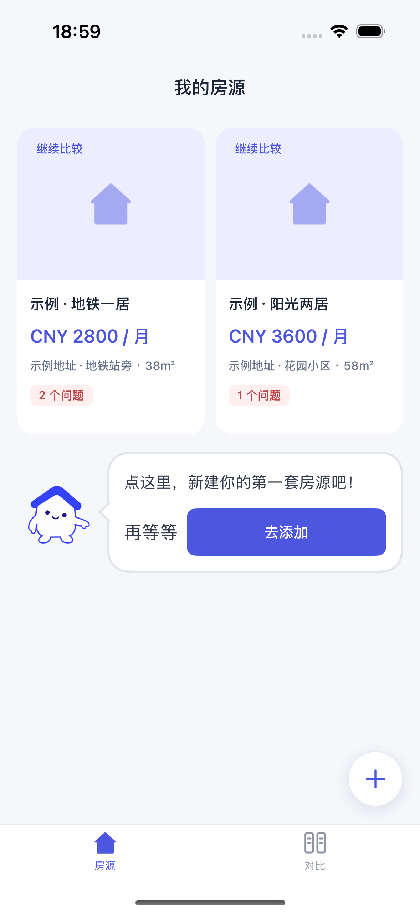
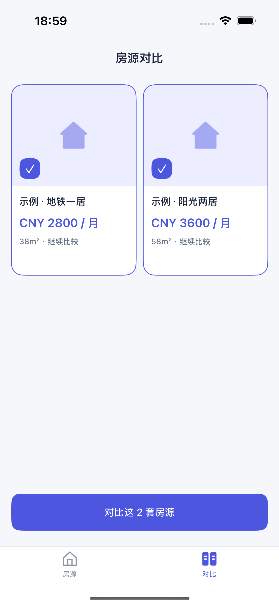
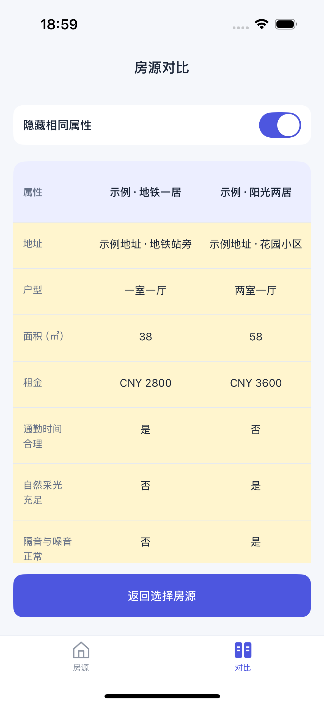

# 首次进入的两套精简示例房源

当前为隔离评审版本。正式首次启动默认仍关闭，等待用户查看两端真实截图并批准后接入。Draft PR #104 未合并、未部署。

## 行为与数据保护

两端共用同一份示例：

| 内容 | 示例·地铁一居 | 示例·阳光两居 |
| --- | --- | --- |
| 模板 | 精简 | 精简 |
| 户型 | 一室一厅 | 两室一厅 |
| 面积 | 38 ㎡ | 58 ㎡ |
| 月租 | CNY 2800 | CNY 3600 |
| 通勤时间合理 | 是（备注约 20 分钟） | 否（备注约 45 分钟） |
| 自然采光充足 | 否 | 是 |
| 隔音与噪音正常 | 否 | 是 |

仅安装数据根目录从未存在、当前存档不存在且没有恢复副本时允许首次初始化；iOS 还排除有旧钥匙串会话的情况。房源数量不参与新用户判断。已有空目录、空存档、旧房源、旧账号文件、恢复副本、损坏文件以及无法判定的文件权限错误均不会补示例。删除或归档后不再补回，重启不会重复。示例不会触发 iOS 新建房源评价计数。

按用户要求，容量与房源点数规则未调整；示例保留普通房源语义。现有首次个人房源引导保持原样。

## 评审入口

- iOS：Debug 参数 `--component-review example-houses --example-review-id <UUID>`，在临时 UUID 目录创建真实 AppWorkspace，使用现有房源卡片与对比页面。Release 不识别该入口。
- 微信：`WECHAT_TEST_DATA_ROOT=xunju-test-examples-20261030-c WECHAT_REVIEW_EXAMPLES=1 node scripts/build.mjs`。构建脚本拒绝在没有隔离数据根时启用评审开关。普通构建默认关闭。
- 当前截图不证明正式启动集成、真机、深色模式、小屏或 iPad；没有修改生产用户数据。

## 验证

证据代码 SHA：`8eb536339e5d85262ab7c1d20bf4b92baba9b2d1`；执行时源码工作树干净。后续证据文档和原图复制不改变应用、测试或配置，可复用这一 SHA 的结果，不把截图称为来自文档提交。

| 验证层 | 结果 |
| --- | --- |
| 微信共享逻辑，6 个定向测试文件 | 77 通过、1 个已有登录用例超过 5 秒；同 SHA 单独复跑该用例通过（1.50 秒总耗时），未修改超时或应用代码 |
| iOS JS 桥接与货币本地化 | 7 通过 |
| 微信官方 wcc / wcsc 编译 | 15 页面、2,053,515 字节；20 WXML、22 WXSS，均退出 0 |
| iOS 模拟器 | 8 UT + 1 UI，9 通过 / 0 失败 / 0 跳过 |
| GitHub 远端 Checks | 本代码 SHA 未返回 workflow run 或 status；不声称 CI 通过 |

微信定向测试：`example-houses.test.js`、`example-session.test.js`、`platform.test.js`、`account-storage.test.js`、`account-runtime.test.js`、`capacity.test.js`，Node 24.19.0，Vitest `--no-file-parallelism`。原始超时与单例复跑日志均保留。iOS 选择器见 [计划](evidence-20261030/ios-plan.json)，覆盖新增示例、老用户空存档与原记录、备份保护、离线重启、旧账号媒体目录、损坏指针、容量与归档。

### iOS 实际点击和截图

- 共享 runner：`rent-room-examples-review-20261030-c`，iPhone 14 Pro / iOS 18.3.1（22D8075），UDID `8F178971-C203-4690-A83B-253046EACBB1`。
- 原始截图 1178 × 2556 px，未经裁切或修改。主 agent 已逐张检查卡片、选中状态和差异表；地址与户型完整，差异开关实际开启。
- 实际操作：点击对比 tab、选择两张卡片、点击对比、点击“隐藏相同属性”的可见开关，再终止并重新启动 App，断言两套示例各出现一次。
- `.xcresult`：`/private/tmp/rent-room-examples-evidence-20261030/ios-c.xcresult`。
- 原始附件目录：`/private/tmp/rent-room-examples-evidence-20261030/attachments-c/`；复制的 PNG 与原附件逐字节一致。
- [结果](evidence-20261030/ios-summary.json)、[共享池收据](evidence-20261030/ios-receipt.json)。XcodeGen 2.45.4 确定性检查通过，未提交生成工程。

### 微信开发者工具

继续等待已登录实例释放。此前 `df878ba6affe418cbb9ebcb12a21d5ed`、`f7a3331bcae54327980e1bc47cec2b8e` 分配到第 1 槽，均因登录无效在健康检查阶段退出，业务回调未执行；失败收据保留，不作为业务通过证据。

## 主 agent 审查

已逐项审查共享 store、两端首次安装识别、备份/损坏文件保护、生成 JS 真源、精简答案语义、测试与构建开关。改动未涉及容量算法、购买或后端，也未修改主工作区的原有变更。正式接入、合入和发布仍需按相应授权与门禁继续。
