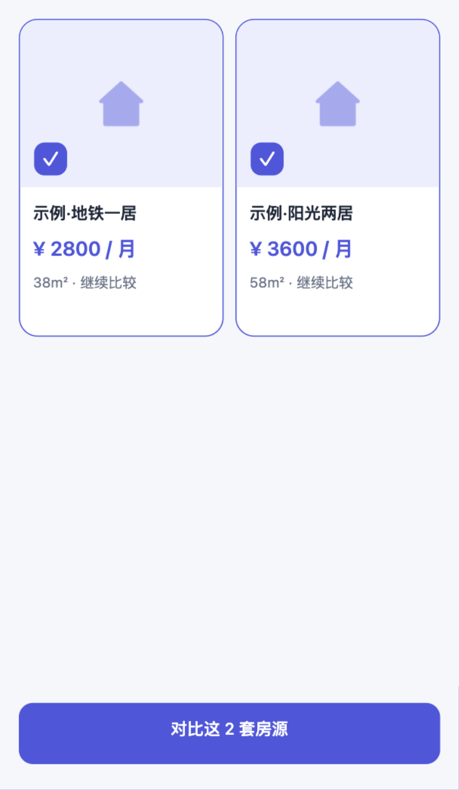
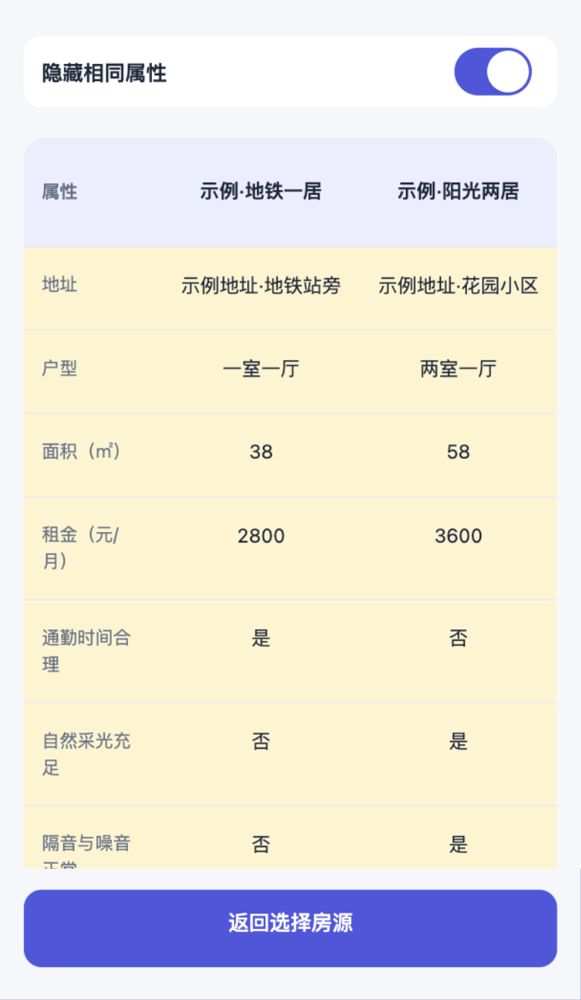
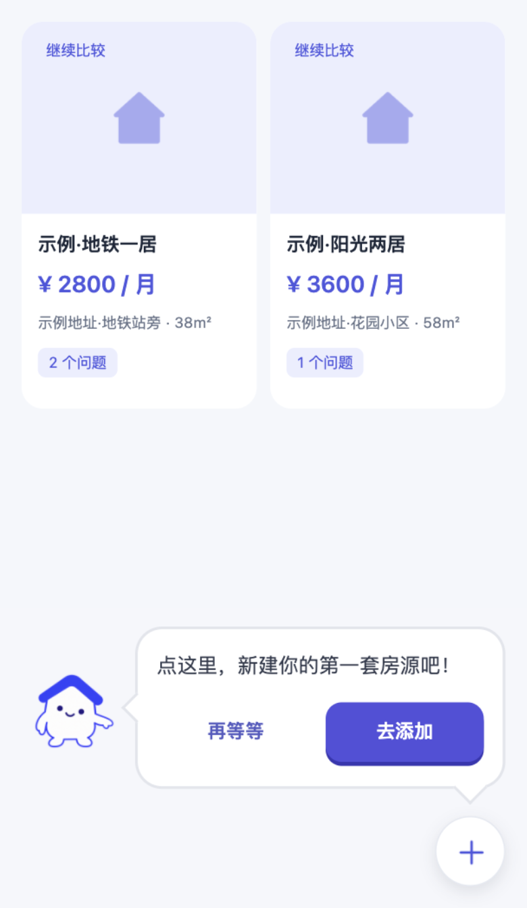

# 首次进入的两套精简示例房源

> 后续状态：用户已确认效果。正式启动接入及与主线组合后的回归见 [2026-10-31 集成验收](INTEGRATION_20261031.md)。以下保留当时的评审快照。

> 2026-10-31 补充：用户要求示例房源包含室内照片。下方是无照片版本的历史验收；当前照片版本及验证边界见 [照片验收](PHOTOS_20261031.md)，不沿用旧版 REVIEW_READY 状态。

以下为 2026-10-30 历史记录。当前为隔离评审版本，状态为 REVIEW_READY：iOS 与微信均已完成真实点击、对比及重启/重载验证，截图已逐张检查。正式首次启动默认仍关闭，等待用户查看两端真实截图并批准后接入。Draft PR #104 未合并、未部署。

## 行为与数据保护

两端共用同一份示例：

| 内容 | 示例·地铁一居 | 示例·阳光两居 |
| --- | --- | --- |
| 模板 | 精简 | 精简 |
| 户型 | 一室一厅 | 两室一厅 |
| 面积 | 38 ㎡ | 58 ㎡ |
| 月租 | CNY 2800 | CNY 3600 |
| 通勤时间合理 | 是（备注约 20 分钟） | 否（备注约 45 分钟） |
| 自然采光充足 | 否 | 是 |
| 隔音与噪音正常 | 否 | 是 |

仅安装数据根目录从未存在、当前存档不存在且没有恢复副本时允许首次初始化；iOS 还排除有旧钥匙串会话的情况。房源数量不参与新用户判断。已有空目录、空存档、旧房源、旧账号文件、恢复副本、损坏文件以及无法判定的文件权限错误均不会补示例。删除或归档后不再补回，重启不会重复。示例不会触发 iOS 新建房源评价计数。

按用户要求，容量与房源点数规则未调整；示例保留普通房源语义。现有首次个人房源引导保持原样。

## 评审入口

- iOS：Debug 参数 `--component-review example-houses --example-review-id <UUID>`，在临时 UUID 目录创建真实 AppWorkspace，使用现有房源卡片与对比页面。Release 不识别该入口。
- 微信：`WECHAT_TEST_DATA_ROOT=xunju-test-examples-20261030-c WECHAT_REVIEW_EXAMPLES=1 node scripts/build.mjs`。构建脚本拒绝在没有隔离数据根时启用评审开关。普通构建默认关闭。
- 当前截图不证明正式启动集成、真机、深色模式、小屏或 iPad；没有修改生产用户数据。

## 验证

应用与 iOS 证据 SHA：`8eb536339e5d85262ab7c1d20bf4b92baba9b2d1`；微信最终原生验收 SHA：`1a801d3f74c7b140646ee738dda919591541c8e4`。两轮启动时源码工作树均干净。两者之间仅变更证据文档与微信 E2E 观察脚本；已核对 `apps/wechat/src`、构建脚本及整个 `ios` 无差异。之后的原图复制与文档提交不改变应用或测试，不把截图称为来自文档提交。

| 验证层 | 结果 |
| --- | --- |
| 微信共享逻辑，6 个定向测试文件 | 77 通过、1 个已有登录用例超过 5 秒；同 SHA 单独复跑该用例通过（1.50 秒总耗时），未修改超时或应用代码 |
| iOS JS 桥接与货币本地化 | 7 通过 |
| 微信官方 wcc / wcsc 编译 | 15 页面、2,053,515 字节；20 WXML、22 WXSS，均退出 0 |
| iOS 模拟器 | 8 UT + 1 UI，9 通过 / 0 失败 / 0 跳过 |
| 微信开发者工具 | 原生点击完成首次引导、选择两套、对比、开启差异开关；原生 Compile 重载后同目录、同 IDs、所有房源字段不变；通过 |
| GitHub 远端 Checks | 本代码 SHA 未返回 workflow run 或 status；不声称 CI 通过 |

微信定向测试：`example-houses.test.js`、`example-session.test.js`、`platform.test.js`、`account-storage.test.js`、`account-runtime.test.js`、`capacity.test.js`，Node 24.19.0，Vitest `--no-file-parallelism`。原始超时与单例复跑日志均保留。iOS 选择器见 [计划](evidence-20261030/ios-plan.json)，覆盖新增示例、老用户空存档与原记录、备份保护、离线重启、旧账号媒体目录、损坏指针、容量与归档。

### iOS 实际点击和截图

- 共享 runner：`rent-room-examples-review-20261030-c`，iPhone 14 Pro / iOS 18.3.1（22D8075），UDID `8F178971-C203-4690-A83B-253046EACBB1`。
- 原始截图 1178 × 2556 px，未经裁切或修改。主 agent 已逐张检查卡片、选中状态和差异表；地址与户型完整，差异开关实际开启。
- 实际操作：点击对比 tab、选择两张卡片、点击对比、点击“隐藏相同属性”的可见开关，再终止并重新启动 App，断言两套示例各出现一次。
- `.xcresult`：`/private/tmp/rent-room-examples-evidence-20261030/ios-c.xcresult`。
- 原始附件目录：`/private/tmp/rent-room-examples-evidence-20261030/attachments-c/`；复制的 PNG 与原附件逐字节一致。
- [结果](evidence-20261030/ios-summary.json)、[共享池收据](evidence-20261030/ios-receipt.json)。XcodeGen 2.45.4 确定性检查通过，未提交生成工程。


### 微信开发者工具

最终通过 run：`6cf82768eca5482eaf7bfd871d9c6fcf`。第 3 槽，PID 3450，工具 2.01.2510290、基础库 3.17.3、automator 0.12.1、Node 24.19.0；设备选择 iPhone 12/13 (Pro)。冻结快照 SHA-256：`fb27630f48f03f515a14352ad8e052b99b5cfea6659088a409b8900a13858178`。本轮仅在隔离数据根 `xunju-test-examples-20261030-c` 操作。

所有按钮、卡片、开关以及 Compile 重载均使用开发者工具原生界面点击。观察脚本只读取真实 App/Page 状态并截图，不调用页面 handler，不用 `setData` 或 mock 代替操作。首次进入与重载后的两套房源 IDs、数据根和完整房源字段相同，精简模板和差异值断言通过。

截图前先由原生可访问性树确认对应画面，再写入测试目录中的 `.ready` 通知观察脚本截图；这些通知不改应用数据。主 agent 逐张检查最终四张原图：两套首页、两个勾选、差异开关开启、重载后首页。SDK 原始截图为 780 × 1342 px 的小程序页面区域，不含开发者工具导航外壳；未经裁切或修改。[原图清单及哈希](evidence-20261030/wechat-image-manifest.json)、[通过收据](evidence-20261030/wechat-native-receipt.json)、[断言](evidence-20261030/wechat-native-assertions.json)、[执行阶段日志](evidence-20261030/wechat-native-test.txt)。






实际执行入口：

```sh
WECHAT_POOL_UI_REVIEW=1 WECHAT_NODE=/Users/pc/.cache/codex-runtimes/codex-primary-runtime/dependencies/node/bin/node \
python3 /Volumes/mac2/codex-builds/wechat-instance-pool/runner/pool.py \
  --root /Volumes/mac2/codex-builds/wechat-instance-pool run \
  --project /private/tmp/rent-room-first-launch-examples-20261030/apps/wechat/dist \
  --wait 600 --timeout 600 -- \
  /Users/pc/.cache/codex-runtimes/codex-primary-runtime/dependencies/node/bin/node \
  /private/tmp/rent-room-first-launch-examples-20261030/apps/wechat/tests/e2e/example-houses.cjs
```

按 `NATIVE_READY` 提示执行对应真实操作；按 `CAPTURE_READY` 提示先观察原生画面，再在该 run 的 `WECHAT_ARTIFACT_DIR` 创建对应 `<name>.ready` 文件。脚本不会自行产生这些画面确认。

### 诊断与保留的失败证据

此前的失败没有覆盖或改记为通过：

| run | 实际结果 |
| --- | --- |
| `a6bc9e7ed8824d4f8365d62a1e1b3cdb` | 回调 240 秒超时，同时原生工具报告 Mac 锁定；未据此断言根因。[收据](evidence-20261030/wechat-timeout-receipt.json) |
| `fd890458f4704f88b234864da633b127` | 解锁后健康检查超时、槽位隔离。确认本任务控制器退出后通过池内置 recover 恢复，保留 profile。[收据](evidence-20261030/wechat-health-failure-receipt.json) |
| `55c177aad0924684b95078f76c9cc9b6` | 同应用正常显示欢迎页和两套示例，但 SDK 页面操作停滞；只终止本任务 runner，正常清理。[收据](evidence-20261030/wechat-sdk-stall-receipt.json) |
| `c89afd1182cb49a186e4f581e1e0e585` | 原生点击与对比截图完成，最终 SDK 文件读取探针报 TypeError；整体未通过。[日志](evidence-20261030/wechat-sdk-file-probe-test.txt) |
| `0a1b5dfb09c64b208058600994453c1b` | 原生重载及全部数据断言通过，但选择/重载截图早于画面刷新；不作为最终图证。[收据](evidence-20261030/wechat-prepaint-receipt.json) |
| `6a3e761f5e514ca29c1b6ebedcabe2d5` | 补拍前自动化连接失败，回调未执行；恢复本任务已隔离的槽 3 后进行最终通过轮次。[收据](evidence-20261030/wechat-health-reconnect-receipt.json) |

两次官方恢复均保留登录和原始失败记录，未操作其他槽位：[首次恢复](evidence-20261030/wechat-recovery-first.json)、[再次恢复](evidence-20261030/wechat-recovery-second.json)。更早未登录槽位的健康检查失败仍保留在池原始 run 目录；不计为业务测试。

## 主 agent 审查

已逐项审查共享 store、两端首次安装识别、备份/损坏文件保护、生成 JS 真源、精简答案语义、测试与构建开关。改动未涉及容量算法、购买或后端，也未修改主工作区的原有变更。正式接入、合入和发布仍需按相应授权与门禁继续。

主线检查：2026-10-30 读取远端 main 为 `abc042ea3c8cecc39be32a891ea3a47cd667deda`，比本分支基线 `9d37a6f0410ba074f40a8e5f6acf8e3a17db490b` 新增 #102 同类别引导调整与 #103 房源长按提示。后者涉及两端首页与 iOS 评审路由，不能声称组合结果等价或已验收。本材料用于审批本分支的示例内容和对比行为；正式接入前须同步主线、处理评审路由组合并复验受影响的首页与引导，再通过合并门禁。
