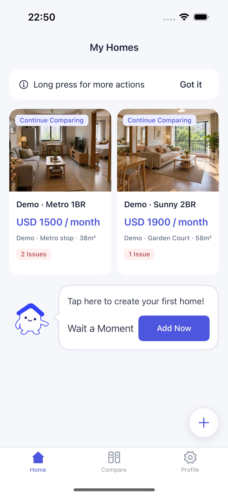
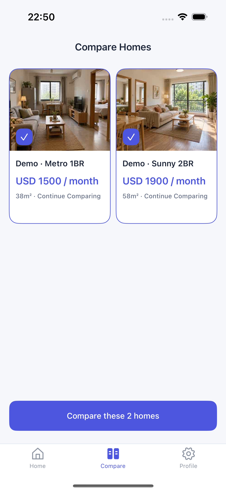
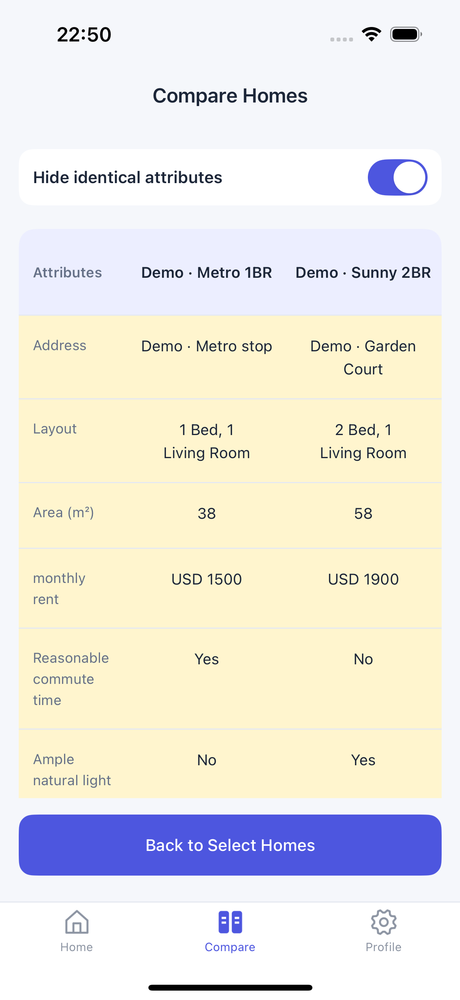

# 英文示例美元租金修正

英文首次生成示例时，一居使用 **USD 1500/月**，两居使用 **USD 1900/月**。首页、选择页和对比表读取同一份房源币种与金额，重启后保留。中文继续使用 CNY 2800/月、CNY 3600/月；已保存的示例和用户房源不迁移、不换币种、不改金额。

这是用于比较的虚构月租，保持空间更大、采光更好的两居租金更高。金额参考美国一居、两居的租金量级后取整，并非实际房源报价或汇率换算。[Realtor.com 2026 年 9 月报告](https://www.realtor.com/research/september-2026-rent/)于 10 月 15 日发布，50 个主要都市区的一居和两居中位租金分别为 $1,568、$1,890。

## 修改和数据边界

基于 PR #104 的 `43dc73bd37bb781d66c1760168ded10193aae610`，应用及测试提交为 `5c4a805b3ef77a4c7af48c5357b16c37f9408f68`。独立工作区：`/Users/pc/.codex/worktrees/english-demo-usd/rent_room`。

- 只改 `exampleHouses('en')` 的默认币种与租金；iOS 规范 JS 包通过生成脚本更新。未改变首次安装判断、存储迁移、照片、卡片布局和用户编辑路径。
- 回归断言覆盖旧英文 CNY 2800/3600 示例、用户自选 EUR 币种与自改租金，以及切换语言后原始存档字节不变。
- 当前 agent 直接审查源文件、生成文件差异、回归断言与以下三张真实原图。没有 worker 或子 agent，未碰主工作区的既有修改。

## 实际验证

| 范围 | 结果 |
| --- | --- |
| 修复前复现 | 精确运行新增美元默认值用例，实际得到 CNY，1 项失败；11 项因筛选未运行。[输出](evidence-usd-20261031/js-before.txt) |
| 共享示例、会话、正式构建入口 | 3 个 Vitest 文件共 30 项通过，包括旧数据保护、删除与重启。[输出](evidence-usd-20261031/js-after.txt) |
| iOS 货币桥接 | currency-review、currency-localization 共 2 项通过。[输出](evidence-usd-20261031/bridge-tests.txt) |
| 微信构建 | 15 页、2,087,691 字节；官方 wcc 20 WXML、wcsc 22 WXSS 均退出 0。[构建](evidence-usd-20261031/wechat-build.txt)、[检查](evidence-usd-20261031/wechat-check.txt) |
| 中文等价性 | 固定时钟和随机数，对默认语言及 zh-Hans 的完整示例输出与 `43dc73b` 做深比较，全部字段相同。[输出](evidence-usd-20261031/chinese-equivalence.txt) |
| iOS 数据与英文 UI | 同一源码 `5c4a805`，6 UT + 1 UI 通过，0 失败、0 跳过。[结果](evidence-usd-20261031/ios-summary-b.json)、[精确计划](evidence-usd-20261031/ios-plan-b.json)、[回执](evidence-usd-20261031/ios-receipt-b.json)、[测试阶段原日志](evidence-usd-20261031/ios-test-b.txt) |

执行环境：Node 24.22.1，XcodeGen 2.45.4。以下命令中的 `$NODE24` 指 `/Users/pc/.cache/codex-runtimes/codex-primary-runtime/dependencies/node/bin/node`。

```sh
# apps/wechat 工作目录：先构建实际 app.js，再运行相关测试。
"$NODE24" scripts/build.mjs
"$NODE24" node_modules/vitest/vitest.mjs run tests/example-houses.test.js tests/example-session.test.js tests/example-launch-runtime.test.js --no-file-parallelism
"$NODE24" scripts/check.mjs
# 仓库根目录：
"$NODE24" --test ios/tests/currency-review.test.mjs ios/tests/currency-localization.test.mjs
python3 /private/tmp/rent-room-english-usd-20261031/run-ios-b.py
```

iOS run `rent-room-english-usd-20261031-b` 使用共享 Simulator Management runner 和仓库 `scripts/run-xcodebuild.sh`，精确选择已修改用例及直接相关的旧安装、恢复副本、删除和照片备份用例。[执行入口](evidence-usd-20261031/run-ios-b.py)保留实际命令。设备为 iPhone 14 Pro / iOS 18.3.1 (22D8075)，UDID `8F178971-C203-4690-A83B-253046EACBB1`。实际 runner 构建缓存为 `/Volumes/mac2/codex-builds/time-fragment-dd-shared-adf0fec677505f0e5471b500-simulator`。XcodeGen 真源检查通过，67 个规范 JS 来源、337554 字节；生成 xcodeproj 未提交。

首次 run a 在构建预检因 PATH 缺少 Homebrew 而报 `xcodegen: command not found`，未进入应用测试。[失败日志](evidence-usd-20261031/ios-a.txt)、[失败回执](evidence-usd-20261031/ios-receipt-a.json)、[原计划](evidence-usd-20261031/ios-plan-a.json)保留。仅修正 runner 环境 PATH 后，以相同源码和选择器运行 b 并通过；没有放宽断言。完整构建日志与 xcresult 保留在 `/private/tmp/rent-room-english-usd-20261031/`。

## 真实英文原图

以下三张来自成功 run b 的 XCUITest 附件，1178 × 2556 px，未裁切、改字或合成。[附件清单](evidence-usd-20261031/attachments-manifest.json)、[原图哈希](evidence-usd-20261031/images.json)。逐张检查确认：两张照片正常；首页与选择卡片分别显示 `USD 1500 / month`、`USD 1900 / month`，没有截断；对比租金行显示相应 USD 金额。该 UI 用例实际完成欢迎流程、选择两套、开启差异开关及重启；重启价格有断言。





## 交付与证据范围

本次仅验证英文示例租金修正。微信当前没有英文界面；中文输出、UI 与图片资源未变，沿用[上次正式入口验收](INTEGRATION_20261031.md)的真实微信交互证据，本轮没有重新运行微信 UI。未运行全量套件、真机、小屏、深色模式或 iPad，也不把本地验证当作远端 CI。

当前主线已前进至房源点数提交 `185fd8ae54744fbeed5272a94f1b348bc89f930e`，与本 PR 的初始化和存储文件有交集。此次价格修正未合并该主线，不能把之前基于 `1f26f8e` 的集成结果解释为新主线组合通过；与房源点数的组合回归仍须在合并前完成。后续证据文档提交不改变本次执行输入。PR #104 未合并，未部署或发布。
