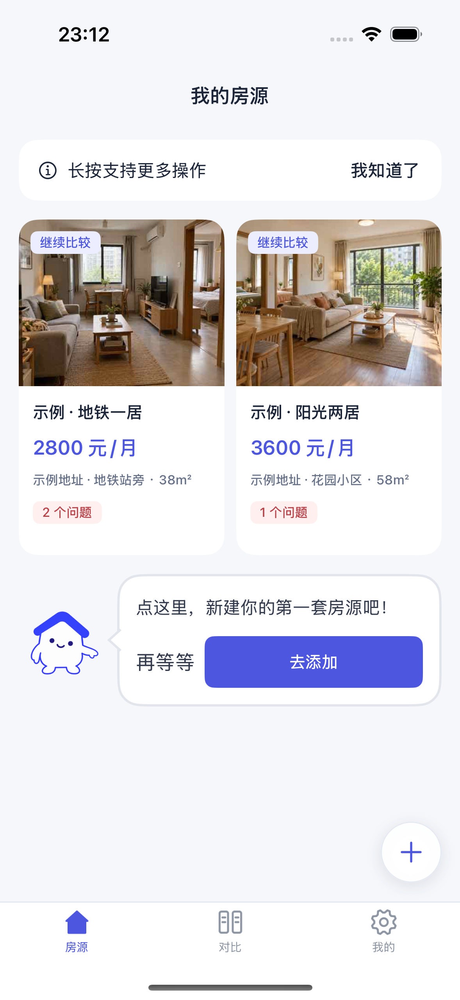
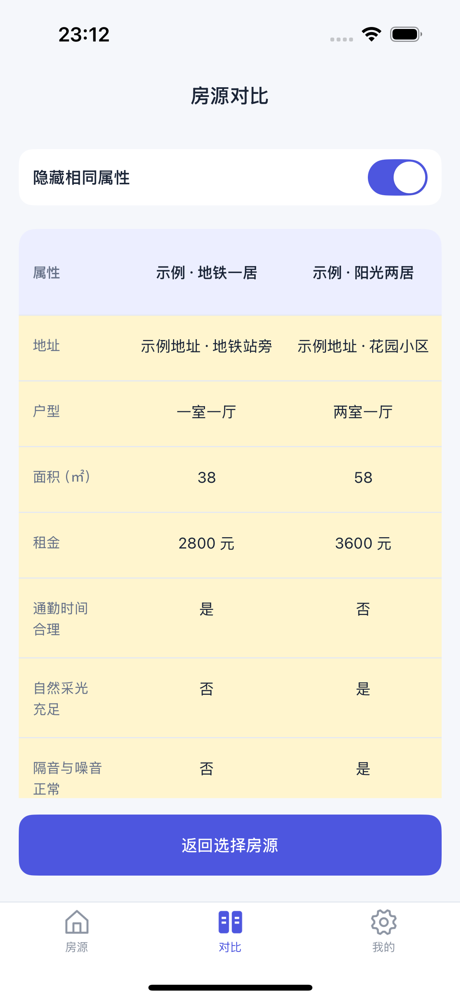
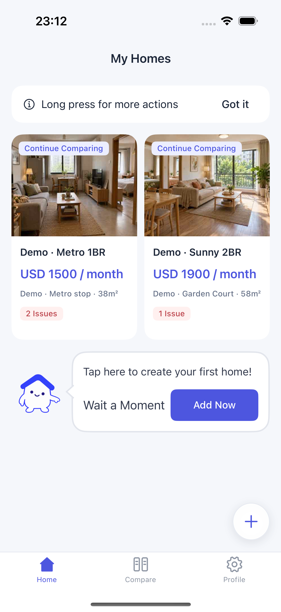
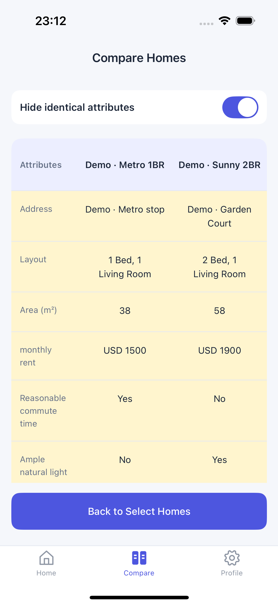
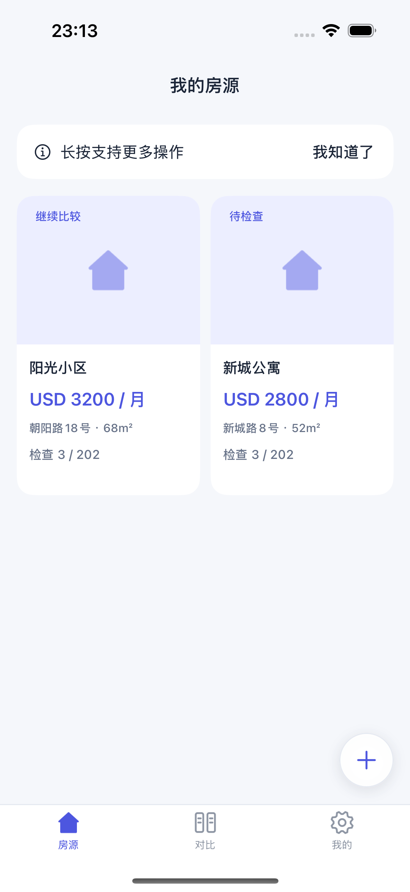
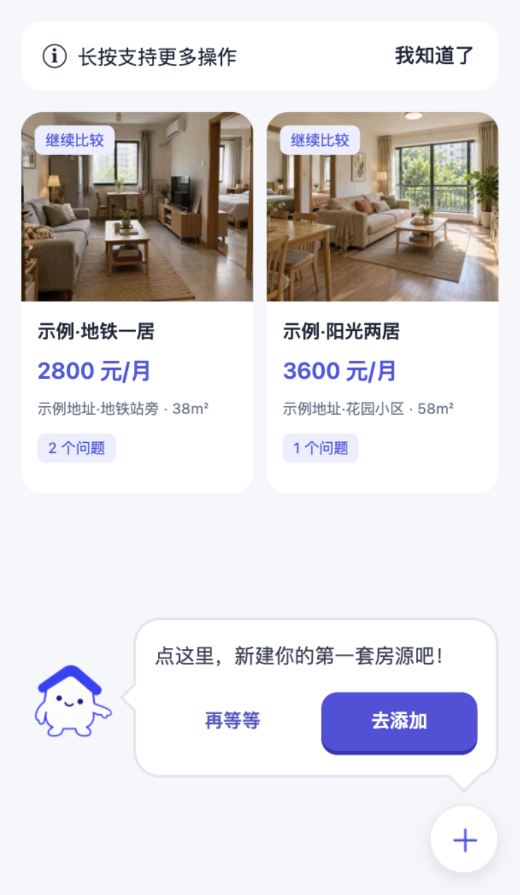
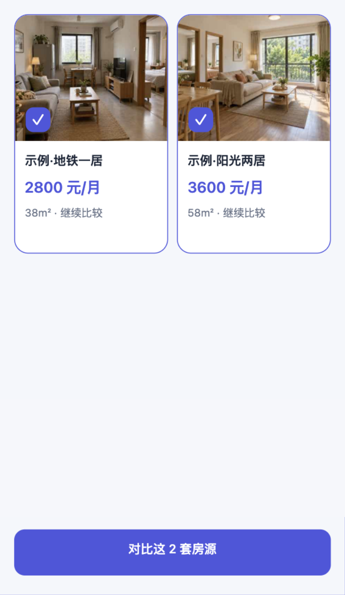
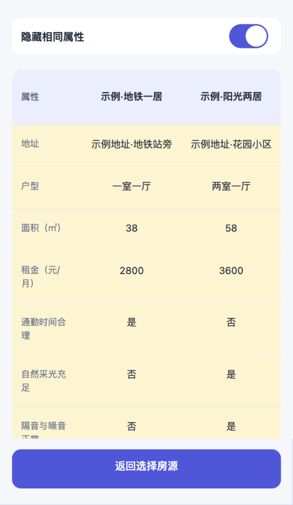

# 主线合入与中文示例人民币单位

中文首次示例在 iOS、微信首页和选择页显示 **2800 元/月、3600 元/月**，对比表也使用“元”。英文 iOS 保持 **USD 1500 / month、USD 1900 / month**。这是显示格式调整，存储仍使用 CNY / USD；不会转换已有金额、币种或用户文本，也不会向老用户、已有空存档或删除后的空列表补入示例。

## 合入范围

用户要求把主线合入当前功能分支。本轮先合入房源点数主线 `185fd8ae54744fbeed5272a94f1b348bc89f930e`（合并提交 `8b29817`），随后发现主线新增删除文案和微信震动规则，再合入 `f23b50a2152d9073f0aff0ddd4fecfcc8716882d`。最终应用与测试提交为 **`98422b64881bba09375f371520a74bcd7e0a483e`**；后续提交只整理证据文档与原图。

工作区为 `/Users/pc/.codex/worktrees/english-demo-usd/rent_room`，主工作区既有修改未动。冲突处理保留主线的点数侧存账本、购买身份、远端扣点预留和删除文案，也保留示例首启判断、离线照片、卡片裁切和中英文数据。

组合回归发现：两套示例原本会被点数迁移误算为已有房源，导致新用户免费点数立即归零。[修复前用例实际失败](evidence-yuan-main-20261031/credits-before.txt)。修正本地旧数据初始化和微信账号迁移的计数时排除示例；已有消费账本不重置、不退款。新建真实房源扣一次，删除和重启不返还点数。

## 验证证据

| 范围 | 结果与证据 |
| --- | --- |
| JavaScript 组合回归 | 13 个相关文件，184 项通过：示例、首次启动、账号/访客、存储、点数以及新合入的清单震动。[输出](evidence-yuan-main-20261031/js-latest.txt) |
| iOS 桥接 | 货币、评审、安静引导、桥接性能共 20 项通过。[输出](evidence-yuan-main-20261031/bridge-latest.txt) |
| 微信生产编译 | 不设置测试目录的正式构建；15 页、2,096,592 字节，官方 wcc 21 / wcsc 23 文件均退出 0。[构建](evidence-yuan-main-20261031/wechat-build-latest.txt)、[编译](evidence-yuan-main-20261031/wechat-check-latest.txt) |
| iOS 生成真源 | XcodeGen 2.45.4 可重复生成；69 个规范 JS 来源，342608 字节；AppCopy 1350 条资源加 4 条主线点数覆盖词条；未提交生成 xcodeproj。[检查](evidence-yuan-main-20261031/xcodegen-latest.txt) |
| iOS 最终组合 | `98422b6` 上 34 UT + 3 UI 全部通过，0 失败、0 跳过。见[精确计划](evidence-yuan-main-20261031/ios-latest-main-plan.json)、[结果](evidence-yuan-main-20261031/ios-latest-main-summary.json)、[回执](evidence-yuan-main-20261031/ios-latest-main-receipt.json)。 |
| 微信真实渲染 | 主线点数组合的首页、双选页和差异表均已实际看到“元”。本轮完整 Compile 重载流程未通过，不能称为完整 e2e 成功。具体失败与图片来源见下文。 |

选择测试围绕初始化、旧数据保护、金额展示和主线冲突边界。iOS 34 个 UT 覆盖新英文默认值、已有空/损坏/恢复文件、旧账号与离线记录、图片备份、点数初始化/持久化/失败回滚、购买身份以及原货币存储；3 个 UI 场景分别为英文正式首次启动、中文正式首次启动及重启、老用户恢复与后台导航。逐方法选择理由在计划内。没有运行全量套件或额外支付 UI。

命令使用 Node 24.22.1。微信先运行 `node scripts/build.mjs`，再以 Vitest 精确选择 `example-houses`、`example-session`、`example-launch-runtime`、`property-credits`、`credit-client`、`credit-runtime`、`guest-storage`、`guest-runtime`、`account-runtime`、`platform`、`runtime`、`checklist-haptics-runtime`、`field-row-events` 这 13 个 `.test.js` 文件，附 `--no-file-parallelism`，最后运行 `node scripts/check.mjs`。iOS 通过共享 `Simulator Management/bin/sim-test-run.mjs` 与仓库 `scripts/run-xcodebuild.sh` 执行，iPhone 14 Pro / iOS 18.3.1（22D8075），UDID `8F178971-C203-4690-A83B-253046EACBB1`。完整日志与 xcresult 保留在 `/private/tmp/rent-room-yuan-main-20261031/`。

### 保留的失败和恢复

- 中文人民币对比新增回归在修复前实际得到 `CNY 2800`，期望 `2800 元`，1 项失败。[计划](evidence-yuan-main-20261031/ios-before-plan.json)、[摘要](evidence-yuan-main-20261031/ios-before-summary.json)、[回执](evidence-yuan-main-20261031/ios-before-receipt.json)。
- 第一次组合提交 `1f7bd7d` 的 34 UT 中 33 通过，3 UI 全通过；唯一失败是主线加了 4 条点数文案，原测试仍期待 1343 条、实际 1347 条。[原结果](evidence-yuan-main-20261031/ios-final-summary.json)、[原回执](evidence-yuan-main-20261031/ios-final-receipt.json)。`d6972ff` 只修正这一测试断言，精确重跑原失败方法通过，[恢复结果](evidence-yuan-main-20261031/ios-catalog-recovery-summary.json)、[恢复计划](evidence-yuan-main-20261031/ios-catalog-recovery-plan.json)。随后最新主线增加删除文案到 1354 条，接纳主线正确断言并重新运行最终组合。
- 微信 run `7e74109c02214dc58ce8b7a20a71d90d` 在确认差异页截图的 120 秒等待中超时。首页和双选原图已保存，失败捕获原图为当时真实差异表；尚未进入 Compile 重载。[回执](evidence-yuan-main-20261031/wechat-a-receipt.json)、[日志](evidence-yuan-main-20261031/wechat-a-test.txt)。
- 微信 run `aa1fcefbe395449580b8b3ae0b634d6d` 再次通过首次欢迎和首页，选择第二张卡时 CUA 窗口控制返回 `noWindowsAvailable`，最终等待双选超时。[回执](evidence-yuan-main-20261031/wechat-b-receipt.json)、[日志](evidence-yuan-main-20261031/wechat-b-test.txt)。两个 run 均正常清理并归还槽 1 为 idle，保留常驻工具登录，未接管其他槽。

## 实际截图

iOS 原图来自最终 `98422b6` 的正式启动测试，无裁切、改字或合成。

以下微信原图来自上述第一个未完成 run，源码 `1f7bd7d`；仅证明图片中实际展示状态，不代表整个回调通过。WeChat DevTools 2.01.2510290、基础库 3.17.3、iPhone 12/13 模拟器；原生 CUA 操作，SDK 仅读取状态和截图，无 handler 调用、setData 或成功 mock。构建使用 `WECHAT_TEST_DATA_ROOT=xunju-test-examples-yuan-main-20261031` 隔离目录；快照 hash 为 `87ec907b247437a4ef65bd9633d2b95cfa1c1e62b9bd9a90130bce51e6f3e0aa`。后合入主线的删除文案和震动规则未改动这两个价格 WXML、照片或示例数据，但完整最新主线微信 UI 回归仍待完成。

## 交付边界

当前 agent 直接审查初始化和点数冲突、媒体布局、货币展示、测试和原图，无 worker 或子 agent。PR #104 仍未合入 main，本轮只把 main 合入功能分支。中文新效果待用户评审；没有上传体验版、TestFlight、提审或发布。未执行真机支付、微信 Android 真机、小屏、深色模式或 iPad 验收；本地通过不代表远端 CI。
