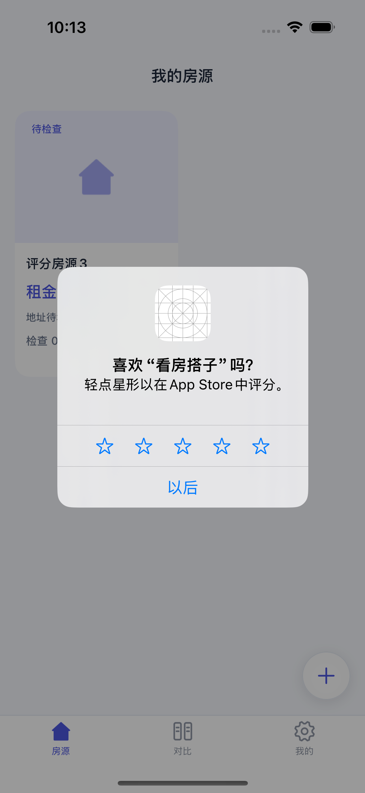
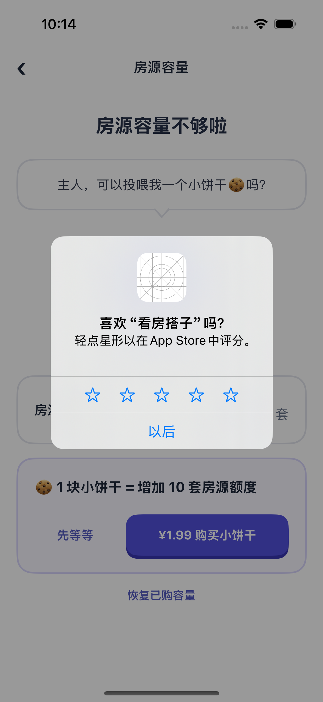

# iOS 系统评分邀请

需求日期：2026-10-30。PR：[#93](https://github.com/Hayden-Chang/rent_room/pull/93)。

## 产品规则

- 停止首次返回首页时自动弹出“使用感受”问卷，设置里的“使用反馈”入口保留。
- 本机当前身份累计成功新建 3 套房源，或一次新购买经服务端确认到账后，满足系统评分请求条件。
- 创建计数与房源保存同事务，失败一起回滚；归档、删除不减，导入、归档恢复不增。计数只需保留到阈值 3。
- 旧版本没有累计创建记录，无法还原已删除或导入记录的来源，因此从本版本开始累计。
- 普通历史购买恢复、已有额度刷新、取消、未批准及退款不产生新评分邀请。本次新购买的待批准或待确认记录会持久化；重启后确认成功仍可满足条件。待批准订单仅接受发起购买后产生的已验证交易，历史订单恢复不能提前消耗资格。
- 两条条件共用一次 `requested` 标记，不以主动反馈内容筛选用户。游客登录时将计数和标记合并一次，沿用 `guestClaims` 防重复。注销后的新游客及其他账号仍是独立本机身份；没有跨设备同步。
- 在首页无导航/弹层，或独立购买页支付及感谢状态结束时，前台稳定 2 秒后调用 Apple `RequestReviewAction`。继续新建/恢复流程优先完成，评分推迟至首页。
- 请求前持久化标记；系统未显示或用户关闭都不立即重试。标记表示“已请求”，不表示已打分。

Apple 控制最终显示：[RequestReviewAction](https://developer.apple.com/documentation/storekit/requestreviewaction)。开发环境用于检查原生界面，TestFlight 不显示；开发截图不能证明正式版首次必弹。真实支付、正式商品及 App Store 线上评分另行验收。

## 实现范围

`ios/Core/app-review.js` 保存资格与请求状态；`bridge.js` 仅为 iOS 传入 `onHouseCreated`，让新建计数与保存同事务。小程序的默认回调不改变原有状态。原生购买控制器区分新购买及历史恢复，在服务端验证和容量保存成功后记录资格，评分记账失败不阻止交易完成。`AppReviewPrompt` 在 Home/Capacity 的安全显示点消费一次资格。

## 定向验证映射

| 生产边界 | 测试 |
| --- | --- |
| 创建阈值、删除、重启、保存失败、导入、游客迁移及消费幂等 | `node --test ios/tests/app-review.test.mjs`，6 项 |
| 小程序默认存储契约 | `tests/model.test.js` 的持久化、失败重试、损坏阻止写入、归档只读、归档删除，5 项 |
| 新购买成功、取消/待批准/验证失败/退款、历史恢复、延迟确认跨重启、评分保存失败 | `XunjuTests/AppReviewTests`，7 个精确方法 |
| StoreKit 验证交易保留实际购买时间，避免历史交易匹配待批准新订单 | `NativeStorefrontTests`，1 个修改方法 |
| 前后台重复确认、确认中切账号、容量保存失败与恢复、fixture 参数隔离 | `CapacityBusinessTests`，7 个精确方法 |
| NativeStore 创建/保存回滚与现有状态保护 | `NativeStoreTests`，3 个精确方法 |
| 游客迁移、重试、设置媒体及重复 ID 保护 | `IdentityScopeTests`，4 个精确方法 |
| 第三次创建及购买后原生评分、关闭和重启不重复、手动反馈保留 | `AppReviewUITests`，2 个方法 |
| 原首次返回问卷改为设置主动进入、保留草稿和后续容量流程 | `InspectionBusinessUITests`，2 个修改方法 |
| 首次返回无问卷后继续 Apple 登录流程 | `AppleLoginUITests`，1 个修改方法 |

开发阶段执行全部 5 个新增/修改 UI 方法。运行 i 选择两条评分入口及首次使用流程；合并主线后的最终运行 m 选择两条评分入口及此前失败的模板/归档流程，精确方法与影响映射见下文计划。没有运行完整 UI 套件。

## 历史开发证据

- Node 24.19.0：6 项核心测试、5 项小程序相关测试通过；其余 15 个无关用例由精确过滤排除。
- XcodeGen 工程编译通过；工程真源仍是 `ios/project.yml`。
- 代码 `885472c59d403be215536f86b846050272a3b580` 的 `development-e.xcresult`：iOS 26.5，21 UT 通过，1 StoreKit UT 因未启用本地商品配置失败；5 UI 中 Apple 登录通过，其余 4 项失败。
- StoreKit 精确补验 `storekit-f.xcresult`：现有 `XunjuStoreKitTests` scheme，iOS 18.3.1，1 UT 通过，实际本地 StoreKit 交易保留购买时间。环境与 scheme 均和 e 不同，不混为同一次运行。
- 26.5 的第三创建实际状态 `created=3, requested=true`，storekitd 已收到 requestReview 并生成 token；录像最后仍为房源页，没有可见评分内容。独立 `purchase-g.xcresult` 已点击购买并确认 `0 / 11 套`，仍没有评分弹窗。不能把这些结果当作原生界面通过。
- 首次反馈回归的失败是切换 tab 后立即使用分支查询误选 `home.first`，改成等待确定的 `home.add`；详细清单的数字键盘 AX 有数字键但录像没有软件键盘，改用聚焦字段的标准 `typeText` 输入，保留小数键类型及持久化值断言。
- 对照运行 h（`c427cb6`）：iOS 18.3.1，21 UT 通过；首次使用/手动反馈 UI 通过，两个评分 UI 的真实系统弹窗已出现，但旧查询错误地将其当作 `Alert`，导致断言失败。按实际 AX 的标题、评分星级和“以后”按钮修正查询，未改变产品代码。
- 最终运行 i（`9d465c93a0d30d3be354a5e0684b13e454ec9fc2`）：iPhone 14 Pro / iOS 18.3.1（22D8075），21 UT + 3 UI 全部通过，0 失败/跳过。两条评分入口均验证真实 StoreKit 界面、关闭后不重复；创建路径额外验证重启幂等和手动反馈。购买 UI 使用业务 fixture 模拟到账，不能当作线上真实支付通过。
- i 仍用共享 runner、相同 poolRoot 和 3 并发上限，仅在临时配置中将设备前缀收窄为池内现有 iOS 18 兼容设备。没有改共享基础设施或强占其他设备。[精确计划](evidence/app-review-20261030/final-plan.json)与[退出 0 的执行回执](evidence/app-review-20261030/final-receipt.json)已保留。
- 证据复用：`885472c` 至最终测试 head 的产品代码未变，f 的 StoreKit 方法及配置未变，e 的 Apple 登录方法未变；Node 核心及小程序源码自 Node 通过后未变。i 后提交仅补文档和原始截图，不改变构建输入中的产品/测试源码。不是全套测试通过。
- **历史失败保留（已在运行 m 完整通过）**：h 的详细清单/模板/归档 UI 在 `templates.edit.simple` 后仍停留于模板列表，失败于 `setup.toggle.周边与小区`；后续模板修改及旧房源归档断言未执行。该模板产品源码相对基线无改动，另一独立性能任务也复现同一导航失败，但本 PR 不据此把该用例标记通过。当时全部 5 个新增/修改 UI 方法已执行，其中该长流程尚未通过，因此保持草稿；主线模板修复后的结果见最终验证。
- 全部日志、计划、录像和 `.xcresult` 在 `/private/tmp/rent-room-rating-20261030/`。该阶段主 agent 已复核产品和测试差异；当时未合并，未进行真机安装、提交审核或发布。
- 历次预执行记录：a/b 排队前取消修正测试前置条件及延迟购买资格；c 因排队期间新增文档触发快照校验而退出；d 在依赖解析时受全局 Git SSH 重写影响退出 74。后续进程级 `GIT_CONFIG_GLOBAL=/dev/null` 已解决依赖读取。

## 原生界面证据

2026-10-30 显示名更新：用户要求将“寻居”改为“看房搭子”。修改 `ios/project.yml` 的 `CFBundleDisplayName`、备份展示文件名及开发副本名；保留内部 Bundle ID、Keychain 与备份格式标识。评分框中的“轻点星形以在 App Store 中评分。”由 iOS 系统提供，产品只调用 `requestReview()`，没有自写这句提示。

运行 j 的冻结源码为 `d8d827a8282062b2518d571dbb1379cfd6170864`。使用 XcodeGen 2.45.4 和现有构建包装脚本，iPhone 14 Pro / iOS 18.3.1（22D8075）实际完成 1 项构建包元数据单测及 2 项评分 UI 测试，3/3 通过、0 失败/跳过。构建包名称及两个系统弹窗标题均断言为“看房搭子”。[计划](evidence/app-review-20261030/name-update-j/plan.json)和[回执](evidence/app-review-20261030/name-update-j/receipt.json)记录精确命令选择范围，原始结果在 `/private/tmp/rent-room-rating-20261030/name-j.xcresult`；runner PID 76645，设备租约及 slot 已释放。部署保护的 `DeploymentGuards.test_verified_isolated_app_is_accepted` 也通过，未进行设备部署。

这次增量仅变更展示名称和对应断言，评分计数、购买确认、持久化及游客迁移源码未变；此前核心和业务单测作为未变逻辑的历史证据保留。显示名会影响系统 UI，因此两条评分 UI 已重新执行，不复用旧名称截图。当时模板编辑长流程的失败仍保留，PR 尚未合并，不能称为全部回归完成。j 后仅补文档和原始截图；后续合并主线与最终验证记录如下。

以下为运行 j 的原始 XCUITest 截图，1178 × 2556 像素，非自绘评分框。开发模拟器的系统弹窗显示占位图标；不代表 App Store 正式图标验收。运行 i 的旧名称截图继续保存在上级证据目录，不覆盖历史证据。

第三次成功创建后（此前两套已归档，证明使用累计创建数）：

购买确认、感谢状态结束后：

[仍可从设置主动打开反馈](evidence/app-review-20261030/name-update-j/manual-feedback-retained.png)。

## 合入前最终验证（2026-10-30，运行 m）

用户已查看“看房搭子”的原生评分截图，并明确回复“没问题，合入代码”。冻结候选为 `a22540aa25cb308b96a7ceb17704edda4cf97b40`，已合并主线 `5a08dc0c1000217aff38c9a0c3ea9985465413c4`。桥接 import 冲突保留评分模块及主线 `localDay` 两方导入，重新生成原生 Core；主线的增量更新和模板导航修复均纳入本轮验证。

- 最终定向 campaign：**27 UT + 3 UI，30/30 通过，0 失败/跳过**。运行 `rent-room-rating-merge-20261030-m`，runner PID 86282，iPhone 14 Pro / iOS 18.3.1（22D8075），UDID `8F178971-C203-4690-A83B-253046EACBB1`。退出码 0，队列、执行 slot 与设备租约均已释放。
- 在原 21 项业务 UT 上增加实际构建包名称验证、增量读取、状态 metadata 与 JSON 转换边界 6 项。评分状态和游客迁移经过主线增量桥接仍完整；持久化失败不会产生错误状态。
- 3 条 UI 按风险排序选择：第三次创建的累计计数及关闭/重启幂等；到账后等待感谢状态结束才请求；此前失败的详细清单/模板/归档完整流程。两条评分入口均再次显示“看房搭子”真实系统弹窗。
- 旧模板失败已消除：本轮完成模板类别关闭并保存、新房源不含该类别、旧详细房源仍保留家具内容和只读状态，归档后的免租期 `90.5` 与备注“协商90.5天”全部断言通过。保留运行 h 的原失败，不能将它改写为当时通过。
- 合并源码上重新运行 Node 24：`node --test ios/tests/app-review.test.mjs ios/tests/bridge-performance.test.mjs`，14/14 通过；小程序持久化/失败重试/损坏保护/归档只读/归档删除 5 项通过（其余 15 项精确排除）。更名后的部署保护 1 项历史通过，对应脚本未再变更。
- StoreKit 本地真实交易 UT 复用运行 f 在 `885472c59d403be215536f86b846050272a3b580` 的通过结果。已比较该 SHA 至候选的 `NativeStorefront.swift`、`NativeStorefrontTests.swift`、`Capacity.storekit` 和 `project.yml`：实际交易方法、购买时间映射、fixture 和专用 scheme 均未变化；只有显示名及另一项 metadata 断言变化，该 metadata 方法已在 m 重跑。运行环境同为 iOS 18.3.1。购买 UI 使用到账 fixture，仍不是线上支付验收。
- 开发阶段全部 5 个新增/修改 UI 均已执行；Apple 登录及首次使用/反馈流程的历史通过保留。最终仅选择上述 3 项，不宣称这两项在合并候选重跑，也不宣称全套回归通过。
- 重试证据：k 构建成功，但设备队列中 `simctl list devices -j` 超时，尚未执行测试；确认服务恢复后重试。l 包装脚本误指向旧计划编号，在解析依赖阶段主动取消、无测试执行；m 使用唯一编号完成。本次没有通过重复失败断言来取绿。

[精确方法及映射](evidence/app-review-20261030/merge-m/plan.json)、[命令包装](evidence/app-review-20261030/merge-m/command.txt)、[退出回执](evidence/app-review-20261030/merge-m/receipt.json)、[xcresult 摘要](evidence/app-review-20261030/merge-m/summary.json)、[Node 输出](evidence/app-review-20261030/merge-m/node-tests.txt)、[小程序输出](evidence/app-review-20261030/merge-m/wechat-store-tests.txt)已入库。完整日志 `/private/tmp/rent-room-rating-20261030/merge-m.log`；结果 `/private/tmp/rent-room-rating-20261030/merge-m.xcresult`；构建缓存 `/Volumes/mac2/codex-builds/time-fragment-dd-shared-3976a29c08332a1c9094f933-simulator`，由共享 runner 管理。配置 `/private/tmp/rent-room-rating-20261030/runner-ios18.json` 保持共享池与 3 并发上限。

候选验证后主线前进到 `ab9c02f55e5a3043bee5a74e7f8f6fd96f902d2a`，新增默认关闭的触摸轨迹组件及设置行。`git merge-tree --write-tree` 无冲突，无需人工处理；验证基线→候选与新主线→模拟合并树的完整二进制补丁逐字节一致（SHA-256 见[等价性记录](evidence/app-review-20261030/merge-m/main-equivalence.json)）。新增组件不读写评分的 Core 状态，不改变评分入口、测试方法、fixture、构建配置或运行环境；新增 AppStorage 仅作用于触摸轨迹偏好。故按主线前进等价规则复用已完成的 campaign。最终仅补充本文和证据文件，没有改变可执行代码或测试输入。

主 agent 已检查最终差异及原始截图。以下为 m 的原始附件：

- [第三次创建系统评分](evidence/app-review-20261030/merge-m/after-third-creation.png)
- [到账后系统评分](evidence/app-review-20261030/merge-m/after-verified-purchase.png)
- [主动反馈保留](evidence/app-review-20261030/merge-m/manual-feedback-retained.png)
- [新房源按保存后的模板排除分类](evidence/app-review-20261030/merge-m/new-template-category.png)
- [旧详细房源快照保留](evidence/app-review-20261030/merge-m/old-detailed-snapshot.png)
- [归档数值、备注和只读状态保留](evidence/app-review-20261030/merge-m/archive-retained.png)
