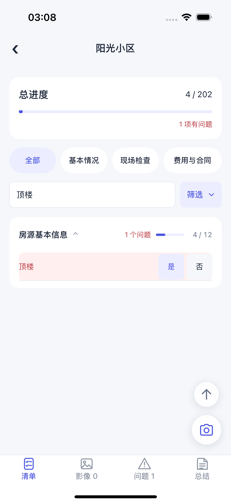
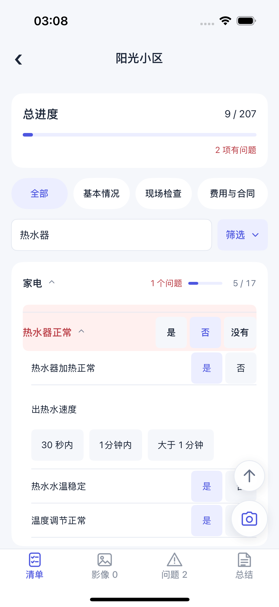

# iOS 选项点击性能修复 · 2026-10-30

用户报告“是／否、没有、正常／不正常”点击卡顿。本轮针对真实选择写入链路；上一轮报告中的重复读取结果不能证明点选速度。

## 原因与改动

1. 每次选择原本重新统计全部房源，并把整份存档传给 Swift 再解析。现在按完整房源序列化结果复用未变房源统计，只传变更房源、完整房源顺序和顶层元数据。Swift 校验整个增量再发布，完整快照仍支持主动重新同步。缓存只保留当前这批房源，删除、初始化和账号隔离按各自上下文处理。
2. `formView` 原本对每个分类重新扫描同一房源的所有检查项、异常项。现在在每次渲染内复用这些结果；不跨写入缓存可变模板、答案或自定义项目。
3. `inspectionGuide` 原本即使教学结束仍展开整张清单寻找教学目标。现在只在教学步骤有效时计算目标，填写进度和完成引导保留。
4. 引导更新复用一次规范化模板，费用项目的正则预编译。

即时完整落盘、上一份存档、保存错误提示、事务回滚均保留；未增加延迟保存或先显示未保存结果。未改选项样式和布局。

## 同机前后测量

基线产品代码：`8bb9a3b33e8de69f9678a9b706a6653ee83db3bc`；最终产品与测试代码：`e0aa560ef651daba15aacf62eb32c6e4263326c4`。

iPhone 14 Pro / iOS 18.3.1 / UDID `8F178971-C203-4690-A83B-253046EACBB1`，共享池租约，Debug `-O`。每个样本均调用实际 `ChecklistPresentation.write`（内部 `choose`），同步持久化，然后按页面调用 `form` 和 `inspectionGuide`。基本信息分类展开，10 次交替选择，验证每次答案及重启后的最终答案。选择会使只读缓存失效，数据没有只读预热替代写入。

| 详细房源数 | 修复前中位耗时 | 修复后定向测量 | 最终回归再次测量 |
| --- | ---: | ---: | ---: |
| 1 | 65.72 ms | 15.31 ms | 24.84 ms |
| 30 | 209.56 ms | 52.90 ms | 67.15 ms |

定向测量减少约 77% / 75%；最终回归运行期间还并行执行了共享 JS 测试，保留其较慢样本，不选择性丢弃。最终 30 套样本范围为 47.38–104.54 ms。这是原生主线程业务处理耗时，不含触摸分发与屏幕呈现，不能等同真机触摸到变色延迟、FPS 或 Release 指标。

同一 30 套存档的桥接响应从 2,165,224 字节降到 77,756 字节（约少 96.4%）；修改前后持久化文本和显式完整快照相同，仅 `choice-0` 出现在增量房源列表。完整即时存档仍为 2,160,208 字节。

## 回归范围与失败证据

- 修复前新增“不在教学时不生成教学目标”测试实际失败；原生保存、刷新基线测试已完成，并保留失败 xcresult。
- 最终选择 96 项原生单测：旧 PR 的 80 项覆盖快照、容量、账号隔离、导入导出、媒体与保存失败，新增 5 项性能/增量测试，再加入清单呈现、自动异常、顶楼、阳台及电梯选择的 11 项直接消费者测试。精确方法及理由在 final-plan.json。
- 最终 3 条 UI 流程按风险选择：新选项反馈与重启；原有详细清单/教学/模板/归档；原有影像导入/问题保存/取消/重启。前一轮完整页面导入导出 UI 本轮未重新执行，其数据层由相关原生测试覆盖。
- 20 个共享规则测试文件共 328 项，以及 12 项桥接与测试运行器 Node 测试。没有运行整个项目单测或 UI 套件。
- 首次共享测试因未构建 dist 缺少运行夹具失败；构建后另有两条旧断言失败，在隔离的 `8bb9a3b` 源码及其重新构建的 dist 上复现同样失败：滑动会发送 `swipeopen` 通知；未回答有电梯时电梯条件分组应隐藏。修正测试，保留“不得折叠/修改答案”和条件隐藏断言，未为其改产品逻辑；12 项所属文件测试全部通过。
- 检查了增量元数据替换、未知房源字段保留、新增/重排/删除、错误增量原子拒绝、失败持久化的会话保留、事务回滚、缓存失效、教学结束及历史模板兼容。当前 agent 直接审查实现与测试。

## 真实页面截图

来自 XCUITest 原始截图，验证选中状态、问题高亮和统计；截图本身不证明帧级响应时间。XCTest 的 tap 到观察耗时包含事件合成与等待空闲，不用于上面的性能表。

## 交付状态

最终结果及路径见结构化证据。所有测试使用隔离存档和共享模拟器池；未触碰主工作区原有改动，未合并 PR、未真机安装、未发布。

最终验证：`e0aa560` 上 iOS 18.3.1 的 96 项原生单测 + 3 条 UI 流程共 99 项通过，0 失败、0 跳过；iOS 26.5 / iPhone 16 的新选项 UI 流程 1 项通过。两次运行均经共享 runner，结束后租约和 run slot 已释放。最终原始截图已人工检查。GitHub 对该提交返回空的 status/workflow 列表，本地验证不作为远端 CI 结果。

- [结构化证据及精确测试映射](evidence/choice-performance-20261030.json)
- 本机完整计划、运行脚本、日志、摘要和截图：`/Volumes/mac2/codex-builds/xunju-choice-evidence-20261030`。
- 修复前 xcresult：`/Volumes/mac2/codex-builds/xunju-choice-before-20261030-01.xcresult`。
- 定向修复后 xcresult：`/Volumes/mac2/codex-builds/xunju-choice-after-20261030-01.xcresult`。
- 最终 iOS 18 xcresult：`/Volumes/mac2/codex-builds/xunju-choice-final-20261030-01.xcresult`。
- iOS 26 xcresult：`/Volumes/mac2/codex-builds/xunju-choice-ios26-20261030-01.xcresult`。

本报告及附件随后独立提交；从 `e0aa560` 到报告提交仅有 docs/ 变更，产品、测试、构建配置、生成输入保持一致，沿用该提交的验证证据。
