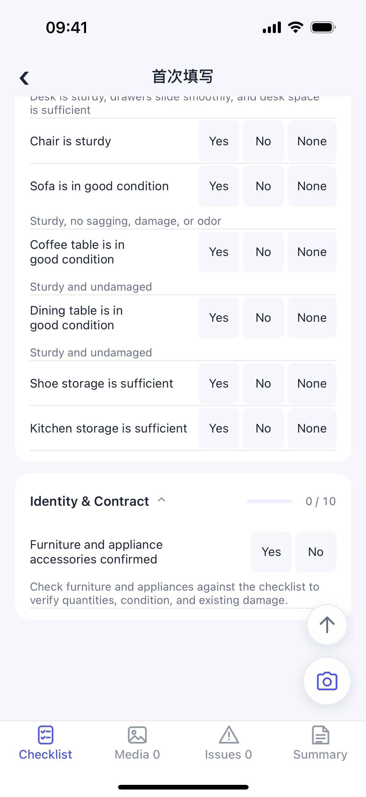
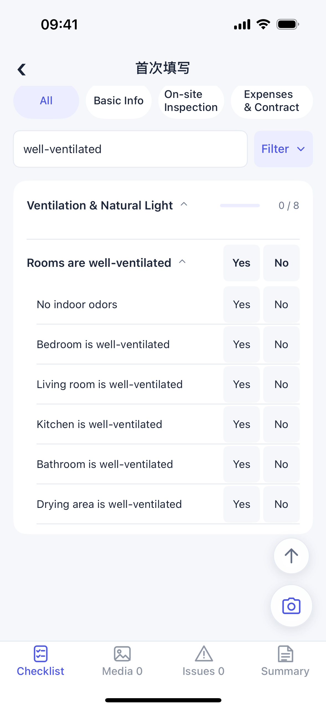
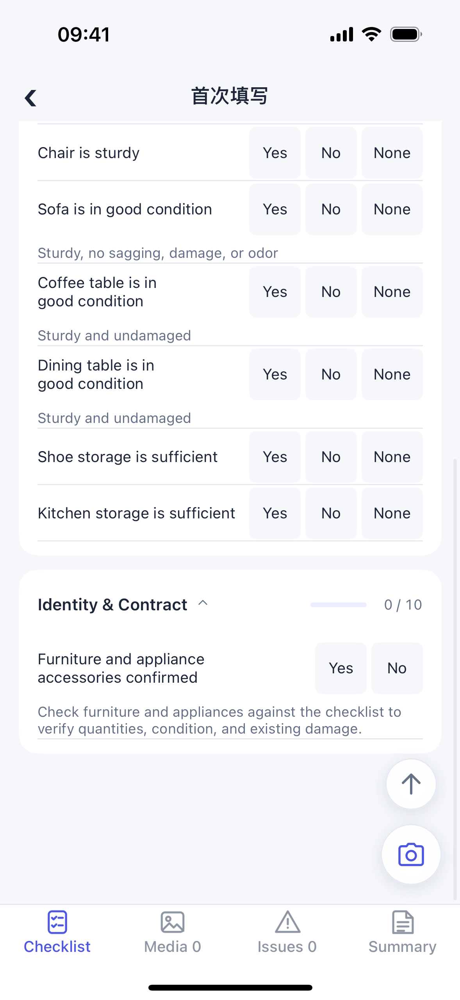
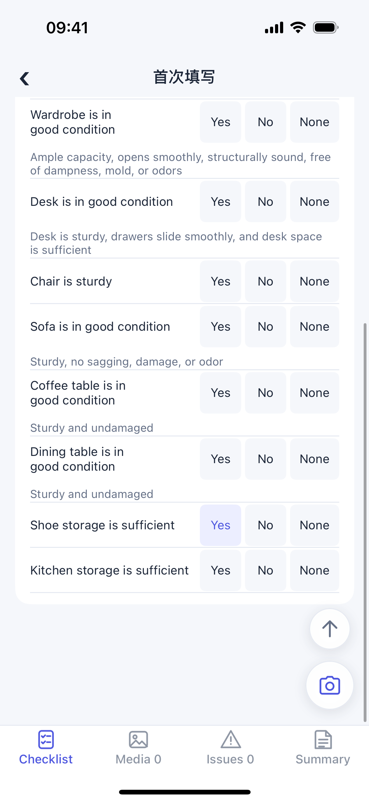

# English checklist copy review — 2026-11-02

Status: `APPROVED`; after reviewing the evidence, the user explicitly requested “先合入到主线”. The latest pre-merge campaign is h below; campaign g is preserved as the original review evidence.

## Result and scope

247 existing English labels/hints were revised across the simple and detailed checklists. Comparable checks now use parallel patterns: `X is in good condition`, `X works properly`, `X is sufficient`, `Room is well-ventilated`, and `No + defect + location`. Entry fields use sentence case; monthly units use `month`.

Real screenshot review also found dynamically generated headings such as `Sink & FaucetNormal` and `Outlet LayoutNormal`. Twenty existing runtime Chinese phrases were registered in the localization source with complete English translations. The original 1,350 source keys/Chinese values and placeholders are unchanged; the generated catalog now has 1,370 entries. Checklist source files, field IDs, choices, answer polarity, storage, and business behavior are unchanged. The gas-hose visual-only qualifier, abnormal-vibration qualifier, and internet-or-installation alternative are preserved.

| Check | Previous | Revised |
| --- | --- | --- |
| Shoe storage | Sufficient shoe cabinet space | Shoe storage is sufficient |
| Kitchen storage | Kitchen storage is sufficient | Kitchen storage is sufficient |
| Coffee table | Coffee table normal | Coffee table is in good condition |
| Ventilation | Air circulation normal in bedroom | Bedroom is well-ventilated |
| Generated plumbing heading | Sink & FaucetNormal | Sink and faucet work properly |
| Generated outlet heading | Outlet LayoutNormal | Outlet placement and capacity meet needs |

The English revision and editorial contract live in `ios/Localization/app-checklist-consistency-en.json` and `app-checklist-consistency-prompt.txt`. Provenance hashes match; `AppCopy.json` was regenerated, not hand-edited. Existing Chinese copy and WeChat behavior were not changed. The screenshot house title `首次填写` is fixture-authored user content and deliberately remains verbatim.

## Reproducible checks

Candidate/evidence SHA: `9cd1ee1dbbe81ca829e1b9e0f50d5554dc715cb1`; base: `f1cc82617ed69e446b8f8fee3f0ced94ff6414a5`. Any subsequent documentation-only commit leaves the tested executable inputs identical.

Use Node 24 and XcodeGen 2.45.4:

```sh
node ios/scripts/build-app-copy.mjs --check
node ios/scripts/build-core.mjs --check
node ios/scripts/check-checklist-copy.mjs
```

The new whole-phrase check drives the real `formView` projection for landlord, sublessor, agency and elevator states. Before the fix it failed with the 20 missing headings (`generated-headings-before.log`); after the fix it covers 55 selectable group headings without mutating house data. This tests runtime projection coverage rather than duplicating the translation table.

The local catalog audit covers all 62 simple inspection items (96 generated form fields including basic/cost entries) and 301 detailed fields. Eight English search cases were checked against real source models; matching does not mutate saved house state. This source audit is broader than the representative visual evidence; it does not claim every field was scrolled through on a device.

### Impact mapping and exact native selectors

All unit selectors are under `XunjuTests/AppCopyTests/`:

| Method | Affected boundary |
| --- | --- |
| `testPackagedEnglishCatalogPermissionsAndMoneyUnits` | Bundled catalog completeness, Chinese leakage, currency/permission consumers; count updated for 20 new whole phrases |
| `testEnglishSearchFindsCanonicalRentWithoutMutatingSavedAnswers` | Reverse English search and canonical stored values |
| `testEnglishComparisonCostLabelsAreFullyLocalized` | Revised expense labels rendered in comparison |
| `testCanonicalComparisonAndWheelUnitsPreserveCustomValues` | Standard versus user-authored value localization |

Exactly two UI methods under `XunjuUITests/EnglishChecklistCopyUITests/` were selected, ranked by visible-copy and stored-answer risk:

1. `testSimpleEnglishRowsKeepChoicesAccessibleAndAnswersPersist`: furniture/storage, appliances, hot/cold controls, non-overlapping label/choice geometry, and a Yes answer surviving app relaunch.
2. `testDetailedEnglishSearchFindsParallelChecksWithReadableChoices`: ventilation, water pressure, storage and cellular-call rows, including the actual generated plumbing/outlet headings.

No full unit/UI suite was run. No physical-device, deployment, TestFlight, or release acceptance is implied.

### Original review run (g)

Campaign **g passed: 6 tests, 0 failures, 0 skipped** (four unit methods and two XCUITest methods), at the exact evidence SHA above. Device: **iPhone 14 Pro / iOS Simulator 18.3.1 (22D8075)**, UDID `8F178971-C203-4690-A83B-253046EACBB1`. All nine exported PNGs are **1178 × 2556** pixels. The runner exited 0; its device lease, queue entry and run slot were released. No application source, resource, build configuration or test changed after this green run. Only this report and unedited evidence copies were added.

Authoritative summary: [test-summary.json](evidence/english-checklist-copy-20261102/test-summary.json). Original-to-copy names, test method, evidence SHA, dimensions and SHA-256: [images.json](evidence/english-checklist-copy-20261102/images.json).

The exact invocation is retained in `artifacts/english-checklist-copy/run-g.sh` and `plan-g.json`; the shared runner performs build-for-testing and test-without-building through the repository wrapper. Local worktree: `/Volumes/mac2/projects/git_repo/run_self/rent_room/.worktrees/english-checklist-copy-20261102`. All following artifact names are relative to that worktree:

- Full log: `artifacts/english-checklist-copy/run-g.log`.
- Result: `artifacts/english-checklist-copy/results-g.xcresult`.
- Summary: `artifacts/english-checklist-copy/summary-g.json`.
- Raw attachments and export manifest: `artifacts/english-checklist-copy/attachments-g/`.
- Full before/after copy audit: `artifacts/english-checklist-copy/changes.md` and `copy-audit.json`.
- Source-model search audit: `artifacts/english-checklist-copy/search-audit.json`.

## Visual evidence inspected by the main agent

The furniture/storage pair uses the same grammatical structure. Coffee-table and dining-table labels wrap naturally without overlapping the visible Yes control. Ventilation rows use the same subject-first sentence; plumbing and outlet group headings are complete phrases. The restored screenshot shows the shoe-storage Yes choice still selected after app termination and relaunch. All nine original attachments were inspected; five unchanged copies are included here.





Additional evidence: [generated plumbing heading](evidence/english-checklist-copy-20261102/english-checklist-detailed-water-pressure.png), [generated outlet heading](evidence/english-checklist-copy-20261102/english-checklist-detailed-storage.png), and [selected answer after relaunch](evidence/english-checklist-copy-20261102/english-checklist-simple-storage-restored.png).

Geometry assertions cover the visible Yes control and title, not every control at every scroll position or Dynamic Type setting. Existing floating actions cover parts of some lower-right rows in the storage/appliance captures; this copy-only change does not alter that layout. The main claim here is English wording and preserved answer behavior, not a complete accessibility/layout audit.


## Preserved development failures and review boundary

Run a stopped in ZIPFoundation resolution due to the local HTTPS-to-SSH rewrite; run b was cancelled before tests when the search fixture and updated main needed reconciliation. Only process-local Git configuration was used; global settings and the dirty primary checkout were preserved. Run c passed four units but failed both new UI tests (optional guidance-card prerequisite and floating-point geometry). Run d passed four units plus detailed UI, but the simple UI exposed one-pixel accessibility-frame rounding. The declared button minimum remains 44 pt; a 0.5 pt measurement tolerance accounts for screen quantization. Run e reran that single method and passed, including answer persistence. These attempts remain in the artifact directory and are not represented as green campaigns.

Screenshot review after d identified the missing generated headings, so the source was corrected and a complete recalculated campaign was required. Run f was cancelled during UI validation to correct the alteration heading to `Listed property alterations are allowed`, matching the bulk Yes behavior. Campaign g uses the final executable inputs. Old screenshots are not the final evidence. The main agent inspected the final exported images, source/generated boundaries and remote PR file hashes; no additional code issue was found. Final PR metadata and Checks are read back after the documentation push. GitHub reports no check runs or commit statuses; that is not a green remote CI result.

At the original review boundary, user visual approval was pending and no merge, deployment, upload or release had been performed.

## Approved merge validation (h)

On 2026-11-02 the user explicitly authorized merging PR #117. Main had advanced from `f1cc82617ed69e446b8f8fee3f0ced94ff6414a5` to `fb83df100f1b69dbb9c9d67e1fc9bcd236fb7d05`. A fresh merge simulation was clean, and the task branch integrated that base without manual conflict resolution at **`238788b800de652816207b59c54e9360e2f74c44`**. All 16 PR file patches remained byte-for-byte identical against the advanced base. Because upstream changes touched answer persistence and outside-tap input completion, the complete focused campaign was rerun instead of assuming the old runtime evidence was equivalent.

Run **`rent-room-english-checklist-20261102-h` passed all 6 tests, 0 failures, 0 skipped**, using the same four unit and two UI methods mapped above. This directly reconfirms English search, generated headings, representative title/Yes geometry and answer preservation after relaunch on the combined code. The copy generator, core generator and 55-heading projection check also passed. No full suite or physical-device test ran.

The device was iPhone 14 Pro / iOS Simulator 18.3.1 (22D8075), UDID `8F178971-C203-4690-A83B-253046EACBB1`. All nine raw PNG attachments are 1178 × 2556 and were inspected by the main agent. The approved copy and representative layout are preserved, with the existing floating-button coverage limitation described above. The runner's build and test stages exited 0 and its slot/device lease were released.

Exact invocation, plan, log, result and all nine attachments are preserved under `artifacts/english-checklist-copy/` as `run-h.sh`, `plan-h.json`, `run-h.log`, `results-h.xcresult`, `summary-h.json` and `attachments-h/manifest.json`. These are local artifacts in the task worktree recorded above. The repository includes [summary h](evidence/english-checklist-copy-20261102/test-summary-h.json), [all screenshot hashes and dimensions](evidence/english-checklist-copy-20261102/images-h.json), and two unchanged representative screenshots below. Only documentation and raw evidence copies were added after the green candidate; executable inputs and test selection are unchanged.




