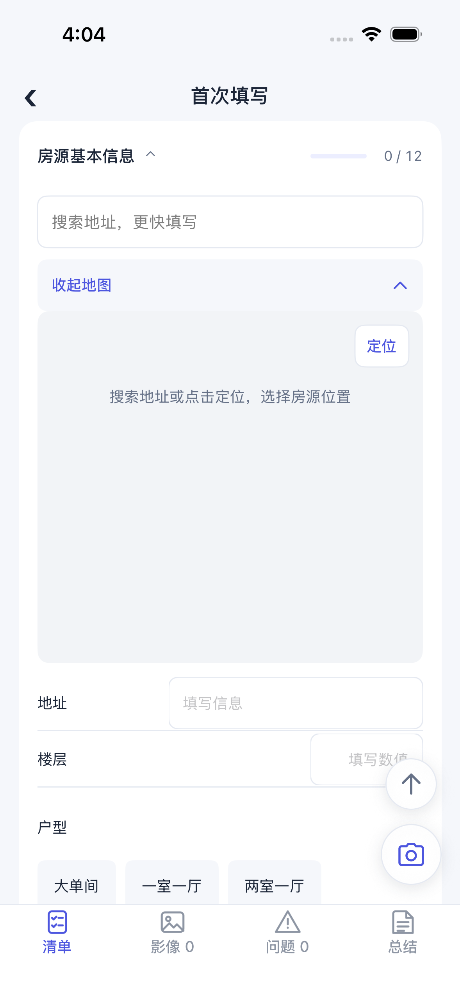
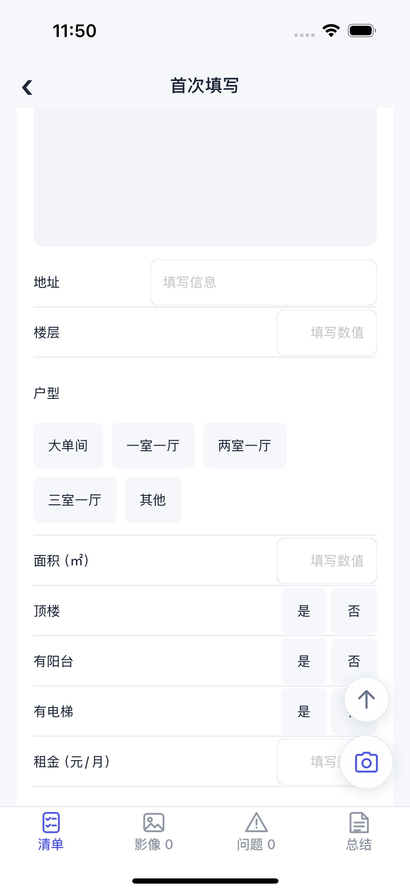
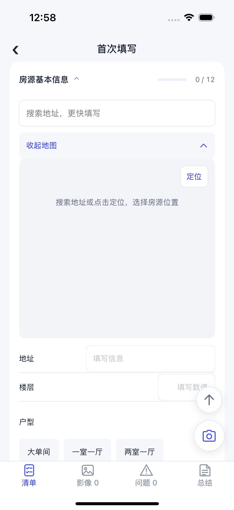
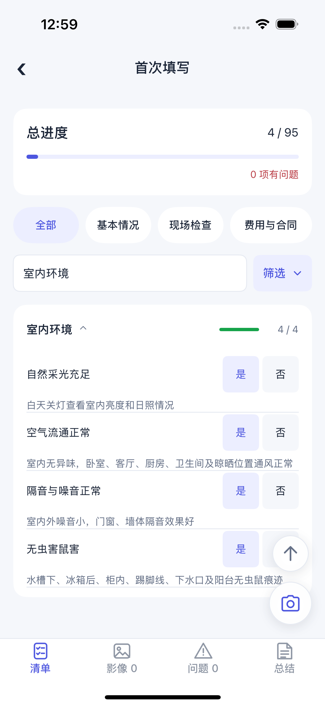

# 首次填写引导顶部定位（2026-10-30）

PR：[#98](https://github.com/Hayden-Chang/rent_room/pull/98)。产品基线 `8a078ec6dcc0aab0681f3099e936acae77ff8b30`，候选证据提交 `a2e740a17cf3869224433021d48417f4791c552a`。

## 主线组合验证与合并授权

用户在截图展示后明确要求“合入到主线”。原审批效果保持；已检查最新原始截图。

主线推进到 `46f6ff3`，新增语言/币种、本地购买，并改变清单组件、初始化和项目配置，因此没有直接复用旧验证。无冲突合入任务分支后，新首次货币提示挡住测试入口；初次组合运行 `26f1731` 主动中断（exit 130，保留日志）。`f60fdb533959992071e369716d08871dfa821205` 仅为测试补上点击“使用美元”及等待弹层消失，原定位断言不变。

在同一台 iPhone 16 / iOS 26.5（`5FC4A20B-AF44-4A92-BF91-B0096BEBF1D9`）运行 2 项单测和 3 条 UI：4 通过，仅精简模式因进入清单后的 UI 查询超时失败，未到达定位断言。按单项失败恢复规则，在同提交、同设备独立执行该精确用例，1/1 通过；其余 4 项通过结果保留，组成最终 2 UT + 3 UI 证据。没有代码变更、弱化断言或重跑整个集合。独立执行用于排查连续启动的影响；通过不能证明进入卡顿的根因已消除，该限制及全部失败证据保留。

主线随后推进到 `a4b47a1`，仅改变左滑 pan 手势的同时识别和失败优先级。逐行检查确认不改变程序触发的 scrollTo/restore、布局、数据、配置及所选测试；本轮日志没有执行 swipe/drag。随后 `4ebd80f` 为已有选择和手动折叠动作追加触觉调用：原 action/toggle、状态、布局和滚动不变，引导按钮使用另一处未变的 action；本轮未启用新增 DEBUG 评审路由。最新模拟合并树 `3de1fde4999ff65d9f57e5d42a969d8669f2cd5d` 无冲突，组合前后 iOS 产品和测试差异的 patch-id 同为 `21fd2acecf65f082ea2ee1f69f257f606710620a`。环境和所选测试仍适用，据此保留验证等价性。

最新主 agent Review 检查 PR 实际源码差异、测试适配、截图及上述等价依据，未发现阻塞性代码问题。此后的提交只补证据文档和截图，不改变已验证代码。[主线组合证据](evidence/filling-guide-merge-20261030.json) 包含计划、结果、失败恢复及原始路径；所有租约已释放。

| 最新详细模式 | 最新精简模式 |
| --- | --- |
|  |  |

## 原始修复验证

`green-calibrated` 在上述提交运行 3 条 UI，3 通过、0 失败、0 跳过；复用 2 项通过的夹具单测。设备为 iPhone 14 Pro / iOS 18.3.1（`8F178971-C203-4690-A83B-253046EACBB1`）。两种模式的标题无障碍框顶部均为 105 pt，导航栏底部为 103 pt；首个地址填写项可见。

| UI 检查 | 结果 | 耗时 |
| --- | --- | --- |
| 精简模式首次填写从顶部显示 | 通过 | 36.830 秒 |
| 详细模式首次填写从顶部显示 | 通过 | 36.963 秒 |
| 再等等恢复原位置且保留答案 | 通过 | 61.039 秒 |

运行耗时包含自动化启动、等待、查询和截图，不是产品性能指标。完整证据见 [结构化记录](evidence/filling-guide-top-20261030.json)。

## 问题与改动

小程序 `apps/wechat/src/lib/onboarding.js` 的 `locateFilling` / `acceptFilling` 将引导和新展开分类定位到视口顶部。iOS `ChecklistPage` 在教学结束后却给 `MPChecklistSurface` 传入 `.center`；较长分类的中部被对齐，分类标题卷出屏幕。完整首次教学路径和独立填写路径都捕获到修复前标题 y=-224.3 pt。

将此处改为 `.top`。顶部按钮和教学原先也是 `.top`，不改变它们的定位。没有修改小程序、字段内容、填写答案、存档格式或发布配置。

## 原始修复验证边界

两种模式均使用 DEBUG 专用夹具，只有 `--business-test <UUID> --filling-guide-fixture simple|detailed` 才启用。它通过真实 `setupFinish`、`add`、`tutorialAdvance` 准备刚结束教学、所有答案为空、首次填写引导待展示的状态。后续打开房源、点击“去填写”、填写选项及“再等等”均由实际页面按钮驱动。没有把夹具准备过程描述为完整首次教学 UI 覆盖；Release 不包含该入口。

最小 UI 选择为精简模式首次定位、详细模式首次定位和“再等等”恢复原位置三条。前两条检查分类标题在导航栏下方 0–44 pt、可点击且第一个填写项可见；第三条检查返回前后滚动位置误差小于 2 pt，刚填的答案仍选中。

两项单测验证测试入口隔离、模式限制、答案为空和引导待展示、重复准备不改变状态。单测来自修复前校准运行；该运行与候选仅相差一处 SwiftUI 滚动锚点，夹具、单测、业务核心和 Debug -O 配置一致，故复用通过结果。

## 原始修复尝试记录

- `red-offline` / `4ece040`：完整首次教学路径，详细模式实际复现；精简模式未通过前置教学查询，不计为定位复现。
- `red-focused` / `f9dc7ac`：2 项单测通过；两种模式顶部检查失败；“再等等”通过。
- `green` / `162971b`：3 条 UI 未通过。详细模式截图已呈现正确顶部布局，但宽泛、重复的元素查询超时；其余两条在进入清单、首次引导出现之前超时。此运行不计为绿色结果。
- `red-calibrated`：`a2e740a` 加已保存的单行锚点反向补丁，Debug -O。2 单测及“再等等”通过；精简模式打印标题 y=-224.333、导航栏底部 y=103 并在可见性断言失败；详细模式卡在进入清单，未执行到定位断言。采样记录到应用主线程约 99% CPU、持续 SwiftUI 更新；没有据此宣称已修复此间歇性进入问题。
- `green-calibrated` / `a2e740a`：同设备、相同 Debug -O 配置，三条 UI 全部通过。使用原有页面和按钮，未绕开首页导航、未重试单个失败方法。
- 初期依赖获取和参数错误另有原始日志，不算作行为复现。ZIPFoundation 0.9.20 使用本机相同提交的独立缓存副本。

## 原始修复可复核材料

原始日志、计划、xcresult、导出附件及采样位于 `/private/tmp/rent-room-ios-onboarding-evidence-20261030`。各次失败材料均保留。所有构建和测试通过共享 `Simulator Management/bin/sim-test-run.mjs` 与仓库 `scripts/run-xcodebuild.sh`，不绕过模拟器池。

校准和最终命令使用 Xcode 26.6、arm64、Debug、`SWIFT_OPTIMIZATION_LEVEL=-O`、`-parallel-testing-enabled NO`。XcodeGen 2.45.4 检查及原生核心生成检查通过；没有提交生成的 xcodeproj。

本轮没有运行完整 UI 套件，未验证真机、完整首次教学的修复后端到端流程，也不声称与小程序逐像素一致。此前进入清单的间歇性等待单独保留为限制。

## 原始修复截图验收

以下均为 xcresult 原始附件，1178 × 2556 px。已由当前主 agent 检查：引导卡在目标分类前；点击后分类标题、搜索地址及第一个填写项可见；后续“再等等”返回搜索结果并保留 4 个已选答案。无裁切或重绘。

| 详细模式修复前 | 详细模式修复后 |
| --- | --- |
|  |  |

| 精简模式：引导 | 精简模式：展开 |
| --- | --- |
|  |  |

| 详细模式：引导 | 再等等后恢复 |
| --- | --- |
|  |  |

原始修复的最终 runner 退出码 0，3/3 UI 通过且无跳过；已核对队列、run slot 和 lease 全部释放。两轮校准结果包、附件、计划、日志及 receipt 另存于 `/Users/pc/.codex/visualizations/2026/10/30/01a18abc-ba28-7211-935a-5b98fddfac2f/ios-filling-guide-evidence`。

主 agent 在 PR 建立后审阅实际 GitHub diff，未发现阻塞性代码问题。主分支更新到 `b5a3b4d` 仅增加设置页评价入口，与清单及本次测试依赖无关，模拟合并无冲突。验证后提交仅增加本报告、JSON 和截图，与证据提交相比产品及测试源码不变，复用上述证据；不是在文档提交重新运行测试。

视觉状态：APPROVED，用户已授权合入主线；合并结果以 PR #98 状态为准。未安装真机、未发布。
