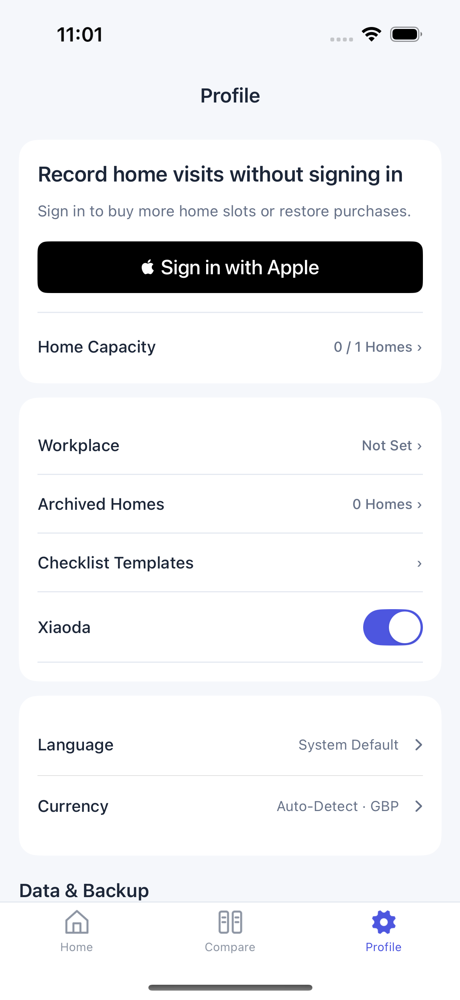
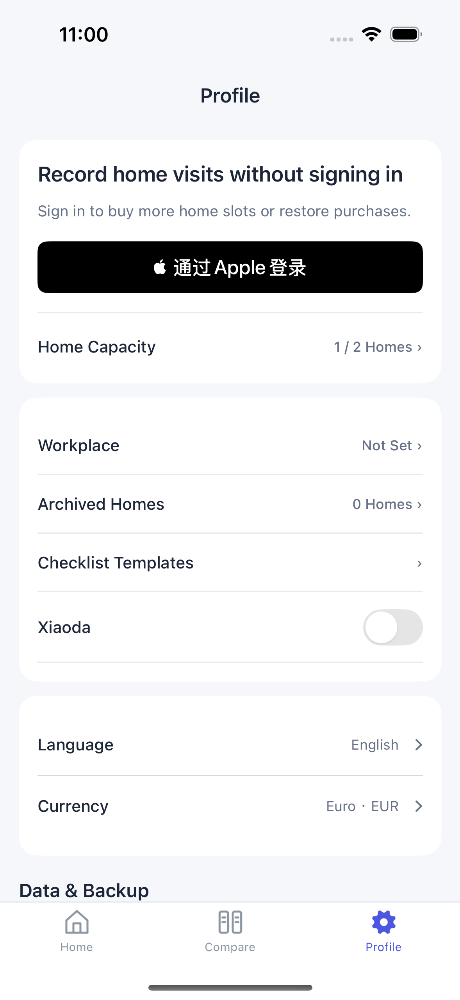
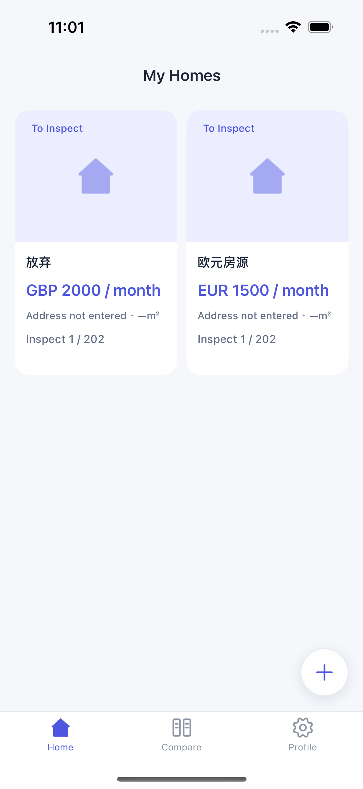
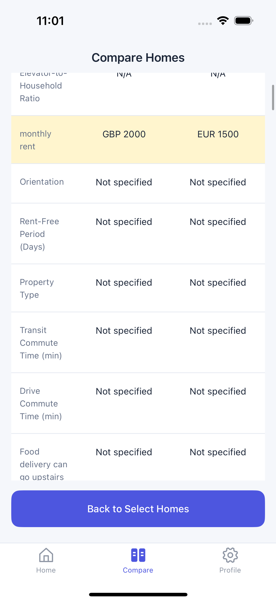
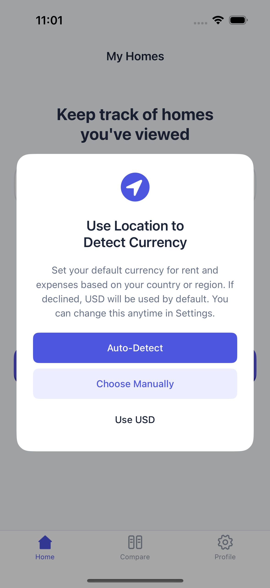
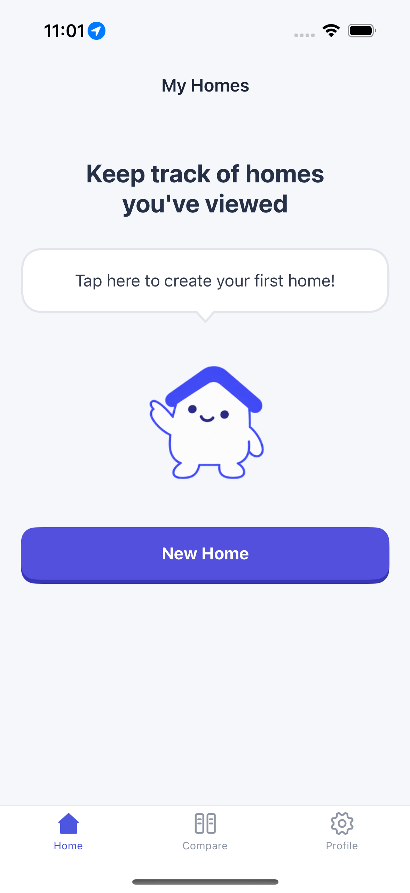
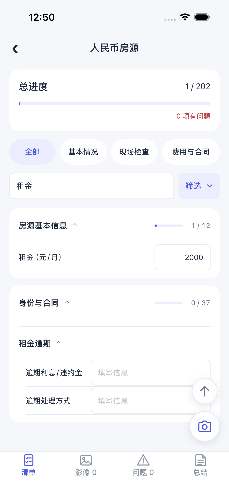
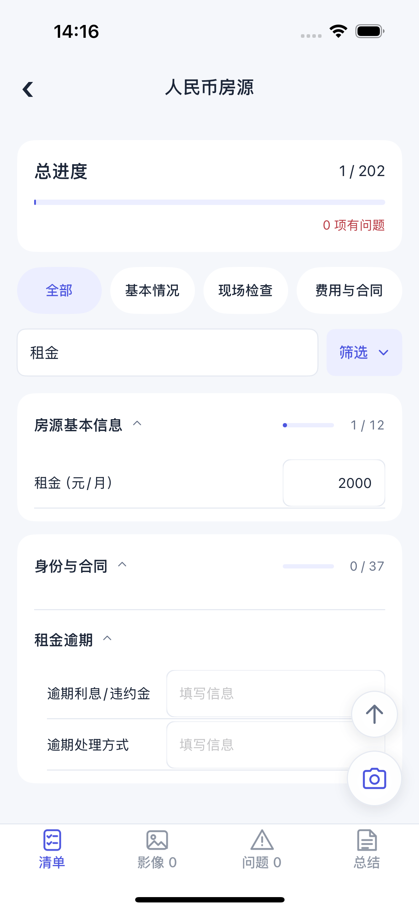
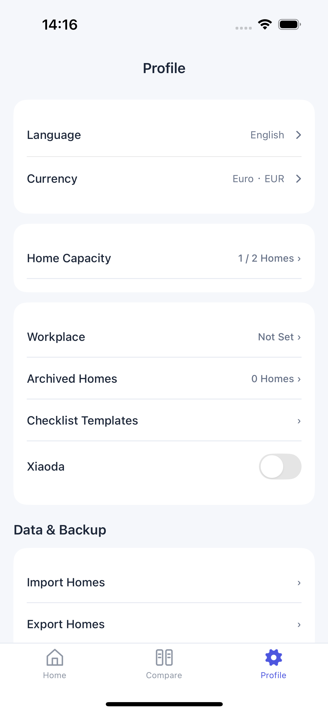

# iOS 中英与货币类型

## 产品契约与实现

用户于 2026-10-30 回复「没问题」，批准语言、货币选择和定位说明组件，并继续完整业务接入。交付分支 `codex/ios-language-currency-20261030`，Draft PR [#95](https://github.com/Hayden-Chang/rent_room/pull/95)。

- 简体中文、英文、跟随系统三种选择，默认跟随系统首选支持语言；没有中英时回退英文。本机持久化，不随登录账号切换。
- 首次完成清单排序及记录模式设置后，显示「获取当前位置自动识别货币类型」。用户可以定位、手选或使用美元。处理后不重复弹出。
- 设置项为「货币类型」。按需申请使用期间定位，由系统地理编码识别国家；拒绝、失败、无法识别均回退 USD。只有已同意、仍选择自动、已有系统权限时才在回到前台更新。无后台定位，识别过程不向应用服务器上传或持久化坐标。
- 手动币种优先。取消、后台切换和迟到的定位回调不能覆盖后来的选择。
- 新建房源保存 `currencyCode`。默认币种变化只影响以后新建的房源；旧记录缺失币种按 CNY 解释。金额不换算，房源卡片、清单费用、对比、导入导出保留币种；不同币种的相同数值仍属于差异。StoreKit 商品价格维持商店返回值。
- 英文翻译只作用于显示，保存的检查项和选项仍使用原有业务值。房源名、备注、地址、媒体说明、自定义费用和旧记录中的自定义选项保持原文；英文搜索映射回原有字段。对比中的“其他”标签与用户补充文字分别处理。

## 文案与资源来源

所有本次新增或修订的英文产品文案均调用 `agy --model gemini-3.8-flash-high --mode plan -p <提示词>`，模型 ID 来自本机 `agy models`。没有人工重写英文值。只发送产品文案，不发送房源或账号数据。

- 组件：`ios/Localization/region-zh.json`、`region-prompt.txt`、`region-en.agy.json`、`region-provenance.json`，190 条，其中 162 种货币。
- 全应用：`app-zh.json`、`app-prompt-01..04.txt`、`app-en-01..04.agy.json`、`app-provenance.json`。4 批共 1,300 条初始文案；上下文修订保留为单独的 `app-*-prompt.txt` 和 `app-*-en.agy.json`，由回执记录覆盖顺序、键集合及哈希。
- 分享封面：`share-zh.json`、`share-prompt.txt`、`share-en.agy.json` 的 5 条文字通过 agy 生成；内置 imagegen 按 `share-image-prompt.txt` 保留原插画构图并替换文字，输出 `ios/Xunju/Resources/InspectionShareCover-en.png`。原中文 JPG 保留。`share-provenance.json` 记录文案与图像哈希。
- `build-regional-copy.mjs` 和 `build-app-copy.mjs` 校验源文案、生成结果、提示词哈希及占位符，再生成打包资源。后者同时生成 `en.lproj/InfoPlist.strings`、`zh-Hans.lproj/InfoPlist.strings`，覆盖应用名、相机、麦克风、位置用途。
- `scripts/check-xcodegen.sh` 包含上述 `--check`，并校验原生 JS bundle 与 XcodeGen 2.45.4 的确定性生成；`.xcodeproj` 不提交。

Apple 原生登录按钮、授权框、相册等系统控件的语言由 iOS 管理；应用内手动语言切换不修改设备语言或替换授权机制。[Apple 原生按钮说明](https://developer.apple.com/design/human-interface-guidelines/sign-in-with-apple/)。

## 验证范围与证据

使用任务独立 worktree `/private/tmp/rent-room-ios-language-currency-20261030`、隔离 Node 24、共享 Simulator Management runner 及仓库 `scripts/run-xcodebuild.sh`。未改动主工作区的已有未提交文件。构建与测试期间源码冻结。

已执行开发证据：

| 运行 | 实际结果与用途 |
| --- | --- |
| 组件 review run-05 | 源码 `45a5121e33e094d0f09baba102379dc43109b377`，7 单测 + 3 组件 XCUITest 全通过；截图获用户批准。此前自动币种行误显示手动币种，review run-04 新断言失败后修复。 |
| integration run-01 | 15 个定向单测通过：偏好、币种快照、旧记录、实际 ZIP 导出预览、取消与迟到回调，以及容量/落盘/损坏恢复。 |
| integration run-02 | 2 个中文业务 XCUITest 通过：手动 GBP/EUR、重启不换算、真实系统拒绝后 USD。 |
| integration run-03 | 3 个业务 XCUITest 通过，包含首次完整清单后的系统授权及真实地理编码。模拟器注入伦敦坐标后，CLGeocoder 实际返回 GB 并使用 GBP。新增费用无单位断言按预期失败，证明原「物业费」未带币种。 |
| integration run-04 | 费用标签回归通过；16 个单测中定位模拟器用例的固定 yield 等待未等到回调，产生 3 条断言失败。改为有界等待实际状态；不是产品拒绝逻辑失败。 |
| integration run-05 | 19 单测中 17 通过，另外两项是测试夹具/读取方式错误：使用不存在的“基本信息”类别、把编译后的二进制 strings 当 UTF-8。3 个 UI 中英文录入/对比/重启和中文系统拒绝通过；英文首次流程在错误的 StaticText 选择器停止，截图证实页面已英文，未据此宣称后续授权已验证。上述观测方式均已修正。 |
| integration run-06 | 候选 `d88d648d2e9ea96059036c038fa15844dd314100`，28 单测 + 3 业务 UI 全通过。逐张看实际截图后发现自动断言未覆盖的两个问题：货币表头去掉单位后漏译，英文首页标题仍被固定单行高度截断；因此不以本轮全绿作为交付终点。 |
| integration run-07 | 修复前新增 `AppCopyTests/testEnglishComparisonCostLabelsAreFullyLocalized` 确认 17 个去单位后的表头仍有中文；首次业务 UI 新增高度断言确认标题文字高 28.67，未达到换行要求 45。两项均为预期行为失败。随后通过 agy 补齐这些表头（保留单价/周期语义），首页允许按内容增长，并保留相同回归断言。 |
| JS 搜索与合并统计 | `model.test.js` / `form-derived-stats.test.js` 精确选择 `localized display search` 与 `per-render statistics match`，2 例通过，20 例未选；未运行整个共享模型套件。 |
| 旧选项回归 | `legacy-wheel-before.log` 断言实际 `[true,true]` 与预期 `[false,true]` 不符，旧自定义「放弃」会被翻译。修复后同一断言通过；永久用例 `ios/tests/currency-localization.test.mjs` 与 Native AppCopy 测试共同保护用户原文及固定天数单位。 |

已合并主线 `ab9c02f55e5a3043bee5a74e7f8f6fd96f902d2a`：保留增量桥接缓存、移除自动通勤查询、触摸轨迹设置；手工冲突限于桥接摘要添加币种、AppRoot 合并环境与触摸图层、设置页同时保留两个功能，JS bundle 从源码重建。合并后的 8 个桥接增量/缓存回归及 1 个币种 JS 用例通过，最终单测补选增量状态、字段适配和触摸偏好集成。最终候选 `f8f3f9ab920d65bde4102782d2112be6f7c62837` 已通过 integration run-08：29 项定向单测和 3 条业务 UI，32 passed / 0 failed / 0 skipped。完整计划、精确命令、选例理由、设备与回执见 [机器可读证据](evidence/language-currency-20261030.json)。主 agent 已复核最终 diff 与截图，费用表头和首页标题的两项视觉问题已关闭。GitHub 当前未返回 status 或 workflow run，未将此表述为远程 CI 通过。

最终全绿后只补交本说明和 `docs/ios/evidence/` 的结果数据及截图；这些文件不参与应用源码、XcodeGen、资源生成、依赖或测试选例，复用上述已验证业务提交的证据，不再重跑。JS/Vitest 证据复用前核对其源文件、Node 24 环境及命令均未改变。全部最终新增/修改单测已执行；3 个组件 UI 在开发阶段通过，3 个业务 UI 在最终阶段通过。没有使用单失败重跑豁免。

### 最终实际截图

以下均来自 run-08 原始截图；英文系统偏好、手动英文、首次说明、原文房源名、多币种和首页换行均可直接核对。完整 13 张原图和英文分享图位于本机 `ios-language-currency/integration/gallery.html`，不是设计稿。

| 自动识别 GBP | 手动英文与 EUR |
| --- | --- |
|  |  |

| 多币种房源 | 英文费用对比 |
| --- | --- |
|  |  |

| 首次清单后的说明 | 首页完整换行 |
| --- | --- |
|  |  |

### 最终选例依据

按风险排序选 3 个 XCUITest：

1. 英文录入与手动币种：中文系统上手动切英文，英文搜索、新建 EUR 房源、旧 GBP 记录、对比与重启，再回到跟随系统。
2. 英文首次设置：默认跟随英文系统，完整清单设置后才弹窗、真实系统授权、模拟伦敦坐标经真实地理编码得到 GBP、重启不重复。
3. 中文拒绝：真实系统拒绝后 USD，重启不再次申请。

单测覆盖全部新增/修改方法，并按变更选择原有字段适配、旧滚轮值、共享搜索、比较、导入原子性、容量、持久化与恢复用例。组件阶段 3 个新增 UI 用例已在开发阶段执行；最终仅选择上述 3 个完整业务方法。没有运行全量单测或 UI 套件。

所有原始尝试保留在 `artifacts/localization-review/`、`artifacts/localization-integration/`，包括计划、完整命令、日志、回执、汇总及原图。每个 integration 结果包为 `/Volumes/mac2/codex-builds/rent-room-regional-integration-20261030-NN.xcresult`，构建包为同前缀 `.build.xcresult`。实际设备为 iPhone 14 Pro / iOS Simulator 18.3.1 (22D8075)，UDID `8F178971-C203-4690-A83B-253046EACBB1`。原图 1178×2556；共享 runner 给本 worktree 分配的历史命名 DerivedData 为 `/Volumes/mac2/codex-builds/time-fragment-dd-shared-5c197e8b90abdeeb43babf93-simulator`。

持久证据目录：`/Users/pc/.codex/visualizations/2026/10/29/01a18878-d8ae-72f2-a0cf-3e4662baf2b2/ios-language-currency/`。主 agent 已查看英文设置、费用输入、原文房源名、多币种卡片、比较和首次引导截图；开发截图揭示登录说明截断，已允许按内容换行。英文分享封面 5 条文字与 agy 结果一致。

## 明确边界

- 本次支持中英操作、海外币种记录和国家识别。保留最新主线移除自动通勤查询的行为；既有天地图地点服务没有扩展为全球地点服务。海外地址可手动记录，海外地点检索、路线、各国租金周期/面积单位不在此次已验证范围。
- 定位成功证据使用模拟器坐标及真实系统权限、真实 Apple 地理编码，不是真机 GPS；无后台定位验收。系统权限、相机、实拍和商店购买未做真机测试。
- 未覆盖所有设备尺寸和辅助功能字号；最终 3 个 UI 用例不证明所有页面视觉完全一致。
- 未合并、未安装到真机、未发布。组件已有视觉批准，完整业务截图已作为本次交付证据；本次未执行合并。

## 2026-10-30 中文人民币表单单位修正

根据真机反馈，`AppCopy.moneyLabel` 在中文且币种为 CNY 时使用“元”，包含“元/月”“元/度”“元/吨”、无单位费用与自定义费用；英文、其他币种及存储值保持不变，无新增英文文案。修复源码 `a8ef73671300c0565f29728dd9f3f67325b1e27e` 已更新至 PR #95。

修复前新增单测的 6 条单位断言按预期失败，修复后 3 项单测通过。实际表单显示“租金（元/月）”，金额 2000；重启后的 CNY 2000 读回断言通过。新增 UI 随后的房源打开步骤未进入表单；既有外币流程停在设置页导航，修复前也出现同一等待边界。实时线程采样停留在 SwiftUI 导航/布局偏好更新，根因未明确。当前整轮 **3 passed / 2 failed / 0 skipped，不满足合并门禁**，未弱化或删除失败断言。

前后模拟器由共享池分配，分别为 iPhone 14 Pro / iOS 18.3.1、iPhone 16 / iOS 26.5；不能据后一次结果宣称旧系统导航问题已修复。原始截图 1178×2556，主 agent 已查看“租金（元/月）”及 2000 的实际显示。[完整机器记录](evidence/cny-form-unit-20261030.json) 包含精确 SHA、xcresult、选例、诊断与证据目录。

本任务此前已按用户授权将 d68ac07 Release 独立副本安装并启动至华为p10002；本次文字修正尚未更新真机。PR 保持 Draft，未合并。

## 2026-10-30 主线整合后的最终验证

用户已明确要求合入主线。候选 `44d860816fc947d6694c6804dec757a388296428` 已整合最新主线 `b07512cbeb62071e526f4ef8c528da91924c1221`，保留本地 StoreKit、评分入口、评分计数、离线目录和隐私清单。语言与货币入口接入主线单一 item 导航；新设置页、法律入口和购买说明的 21 条英文继续由 agy 生成，保留 prompt、原始结果和哈希，AppCopy 共 1343 条。

整合时发现多币种创建绕过了主线评分计数，新增 `currency-review.test.mjs` 在 `2f86a59` 按预期失败（应为 1，实际 undefined），修复后验证保存失败回滚、三次创建、重启和评分只请求一次。诊断第一轮还发现冲突处理遗漏了返回用户测试夹具重建 store 后的币种绑定；已恢复原绑定。第二轮新增文案测试误用 AppCopy 检查实际来自 RegionalCopy 的两个标题，已按真实渲染路径修正观测，未删除业务断言。

最终完整 campaign `rent-room-regional-merge-20261030-final-01`：**41 单测 + 3 UI = 44 passed / 0 failed / 0 skipped**。全部新增/修改单测均在精确选例中，UI 依风险选择中文元与重开、GBP/EUR 与中英设置/比较、首次清单和真实地理编码。另有 16 个 JS 检查及 2 个定向 Vitest 用例通过（20 个未选）。无全量单测或 UI 套件，无单失败豁免。新增中文单位 UI 在移除诊断探针后的最终候选再次通过。

实际设备为 iPhone 14 Pro / iOS 18.3.1 (22D8075)，原图 1178×2556。历史 iOS 26.5 房源点击失败保留于上节证据；本轮不宣称已在该系统复现或修复，也不以一轮通过抹去历史失败。实际系统拒绝 UI 曾在 f8f3f9a 通过，本轮三例排序未重跑该方法，拒绝/取消仍由本轮单测覆盖。

主 agent 单独复核最新 diff、源文案溯源、选择映射、金额与原文保存、截图和远程检查。截图确认重启重开后的“租金（元/月）2000”、英文设置/条款入口、EUR 输入和 GBP/EUR 对比、系统默认英文、自动 GBP 及首页完整换行。GitHub 未返回 status/workflow run；不将此表述为远程 CI 通过。运行已结束，slot 和设备 lease 释放。

[最终机器证据](evidence/language-currency-merge-20261030.json) 包含完整方法、原因、命令文件、日志、xcresult、runner 回执和截图；持久目录 `/Users/pc/.codex/visualizations/2026/10/29/01a18878-d8ae-72f2-a0cf-3e4662baf2b2/ios-language-currency/merge-final-20261030`。本说明及截图是最终绿灯后的文档补充，不参与源码、资源生成或测试行为；文档提交复用 `44d860816fc947d6694c6804dec757a388296428` 证据。此前“not merge-ready”属于旧候选记录，本节为当前状态。未重新安装真机或发布。

