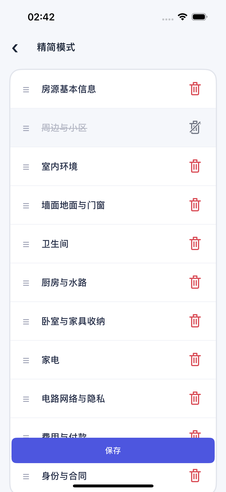
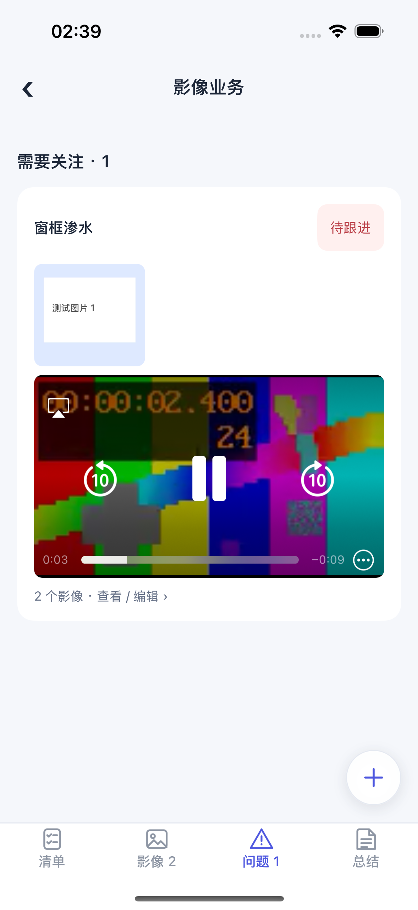

# iOS 性能优化与验证（2026-10-30）

后续选项点击卡顿的写入链路优化与最新验证见 [点选性能报告](CHOICE_PERFORMANCE_20261030.md)。本报告保留上一轮只读和图片处理测量。

本次改进清单读取、Swift/JavaScript 数据传输、缩略图复用和照片导入，并修复真实 UI 回归中发现的模板导航刷新循环。PR：[#87](https://github.com/Hayden-Chang/rent_room/pull/87)。基线 `eb75079b3e46726e5742cc4c861dc7a278d9dd31`；前后性能对照使用 `3493385fb894c0a8210937275985ec3e238c77d9`，最终交付另含导航及测试修复。

## 测量结果与范围

| 操作 | 优化前 | 优化后 | 本轮耗时/数据量减少 |
| --- | ---: | ---: | ---: |
| 30 套默认房源的 NativeStore 初始化（单次） | 1194.86 ms | 329.74 ms | 72.4% |
| 同一房源三项连续读取的首轮未缓存调用（单次） | 2962.19 ms | 88.73 ms | 97.0% |
| 同一房源的 form + inspectionGuide + media 连续读取（10 次中位样本） | 2733.55 ms | 0.72 ms | 99.97% |
| 已预热的 600 px 缩略图读取（20 次中位样本） | 3.18 ms | 0.16 ms | 94.9% |
| 三次读取返回的 UTF-8 JSON 总量（Node VM，30 套相同房源） | 6,506,747 B | 12,131 B | 99.81% |

前后均使用共享池中同一台 iPhone 14 Pro / iOS 18.3.1 模拟器（`8F178971-C203-4690-A83B-253046EACBB1`，OS build `22D8075`）、Xcode 26.6、arm64、`Debug + SWIFT_OPTIMIZATION_LEVEL=-O`，关闭 XCTest 并行。Debug 是为了保留既有业务测试的隔离夹具；这不是生产 Release 测量。

读取测试包含第一次未命中；优化后首轮为 88.73 ms，随后命中缓存，中间一次为 18.47 ms。完整样本保存在配套 JSON；测试按排序后的第 6 / 11 个样本报告中位样本。共享机器存在其他构建负载，这些数据是相同方法的一轮前后对照，不能外推为所有数据规模的稳定承诺。

初始化指 NativeStore 构造过程，不是从点击图标到首屏的冷启动。读取测试使用 30 套默认房源、默认折叠状态和空影像；缩略图测试使用 4000 × 800 的固定图片。没有据此声称全应用帧率、真机能耗或峰值内存已达标。

## 改动及保留的行为

1. **增量桥接。** 原实现每次读取都重新统计全部房源并返回完整存档，写操作还在 `value` 和 `state` 重复返回同一状态。Swift 现在选择增量协议：仅状态变化或显式 snapshot 时返回存档与摘要，`valueIsState` 保持写操作原有返回语义。status、capacity、error 始终更新；未选择增量协议的调用保持原响应格式。
2. **有界查询缓存。** 仅缓存明确无副作用的 form、targets、issues、media、compare、inspectionGuide、templates、setupState。对完整请求递归排序对象键，消除 Swift 字典编码顺序变化；状态身份或本地日期变化即失效。最多 8 项、估算序列化内容总量 1 MiB，单项超过 256 KiB 不缓存；此预算不是 JavaScript 实际堆大小。会写状态的 homeGuide 不缓存。
3. **大 JSON 解码。** 对桥接的 state/value 使用 Foundation 一次解析并转换 JSONValue，避免 Codable 在每个异构节点反复试探类型。数字 0/1 与布尔值明确区分；小型协议元数据继续严格解码。存档 Codable、schema 和原子保存路径不变。
4. **缩略图缓存。** 保持现有 600 px、EXIF 方向和渲染方式，复用已解码图片。完整账号目录路径及新读取的文件大小、修改时间、inode 决定有效性；删除、替换或损坏文件不会显示旧缓存。LRU 上限 64 项 / 32 MiB 解码像素，内存警告清空；缓存淘汰不删除原图。此限制只约束缓存持有的像素，不是进程内存上限。
5. **照片导入异步化。** JPEG 编码与原子写入移至后台 Task；取消时等待后台结束后清理，避免取消清理与迟到写入竞争。最终账号/页面身份与大小检查仍在主 actor 执行。视频导出路径和保存、回滚语义保持。

6. **模板导航。** 目标页面闭包只捕获 workspace，避免隐式捕获父页面及其不断变化的 dismiss 环境。修复前完整页面路径中主线程持续执行 SwiftUI / AttributeGraph / NavigationStack 更新，采样约 99% CPU；诊断日志连续出现 `_dismiss changed`。修复后原 iOS 18 两条完整流程通过，涵盖编辑、保存、再次打开、模板隔离和旧房源归档快照。

页面布局、文案、交互手势、小程序业务源码、后端、存档格式、依赖、XcodeGen 配置和发布设置保持不变。`XunjuCore.js` 由 `node ios/scripts/build-core.mjs` 生成；未手改生成产物，未提交 `.xcodeproj`。

## 审计覆盖和剩余边界

| 领域 | 审计结论 |
| --- | --- |
| 状态桥接与清单重复计算 | 本次修复；覆盖只读、写入、失败回滚、容量变化、跨日和重启 |
| 图片内存与导入阻塞 | 本次修复重复解码和照片编码占用主 actor；有预算、方向、替换、删除及取消检查 |
| 网络查询 | 已有 debounce、取消/epoch、超时和计费守卫；本次未改 provider，不声称服务响应更快 |
| 持久化 | 保留同步原子保存和上一版本恢复；未用 debounce 换取崩溃前数据丢失窗口 |
| ZIP 备份 | 现有 actor 按块流式处理；本次检查往返、容量拒绝及账号变化回滚 |
| SwiftUI 布局与滚动 | 修复模板目标闭包捕获引发的更新循环；保留 lazy grid、清单定位与引导锚点 |

首次未缓存缩略图仍同步解码，全尺寸预览仍同步读取；对这些路径没有缺乏测量依据的布局替换。未执行真机相机、真实 GPS、StoreKit Sandbox、FPS、能耗或峰值内存测试；自动 UI 中的图片/视频来自显式隔离夹具，走真实导入、保存、预览和重启流程。历史审计曾记录实时路线服务失败，本轮未复测该外部服务，不能据此判断其当前状态。

## 回归证据

基线新增测试提交 `68c07258cd61ffcfbffbf1b51caa719fde0e6b47` 只添加测试，产品代码仍为上述 main 基线。

| 行为 | 修复前证据 | 修复后证据 |
| --- | --- | --- |
| 读取不再重复发送存档；写入不复制状态 | 最初 5 项 Node 桥接测试 4 失败，明确断言多余 state / value | 最终 7 项桥接测试通过，包括跨日与过滤条件 |
| 同图重复读取应复用解码图片 | `testRepeatedThumbnailReadsReuseDecodedImage` 失败 | 最终同名测试通过；补充预算、内存警告及 EXIF 检查 |
| 照片导入期间主 actor 应可处理排队工作 | `testPhotoImportAllowsMainActorProgress` 失败 | 最终同名测试通过；补充进行中取消后无残留文件 |

有效 iOS 基线共 6 项：4 通过、2 行为断言失败。它不是绿色基线，也没有把编译错误当作缺陷复现。

最终产品代码 `7c51cacefc1213621df75dfbe474ca35f0dbf10b`：iOS 18.3.1 的 80 项原生单测和 3 条 UI 流程全部通过（83 / 83，无跳过），Node 测试 11 / 11；iOS 26.5（iPhone 16）相同 3 条 UI 流程全部通过（3 / 3，无跳过）。两个 runner 均正常退出 0 并释放租约。最终首次进入清单分别为 1.66 / 1.97 秒，这包含测试操作和页面动画，用于捕获极端等待，不作为生产启动性能指标。

最终 iOS 18 再测 NativeStore 初始化 178.81 ms、首轮读取 47.60 ms、重复读取中位样本 0.55 ms、预热缩略图 0.145 ms。正文对照表保留较早那轮完整前后配对值，没有选择最终更快的一轮来夸大收益；各轮原始样本均在 JSON 中。

已检查最终运行的原始截图：精简模板重进后仍禁用“周边与小区”；归档只读房源保留免租期 90.5 和“协商90.5天”备注；照片、视频关联正确；两个系统的视频均显示暂停控件和前进的时间码。这里只确认本次业务状态及展示，不声称与小程序逐像素相等。

单测选择来自实际调用边界：NativeStore/JSONValue → 状态读写、账号隔离、容量、模板、引导、问题草稿、地图计算写入、备份消费者；ThumbnailCache → 复用/文件失效/预算/方向；NativeMediaImport → 图片、视频、取消及身份变化。排除了只测试未修改夹具启用条件或不相关模块的测试；未运行完整单测或 UI 套件。

按风险排序选择 3 个现有 XCUITest 方法；扩展原方法中的断言，不新增最终 UI 方法：

1. `InspectionBusinessUITests/testDetailedNoneTemplateChangesAndArchivedSnapshot`：清单输入、筛选、无选项、备注、问题标记、重启、模板变更及归档快照；新增首次清单进入 30 秒上限，捕获此前百秒级导航循环；等待底部选择弹层消失后再点击模板。
2. `BusinessFlowTests/testIssueMediaSaveDiscardCaptionAndRelaunch`：真实照片/视频导入路径、缩略图与预览、问题保存/放弃、影像备注/过滤、重启和归档只读；先显示系统视频控制栏，再点击播放按钮并断言暂停状态，保留 3 秒断言期限。
3. `PixelParityAuditTests/testReferencePagesAndArchivedState`：首页、清单、对比、设置、归档、模板、工作地、导出、导入取消、反馈和容量页面截图；增加模板修改保存、重进及两种模式隔离验证。

剩余 UI 风险（真实相机/相册权限、实时路线服务、真实购买、超大库滚动）未用更多 UI 方法扩展本轮；相应数据边界尽可能由单测覆盖。

## 尝试记录与测试维护

- 早期 runner 计划验证、依赖获取/Release 编译和测试图片探针编译失败保留在原日志；未作为性能或行为证据。最终统一使用可编译的 Debug -O 条件。
- 首轮候选 `898b707`：79 单测中 78 通过，MapCore 仍断言旧引导标题；基线与候选 bundle 的 coach 输出都已是相同的新四步文案。只更新该断言，保留目标字段、关闭引导、重启和答案完整性检查。
- 首轮读取时间波动暴露等价请求可能有不同 JSON 键顺序，随后修复缓存键、补上导入中取消测试。该轮 UI 尚未完成即主动停止，runner 返回 130；未把未执行 UI 当作通过，也未套用“仅一项失败”例外。随后重新执行完整的 80 单测 + 3 UI 定向计划。

- 第二轮候选 `3493385`：80 单测通过，影像 UI 通过；清单与页面审计两条 UI 均在模板编辑入口失败。采样记录到主线程持续 SwiftUI / AttributeGraph / NavigationStack 更新，约 99% CPU。保留了这次 81 通过 / 2 失败的完整 xcresult、录像和调用栈。
- 一个临时独立模板测试出现 runner 返回成功、实际执行 0 项的异常；没有计为通过。已验证模拟器加载了旧 XCTest runner 的 Dead container。增加仅在本任务有效 lease 内卸载 XCTest runner 的预检，保留业务应用及其数据；4 项 Node 测试验证租约与错误边界。刷新后的独立模板测试通过，但不能代替原完整路径。该临时测试已移除，保存重进断言合入原 PixelParityAuditTests 方法。
- `60c5ba5` 在 iOS 26.5 的完整候选验证为 80 单测通过、1 UI 通过、2 UI 失败。视频失败来自测试在控制栏隐藏时只点了一次视频画面，未明确点击播放。清单流程出现首次进入超长等待及归档后新建未进入清单；保留原录像与采样，继续加入事件日志定位。
- 原 iOS 18 设备复验及 `923eb38` 诊断继续复现模板失败。Pixel 路径的编辑事件确实触发，随后 `_dismiss changed` 持续重复；Inspection 路径则在弹层消失前点击了后面的模板入口，编辑事件没有触发。
- `a277e95` 限定模板目标闭包捕获，并等待弹层退出；原 iOS 18 两个完整用例均通过（115.19 / 59.90 秒），首次进入清单 1.88 秒。诊断参考 [Apple 开发者论坛第一手复现](https://developer.apple.com/forums/thread/720096) 及仓库既有记录，结论以本次事件日志和实际前后验证为准，不把论坛帖子视为 Apple 官方确认。
- 同一修复在 iOS 26.5 的媒体、清单两条完整流程均通过，首次进入清单 1.68 秒。此前一次超长首次进入未独立确定根因，后续保持 30 秒回归断言；不把一次未复现包装成独立产品修复。`7c51cac` 移除全部临时事件与视图诊断日志后重新执行最终验证。

## 可复核材料与复现

结构化记录：[evidence/performance-20261030.json](evidence/performance-20261030.json)，含 SHA、完整方法选择及理由、运行命令、全部性能样本、失败分类、xcresult 摘要和附件路径。

本机材料持久目录：`/Volumes/mac2/codex-builds/xunju-performance-evidence-20261030`；原始临时目录：`/private/tmp/rent-room-ios-performance-20261030`。完整 xcresult 位于 `/Volumes/mac2/codex-builds/`，具体路径与实际执行方法数见 JSON；runner receipt 位于 `/tmp/todo-ios-sim-pool/run-receipts/`。

桥接测试命令：`node --test ios/tests/bridge-performance.test.mjs`。原生测试必须继续通过共享 `Simulator Management/bin/sim-test-run.mjs --plan … -- scripts/run-xcodebuild.sh …`，不要绕过共享池；JSON 中保留了本轮实际命令和准确 selectors。若复测需使用新的 run ID/结果路径并按当前 SHA 校验计划，不覆盖已保留的结果。

当前 Codex agent 已在 PR 建立后审查全部手写代码差异、测试和生成资源一致性，未发现待修正的阻塞问题。验证后仅新增报告、结构化证据和两张原始截图；`git diff` 确认产品及测试代码与上述验证 SHA 一致，因此文档提交沿用这轮测试结果。GitHub 当前没有检查或状态回报，不能描述为 CI 通过。未合并、未安装到真机、未发布。
