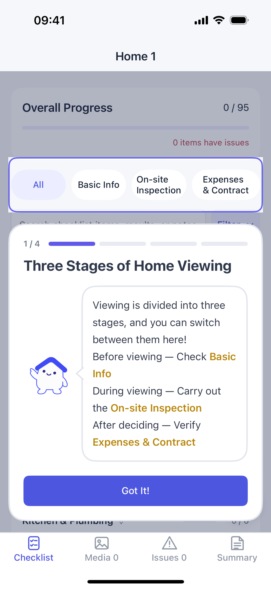
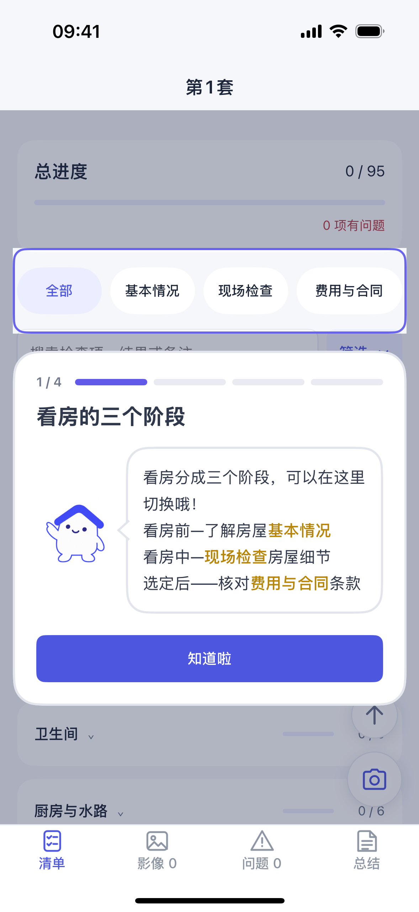

# Stage guide copy and emphasis — 2026-11-02

The English first-house guide now repeats the matching phase-tab names verbatim: `Basic Info`, `On-site Inspection`, and `Expenses & Contract`. This lets the existing localized highlight matcher apply the same egg-yellow (`#b8860b`) bold emphasis as Chinese iOS and WeChat. Chinese text, tab names, tutorial behavior and stored records are unchanged.

Only translation key `s0967` changes. The editorial revision and its hashes are registered in `ios/Localization/app-provenance.json`; `node ios/scripts/build-app-copy.mjs` regenerates `AppCopy.json`. The original agy output is preserved. No Swift production code, project configuration or mini-program source changes.

## Regression and local validation

- Base: `bb5c8311` (latest verified origin/main at task start).
- Evidence commit: `9a49676ba2af728b2b78991a58c1fd23523c9c7a`.
- Worktree: `/private/tmp/rent-room-stage-guide-labels-20261102`, branch `codex/stage-guide-labels-20261102`.
- Run: `rent-room-stage-guide-20261102-a`, development phase, through the shared simulator runner and `scripts/run-xcodebuild.sh`.
- iPhone 14 Pro, iOS Simulator 18.3.1, UDID `8F178971-C203-4690-A83B-253046EACBB1`; both raw screenshots are 1178 × 2556 pixels.
- XcodeGen 2.45.4 checks passed; `project.yml` is unchanged and no generated project is tracked.
- Result: 3 unit tests and 2 UI tests passed, 0 failures, 0 skipped. No full suite ran.
- Simulator lease and runner slot were released. The shared runner selected its managed build cache; the requested DerivedData path and exact command are retained in `command-a.json`.

The new `node --test ios/tests/stage-guide-copy.test.mjs` regression checks each description against its translated highlight/tab label. Before the fix, Chinese passed and English failed with `English description must contain exact tab label: Basic Info`. After the fix, both passed, including a repeat under Node 24.22.1. The original failure log is retained. Native-core and app-copy generation checks also passed.

Exact Xcode selection and impact mapping:

| Selector | Relationship to this change |
| --- | --- |
| `XunjuTests/XiaodaTeachingTests/testStageGuideRepeatsTabLabelsWithEggYellowEmphasisInBothLanguages` | New regression: loads the actual packaged guide through NativeStore, checks corresponding localized labels, every emphasized character's color and bold font, and ordinary text color |
| `XunjuTests/XiaodaTeachingTests/testAttributedSpeechKeepsEmphasisAndInlineActionImages` | Existing attributed-renderer emphasis and icon contract |
| `XunjuTests/XiaodaTeachingTests/testSpeechUsesAvailableWidthAndKeepsExplicitNewlines` | Existing renderer wrapping and explicit-newline contract |
| `XunjuUITests/StageGuideCopyUITests/testEnglishGuideRepeatsItsPhaseTabLabels` | New UI regression: real setup, house creation, first guide, corresponding tab labels, screen bounds, screenshot and next-step navigation in English |
| `XunjuUITests/StageGuideCopyUITests/testChineseGuideKeepsMatchingPhaseTabLabels` | New UI regression: the same affected guide in Chinese |

Both added UI methods ran. They use a new disposable business-test UUID, native taps and observable waits. Tapping the production message finishes its existing typewriter animation. No test-only product timing or rendering changes were added. Color is asserted at the attributed-text unit layer and inspected in real UI screenshots; accessibility labels alone are not claimed to prove color.

Local raw artifacts, relative to the worktree: `artifacts/stage-guide/plan-a.json`, `command-a.json`, `run-a.sh`, `run-a.log`, `results-a.build.xcresult`, `results-a.xcresult`, `summary-a.json`, and `attachments-a/manifest.json`. The command preserves task-local HTTPS Git handling and never modifies global configuration.

## Visual review and delivery state

The main agent inspected both exported screenshots. All three English stage names are visibly egg-yellow and bold; the Chinese stage names retain the same treatment. English wraps naturally within the bubble, including a line break between `Basic` and `Info`. The title, bubble and next button remain visible, and the button advances to the filter guide in both languages. Device, larger accessibility font sizes and the mini-program UI were not rerun; mini-program source is unchanged.

State: `REVIEW_READY` for local visual approval. No GitHub PR, merge, deployment, upload or release occurred. Automatic approval review rejected the branch push because the request did not explicitly authorize uploading code to GitHub; user authorization is still required. Local code and test review found no actionable issue. Only documentation and unchanged exported evidence are added after the green evidence commit; executable inputs are unchanged. This is local development evidence, not a final PR-head or remote-CI gate.
