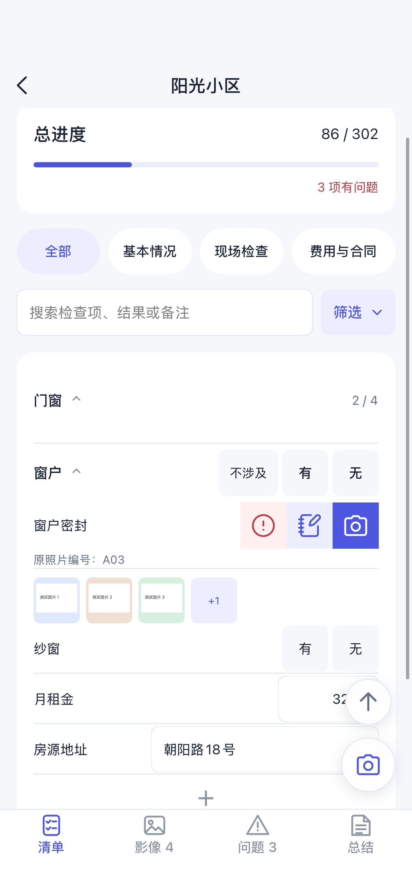
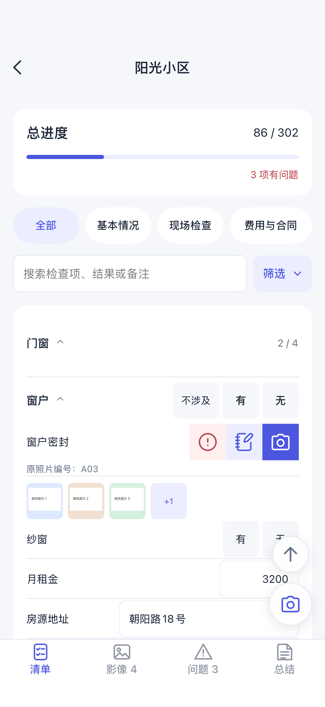
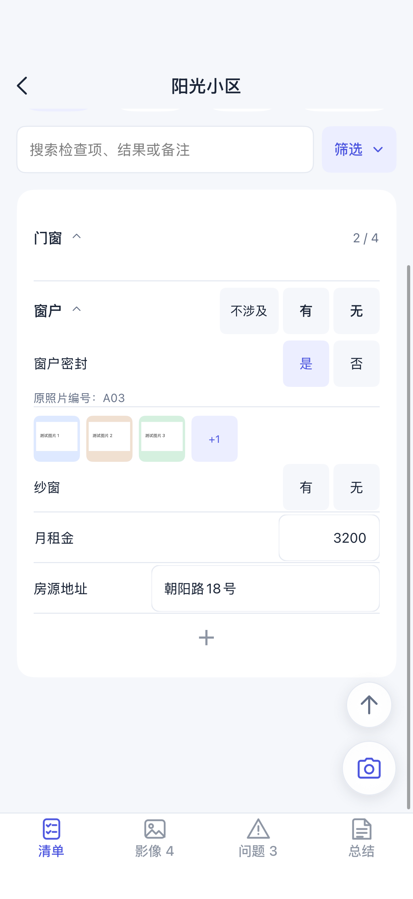
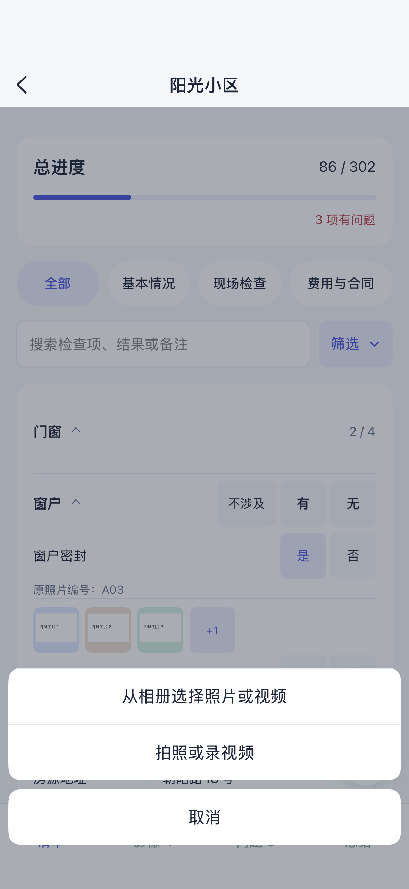
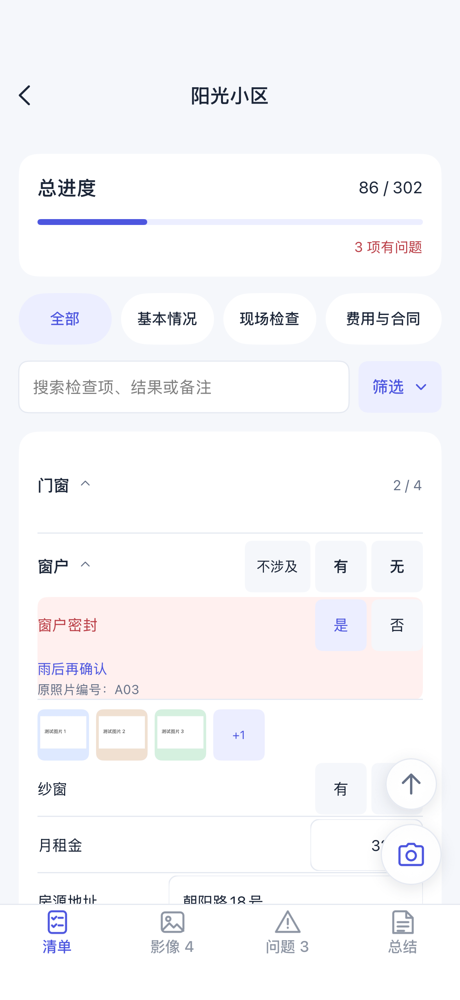

# 清单横滑与纵向滚动冲突修复

日期：2026-10-30。PR：[99](https://github.com/Hayden-Chang/rent_room/pull/99)。

## 行为与根因

清单行的 `MPHorizontalPan.Coordinator` 原先允许与任意 `UIPanGestureRecognizer` 同时识别。横向意图中带纵向偏移时，操作栏和父列表可以同时移动；列表位置回调还会调用 `coordinator.close()`，与松手展开结果相互影响。

修复禁止横滑同时识别其他手势，并只让包含该行的 UIScrollView 原生滚动手势等待行手势判定方向。明显纵向意图继续由 `gestureRecognizerShouldBegin` 拒绝，父列表正常滚动。阈值、速度处理、按钮尺寸、答案/备注/媒体逻辑没有改动。优先级使用 Apple 的 [gestureRecognizer(_:shouldBeRequiredToFailBy:)](https://developer.apple.com/documentation/uikit/uigesturerecognizerdelegate/gesturerecognizer%28_%3Ashouldberequiredtofailby%3A%29)。

## 修复前证据

基线 `b5a3b4d40d6476dffd17fcf30721d3b6383d4788`，仅加入新 UI 回归用例；[测试补丁](evidence/swipe-axis-lock-20261030/red-test.patch) 和 [修复前计划](evidence/swipe-axis-lock-20261030/red3-plan.json) 随证据保存。

- 在 iPhone 16 / iOS 26.5 上，从行中真实左拖 155 pt，同时向上偏移 55 pt。
- 目标标题的 Y 从 510.6667 变成 478.3333，误滚动 32.3334 pt，超过 2 pt 容差。
- `testDiagonalSwipeKeepsListStillAndVerticalDragClosesActions` 在该行为断言处失败。后续步骤未执行，不作已验证声明。
- 结果包：`/Volumes/mac2/codex-builds/rent-room-swipe-axis-red3-01a18ae4.xcresult`。
- 初次运行缺 esbuild，第二次因 SwiftPM 更新停留而主动中止；两次均未执行测试，均不计作缺陷复现。依赖就绪后使用本机已缓存的固定 ZIPFoundation 0.9.20，添加 `-skipPackageUpdates`。

## 定向选择

所有 selector 均精确到方法，未运行全量 UT 或 UI 套件。

| 边界 | selector | 类型 |
| --- | --- | --- |
| 横滑与父滚动互斥、仅限当前祖先滚动手势 | XunjuTests/SwipeGestureTests/testHorizontalPanExcludesParentScrollingAndOnlyPrioritizesItsScrollPan | 新增 |
| 纵向意图拒绝、关闭旧操作栏 | XunjuTests/SwipeGestureTests/testVerticalIntentFailsBeforeRecognitionAndClosesActions | 新增 |
| 跟手、反向、纵向、单活动行 | XunjuTests/MiniProgramComponentTests/testSwipeFollowsFingerAndHandlesReverseAndVerticalScroll | 受影响既有 |
| 短划与边界夹紧 | XunjuTests/MiniProgramComponentTests/testSwipeFastShortFlickAndClampedTravel | 受影响既有 |
| UIKit 短划原生速度 | XunjuTests/MiniProgramComponentTests/testNativeShortFlickUsesRecognizedVelocity | 受影响既有 |
| 两个斜向方向、反向收起、正常竖滑、拍摄入口、保留答案 | XunjuUITests/MiniProgramReviewTests/testDiagonalSwipeKeepsListStillAndVerticalDragClosesActions | 新增，最高 UI 风险 |
| 问题标记、备注保存与页签保留 | XunjuUITests/MiniProgramReviewTests/testChecklistSwipeNoteAndRetainedTabs | 受影响既有，第二 UI 风险 |

最终验证提交：`7ee1e64eb81c950ce8b42903f6ec380534de19cf`。首次修复后请求在排队期间主动取消，未构建或执行测试；仅将已选答案断言移到答案按钮重新可见的时刻，首个斜向拖动及位移断言与修复前保持一致。

## 范围

使用现有 DEBUG `parity-detail` 宿主中的真实 `MPFieldRow` 与 `MPChecklistSurface`，通过原生触摸验证组件。拍摄仅验证打开来源菜单，不代表相机/相册硬件授权与采集通过。iOS 17 的 DragGesture 回退路径未修改、未验证；未安装到真机。UI 明确批准前保持 Draft，不合并或发布。

## 最终结果与审查

`REVIEW_READY`：5 UT + 2 UI，7 通过、0 失败、0 跳过。两种斜向左滑及反向收起的标题 Y 差值均在 2 pt 断言容差内；纵向上滑移动超过 20 pt 并关闭操作栏；问题标记、备注保存/切页保留和拍摄来源菜单均通过。截图直接来自该次 XCUITest，主 agent 已检查，尺寸均为 1178 × 2556。

- 证据源码：`7ee1e64eb81c950ce8b42903f6ec380534de19cf`，运行时工作树干净。
- 基线：`b5a3b4d40d6476dffd17fcf30721d3b6383d4788`；完成源码验证时 PR 的 base 仍为此提交。
- 设备：iPhone 16 / iOS 26.5 (23F77) / arm64，UDID `5FC4A20B-AF44-4A92-BF91-B0096BEBF1D9`。
- Scheme：`Xunju`；XcodeGen 2.45.4。`project.yml` 未修改，生成的 `.xcodeproj` 未跟踪或提交。
- runner 配置：`/Volumes/mac2/projects/git_repo/run_self/Simulator Management/config/runner.json`。
- run ID：`rent-room-swipe-axis-final2-01a18ae4`，session ID：`01a18ae4-8e6a-7540-b653-233b5a49e9fb`。
- 测试命令 PID：`58472`；以 run ID 与 receipt 对应此次执行。
- [精确计划](evidence/swipe-axis-lock-20261030/final2-plan.json)、[完整命令](evidence/swipe-axis-lock-20261030/final2-command.sh)、[测试汇总](evidence/swipe-axis-lock-20261030/final2-summary.json)、[runner receipt](evidence/swipe-axis-lock-20261030/runner-receipt.json)、[截图来源与哈希](evidence/swipe-axis-lock-20261030/images.json)。
- 日志：`/private/tmp/rent-room-swipe-axis-evidence/final2.log`。
- 结果包：`/Volumes/mac2/codex-builds/rent-room-swipe-axis-final2-01a18ae4.xcresult`。
- 构建结果包：`/Volumes/mac2/codex-builds/rent-room-swipe-axis-final2-01a18ae4.build.xcresult`。
- runtime 映射后的独立缓存：`/Volumes/mac2/codex-builds/time-fragment-dd-shared-a96ee76cbd3758a4476e40a9-simulator`；缓存记录的 workspace 为本任务 worktree，不与其他任务共享写入。
- 退出码 0；本 run 的执行槽、缓存锁及设备租约均已释放。未关闭、清除或重置共享设备。
- 本次最终批次排队共 784.807 秒，构建阶段约 85.3 秒，测试命令阶段约 339.5 秒；测试阶段包含安装/会话启动及收尾，没有进一步拆分为各阶段耗时。
- 主 agent 在 PR 发布后复查了远程 diff、观察时机调整、文件范围与证据；未发现需返工项。该 head 没有远程 checks/statuses，不能称为远程 CI 通过。
- 测试通过后只添加本说明和 `docs/ios/evidence/swipe-axis-lock-20261030/` 下证据。它们不在应用 sources/resources 中，不影响构建配置、运行或测试选择；因此复用上述源码 SHA 的结果，未重复运行已通过测试。

## 原始截图

修复前，斜向左滑同时带动列表：

修复后，向左上方拖动展开三个 44 pt 按钮，列表位置保持：

修复后，向左下方拖动也保持列表位置：

正常竖滑仍移动列表并关闭操作栏：

拍摄入口打开原有来源菜单；问题标记与备注保留：

