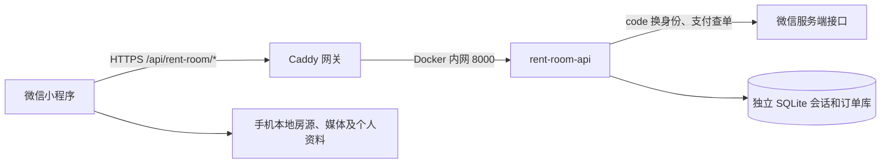

# 寻居后端、服务器与代码仓

核对日期：2026-10-16。本文根据代码、服务器联调部署记录和用户手机验收整理；运行状态、版本及开关是该日期的快照。配置仅记录名称和位置，不包含任何密钥正文。

## 当前实现

寻居使用自有服务器上的独立 Python / FastAPI 服务 `rent-room-api`，由 Uvicorn 运行、Docker Compose 管理，Caddy 提供 HTTPS 和路由。它负责微信身份验证、登录会话、房源包订单及购买权益，不依赖模型服务或 Supabase。

房源记录、清单答案、备注、照片、视频、头像和昵称保存在用户手机。云端尚无房源同步接口，也没有云端房源库；后端返回“可用总容量”，小程序根据本机未归档房源计算“已用容量”。



## 代码仓位置

| 项目 | GitHub 仓库 | 本机仓库根目录 | 内容 |
| --- | --- | --- | --- |
| 小程序 | [Hayden-Chang/rent_room](https://github.com/Hayden-Chang/rent_room) | `/Volumes/mac2/projects/git_repo/run_self/rent_room` | `apps/wechat/` 内的小程序代码、测试及构建脚本 |
| 后端 | [Hayden-Chang/model_server](https://github.com/Hayden-Chang/model_server) | `/Volumes/mac2/projects/git_repo/run_self/model_server` | `business_api/` 内的寻居后端，以及共享网关和部署配置 |

后端核心文件均位于 `model_server`：

| 仓库相对路径 | 职责 |
| --- | --- |
| `business_api/app/rent_room_main.py` | FastAPI 入口、登录、Bearer 鉴权、容量查询、下单、查单和微信通知 |
| `business_api/app/rent_room_settings.py` | `RENT_ROOM_*` 配置、登录与支付开关及配置完整性校验 |
| `business_api/app/rent_room_store.py` | SQLite 表、会话、订单、幂等、退款终态与权益计算 |
| `business_api/app/rent_room_wechat.py` | 微信 `code2Session`、支付签名、查单、发货确认、推送验签和加解密 |
| `business_api/tests/test_rent_room_capacity.py` | 身份隔离、订单、退款、持久化等后端测试 |
| `business_api/Dockerfile` | Python 镜像构建；Compose 覆盖启动命令来运行寻居入口 |
| `docker-compose.yml`、`Caddyfile`、`Caddyfile.accounts` | 仓库中的服务及网关配置；现网采用下文的独立部署目录 |
| `docs/rent-room-capacity.md` | 后端接口、支付契约与配置说明 |

小程序的对应入口为 `apps/wechat/src/lib/account-session.js`（登录）、`account-storage.js`（账号目录）、`account-profile.js`（本机资料）、`billing.js`（权益/订单）、`capacity.js`（未归档占用）和 `platform.js`（服务组装）。

最近联调部署的后端源码为 [`6fb4abed6b62635081b0440a3cfc634c7f1010bc`](https://github.com/Hayden-Chang/model_server/tree/6fb4abed6b62635081b0440a3cfc634c7f1010bc/business_api)。部署时容器中的五个 `rent_room_*.py` 与该提交逐文件 SHA-256 一致。本机 `model_server` 主检出仍在较早提交 `96f55e8`，不能据其当前文件判断现网版本；应查看上述提交或独立 worktree。本次没有更新或覆盖两个仓库的主检出文件。

## 服务器与现网部署

| 项目 | 实际值 |
| --- | --- |
| 公网 IP | `47.120.13.5` |
| 系统 | Ubuntu 22.04.5 LTS，x86_64 |
| SSH | 别名 `monitor-srv`，用户 `root`，端口 `22`；连接命令 `ssh monitor-srv` |
| SSH 私钥位置 | 本机 `/Users/pc/.ssh/id_monitor_deploy`，公钥为同路径加 `.pub` |
| 公网 API 基址 | `https://api.keeline.xyz/api/rent-room` |
| 小程序 AppID | `wxf43c7f280c98efca`（公开工程标识） |
| 独立部署目录 | `/opt/model_server/rent-room` |
| Compose 文件 | `/opt/model_server/rent-room/docker-compose.yml` |
| 私有配置 | `/opt/model_server/rent-room/private.env`，权限 `0600`，由 `env_file` 引入 |
| Compose 项目 / 服务名 | `rent-room` / `rent-room-api` |
| 容器名 | `rent-room-rent-room-api-1` |
| 当前镜像 | `rent-room-api:6fb4abed6b62` |
| 镜像内代码 | `/app/app/rent_room_*.py` |
| 服务端口 | 容器内 `8000`，未绑定宿主机公网端口 |
| Docker 网络 | `model-server_default`，与网关共享网络 |
| 数据卷 | `model-server_rent-room-capacity` |
| 容器内数据库 | `/var/lib/rent-room/capacity.sqlite3` |
| 宿主机卷目录 | `/var/lib/docker/volumes/model-server_rent-room-capacity/_data` |
| 发布源码目录 | `/opt/model_server/rent-room/releases/6fb4abed6b62635081b0440a3cfc634c7f1010bc/business_api` |
| 部署记录 | `/opt/model_server/rent-room/deployment.json` |

当前容器实际启动命令：

```sh
uvicorn app.rent_room_main:app --host 0.0.0.0 --port 8000 --no-access-log
```

现场版本：Python `3.12.14`、FastAPI `0.141.1`、Uvicorn `0.52.4`、httpx `0.28.1`、cryptography `44.0.1`。它由 Docker Compose 管理，不是独立的 systemd 应用服务，也不是 Node.js / Nginx 方案。

共享网关容器为 `model-server-caddy-1`，镜像 `model-server-caddy:2.11.4`，发布公网 `443`。**当前生效的宿主机网关文件是 `/opt/model_server/Caddyfile.accounts`**，只读挂载到容器 `/etc/caddy/Caddyfile`；寻居部署目录中的 `Caddyfile.accounts.candidate` 是候选文件，不是运行中的配置。

实际路由为 `/api/rent-room/* → rent-room-api:8000`，请求体上限 `64KB`，不承担媒体上传。该网关还服务其他产品；修改时需保留其余路由。根目录 `/opt/model_server/.env` 属于既有服务配置，寻居维护使用自己的 `private.env`。

## 登录与资料

1. 小程序调用 `wx.login()` 得到临时 `code`，通过 HTTPS 发送至 `POST /api/rent-room/session`。
2. 后端使用服务器中的 AppID / AppSecret 调用微信 `/sns/jscode2session`，取得 `openid` 和 `session_key`。
3. 后端以 `SHA-256(AppID + ":" + OpenID)` 生成稳定的 `account` 标识，签发有效期 2 小时的随机令牌，返回 `{account, token, packs, limit}`。
4. 小程序仅在内存保留令牌，后续请求使用 `Authorization: Bearer <token>`；令牌过期返回 `401`，客户端重新登录。SQLite 保存令牌哈希，微信 `session_key` 加密保存。
5. 小程序按账号隔离本地数据。首次确认身份时，旧版本未归属记录先备份再归属该账号；正常退出保留本机记录。

登录接口没有获取微信头像和昵称。资料使用小程序的 `chooseAvatar` 和 `input type="nickname"`，用户选择后保存在本机账号目录，不上传后端。详细客户端行为见 [账号与本地数据](ACCOUNT_LOGIN.md)。

## 房源容量与支付

免费 2 套；商品 `room_capacity_10` 每包 `199` 分，即 ¥1.99，增加 10 套容量。后端从该账号已确认支付且未退款的订单计算：`总容量 = 2 + 已购包数 × 10`。

已用数量由小程序计算，**归档房源不占容量**。归档释放名额，还原重新占用；ZIP 覆盖和新增副本按未归档房源净增量检查。后端不持有房源列表，所以目前也不做跨设备房源占用统计。

支付代码已实现 `wx.requestVirtualPayment` 所需签名、服务端查单、发货确认及加密通知。只有服务端核实微信订单号、金额和状态后才增加容量；客户端成功回调本身不增加权益。重复通知和重复下单有幂等约束，退款会扣回权益，已退款订单不能被迟到的付款结果重新计入。

**用户已授权开启联调支付，最近部署验证结果：**

- `RENT_ROOM_PAYMENTS_ENABLED=true`、`RENT_ROOM_IOS_PAYMENTS_ENABLED=true`。
- AppSecret、独立 Token Secret、OfferID `1450681249`、支付 AppKey 及推送 Token/AESKey 均已配置在服务端；微信后台消息推送已保存。
- 公网 `/catalog` 实测 HTTP `200`，返回 `available:true`、`iosAvailable:true` 和199分商品信息。
- 容器健康、签名GET回显、错误签名403、加密POST及未登录鉴权检查通过。
- 用户已在iPhone实付一笔¥1.99，确认显示1/12、旧错误提示消失，退出重新登录后仍为1/12。原订单真实查单连续两次返回paid、1包、总容量12。
- **退款及容量回收实单按用户要求暂缓，仍未验收**；换机与Android实单也未验收。自动化退款用例不替代这些实单验收。

登录、权益刷新和每分钟后台任务均可有界补查；普通同单查单间隔5分钟，显式订单查询及发货通知强制查单。已支付待发货/发货中状态经严格核验后幂等发放，并补偿发货确认；微信令牌被拒绝时只刷新重试一次。完整支付契约见 [后端说明](https://github.com/Hayden-Chang/model_server/blob/6fb4abed6b62635081b0440a3cfc634c7f1010bc/docs/rent-room-capacity.md)。

## API 一览

路径以 `https://api.keeline.xyz` 为前缀。

| 方法和路径 | 鉴权 | 用途 |
| --- | --- | --- |
| `GET /api/rent-room/catalog` | 无需登录 | 商品价格、增加容量和购买开关 |
| `POST /api/rent-room/session` | 微信临时 `code` | 验证身份，取得令牌与容量 |
| `GET /api/rent-room/entitlements` | Bearer | 查询当前账号房源包与总容量 |
| `POST /api/rent-room/orders` | Bearer | 按 `requestId`、`productId`、`platform` 创建本人订单 |
| `GET /api/rent-room/orders/request/{requestId}` | Bearer | 查单、确认支付并返回权益 |
| `GET /api/rent-room/wechat/notify` | 微信签名 | 微信通知地址校验 |
| `POST /api/rent-room/wechat/notify` | 验签、解密及 AppID 校验 | 支付通知查单；退款通知核对原单与最终结果 |
| `GET /health/live` | 容器内部检查 | 寻居进程存活探针，不作为公网寻居健康地址使用 |

客户端构建配置为 `WECHAT_API_URL=https://api.keeline.xyz/api/rent-room`；微信后台 request 合法域名为 `https://api.keeline.xyz`。

## 常用维护入口

在本机连接服务器：

```sh
ssh monitor-srv
```

在服务器查看寻居状态、日志与健康结果：

```sh
cd /opt/model_server/rent-room
docker compose ps
docker compose logs --tail 100 rent-room-api
docker inspect --format '{{.State.Health.Status}}' rent-room-rent-room-api-1
docker compose exec -T rent-room-api python -c "import urllib.request; print(urllib.request.urlopen('http://127.0.0.1:8000/health/live', timeout=5).read().decode())"
curl --fail --silent --show-error https://api.keeline.xyz/api/rent-room/catalog
```

维护时如需重启原进程，执行 `docker compose restart rent-room-api`。若修改了 `private.env` 或镜像引用，需要执行 `docker compose up -d --no-deps rent-room-api` 重新创建容器；单纯 `restart` 不加载新的环境配置。这些是维护指引，合入代码本身不会重启服务或改变支付开关。

更新服务时，从后端仓库的明确提交构建镜像，备份配置及数据库，将新镜像标签写入独立 Compose 文件，再只更新 `rent-room-api`。核对健康与 `/catalog` 后，使用小程序完成真实登录验收。只有网关路由有变动才需要校验并重载 Caddy；不要通过整体重建共享栈更新寻居。

SQLite 使用 WAL 模式，运行中备份应使用 SQLite 在线 backup 或停服一致性备份，不能只复制主 `.sqlite3` 文件而漏掉 WAL。数据库保存购买权益，持久卷不可当作容器临时文件删除。私有环境文件需与数据库分别保管，尤其应保留会话加密所用的 Token Secret。

已确认存在部署前备份目录 `/opt/model_server/rollback-backups/rent-room-20261015T070640Z`，其路径也记录在寻居部署目录的 `backup-path` 文件。该历史目录仅核对过存在。最近联调部署备份位于 `/opt/model_server/rent-room/backups/payment-release-20261016T065044Z`，包含独立配置及SQLite在线备份，quick_check通过；仍未验证完整恢复流程或定时备份任务。

## 后续云同步的扩展位置

继续在这个后端增加按账号鉴权的房源同步接口、云端房源存储、媒体对象存储和冲突处理即可沿用现有身份体系；目前这些模块均未实现。是否在多设备间共享容量占用，需要在同步设计时另行确定。支付权益能够重新查询，不等于房源记录已同步到云端。
