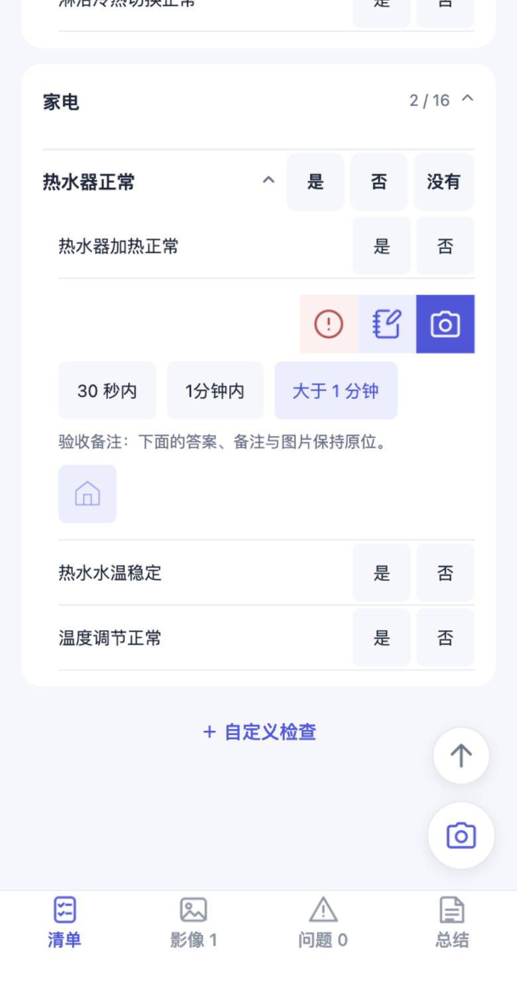
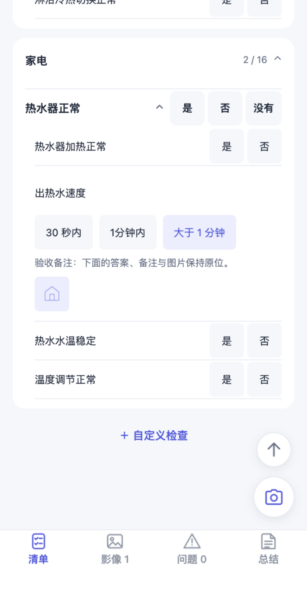

# 检查项标题左滑修复 · 2026-10-13

## 行为

左滑容器只包含描述标题与问题、备注、拍摄三个操作。答案、地图、输入、备注与媒体保持在容器外，不参与位移，也不撑高操作按钮。同行二选一仍保持同行，答案固定；三个操作各 44px，总展开宽度 132px，适配标题列。长标题按实际换行高度显示。

右滑从标题或操作按钮区开始均可收起；点击标题、其他 item、页面空白或悬浮区域可收起。答案按钮、分组操作和表单工具首次点击优先收起，下一次正常执行；导航与回顶部可同次完成。输入框允许聚焦并收起菜单。滚动和离开页面关闭临时状态，不改写答案、备注或媒体。

## 验证与影响映射

基线：9270183a34e3100a2b8424cd9c197b3781d4bae5。独立 worktree：`.worktrees/item-swipe-header`；分支：`codex/item-swipe-header`。Node v25.9.0、Vitest v5.0.3；使用已有环境，仓库推荐 Node 24，本轮未安装/升级运行时。依赖从已有工程复制到本任务独立 node_modules，锁文件未改。

- 新增 `field-row-swipe-scope.test.js`：最初六项在旧产物上全部按预期失败，分别为选项/附件仍位于滑动容器、操作按钮没有滑动祖先、跨 item 首次点击改答案、右滑结束误触操作、悬浮控件不在收起边界、分组答案先修改而未收起。
- 修复后该文件共 10 项通过，增加答案区不启动滑动、下一次点击可用、操作按钮新触摸可执行、标题手势后的 tap 抑制与导航/滚动/离开关闭。
- 受影响已有测试：`field-row-swipe.test.js`（6，手势阈值/互斥/只读/取消/操作）、`field-row-placeholder.test.js`（3，焦点与输入）、`detail-filter.test.js`（8，新增收起前置逻辑不影响既有筛选提交）、`runtime.test.js`（1，构建后页面与共享 service）。合计 28 项通过。
- `npm run check`：官方 wcc 编译 8 个 WXML、wcsc 编译 6 个 WXSS，通过，7 个页面。

命令均从 `apps/wechat` 执行：

```sh
npm run build
npm test -- tests/field-row-swipe-scope.test.js
# 旧代码：6 failed；原始输出 artifacts/swipe-header/before.log。
npm run build
npm test -- tests/field-row-swipe-scope.test.js tests/field-row-swipe.test.js tests/field-row-placeholder.test.js tests/detail-filter.test.js tests/runtime.test.js
npm run check
```

原始日志在本任务 `apps/wechat/artifacts/swipe-header/`（before.log、after.log、build-before.log、build-after.log、check.log）；编译结果在 `artifacts/compile-result.json`。没有执行全量单测或 UI 套件。

## 初次提交时的 UI 证据限制（已补充下方截图）

VM 测试和模板祖先断言验证逻辑与绑定范围，不是实际手势或像素证据。开发者工具 Stable 2.01.2510290 当前工程是另一个任务 `.worktrees/inline-address-map/apps/wechat/dist`，本轮仅只读查看，未切换/重启该会话，未改用户缓存或数据。本次版本暂无开发者工具截图和真机手势证据，因此 PR 为草稿、未达到合并门禁，未上传预览、体验版或发布。

待在独占且数据隔离的会话导入本分支 dist：

1. 找到非同行选项字段（如热水器等待时间），从标题左滑，确认仅标题移动、操作与标题等高，下方选项及附件位置不变。
2. 从选项区域左滑不能展开；同行“是/否”固定，长标题换行不裁切，三个操作可点。
3. 从标题和三个操作区分别右滑；点击当前答案、另一个 item、分类、空白、拍摄按钮、导航，核对收起与首次点击规则。
4. 点击三个操作确认只触发一次、归属正确；滚动和切页后菜单关闭；重开检查答案、问题标记、备注与媒体保留。
5. iOS/Android 真机复核受影响手势，并由用户确认 UI 后再合入。

## PR 最终复核

创建草稿 PR #5 后，主线前进到 cb03d735d990668aa412c8e0f703384e3cfb4c95（未回答分组折叠修复）。已无冲突合入任务分支，组合提交 faf66221ee047c63d28934b3e3cab52bd8005681。本 PR 对主线的业务 diff 未变；因主线改了页面使用的模型，重新构建并执行上述五个文件及新增主线的 `tests/unanswered-group-runtime.test.js`（直接调用本次修改的 fold/group 边界）：29/29 通过，官方编译再次通过。

最终命令：`npm test -- tests/field-row-swipe-scope.test.js tests/field-row-swipe.test.js tests/field-row-placeholder.test.js tests/detail-filter.test.js tests/runtime.test.js tests/unanswered-group-runtime.test.js`，以及 `npm run build` / `npm run check`。日志 build-final.log、final.log、check-final.log 保存在同一证据目录。当前主 agent 已独立复查远端 PR diff、八文件范围、旧失败与新通过证据；之后仅补充此文档，没有改变源码、测试或配置。UI 与真机证据仍未取得，草稿保持未合并。


## 实际截图验收与运行时修复

2026-10-13 在本任务 dist 的微信开发者工具 Stable 2.01.2510290、基础库 3.17.3、iPhone 12/13 (Pro) 模拟器中验证。复用了本任务独立自动化端口 9437；其他工程窗口未关闭或重启。开发者工具本地缓存为共享环境，创建独立的“左滑标题验收 · 1013”房源作为样本；未修改已有房源。答案为“大于 1 分钟”，备注与测试缩略图归属于出热水速度 f62_1。数据、筛选与滚动位置由官方 SDK 准备，不能算作点击或手势证据。

实际渲染发现 `selectAllComponents('field-row')` 返回空列表；添加组件 class 并使用 `.field-row` 后，运行时返回 6 个可见组件，修复页面级收起逻辑。新增回归在修复前失败，修复后六个受影响测试文件共 30/30 通过；构建和官方 WXML/WXSS 编译通过。日志位于 `apps/wechat/artifacts/swipe-header-ui/` 的 selector-before.log、build.log、tests.log、check.log。

- 通过：原生鼠标在描述行左拖，运行时 actions=true、offset=-132，实际截图三个操作仅占标题行。
- 通过：原生点击下方“30 秒内”，运行时 actions=false、offset=0，答案仍为“大于 1 分钟”，首次点击只收起菜单。
- 通过：左滑前、展开后、点击收起后的答案、备注和缩略图矩形完全一致。标题/操作高度 44 CSS px；答案 top=272、height=44，备注 top=324、height=18，缩略图 top=350、height=44，横向均 left=44、width=314。
- 未完成：右滑、答案区左滑及完整操作按钮链路的原生交互复核。多工程窗口切换以及原生拖动工具 noWindowsAvailable 中断了后续动作；失败尝试不计入通过证据。逻辑测试通过不能替代这些实际交互，也没有 iOS/Android 真机证据。

实际左滑后的截图（未经合成）：



实际点击答案收起后的截图：



完整工具窗口截图 native-left-drag.png、SDK 只读截图 04-native-left-swipe.png / 05-after-click-attempt.png 及对应 JSON 几何记录保存在上述本地证据目录。01-before/02-open/03-closed 属于直接调用处理函数后的真实渲染截图，仅用于布局对比，不计入原生手势证据。

本轮仅补充组件选择器修复、回归与验收记录；未上传预览、体验版或发布。草稿 PR 保持未合并，截图待用户确认。

## 用户批准后的最终合入检查

用户在看到实际截图和剩余手势验证限制后，明确授权“好的，并合入”。最终业务候选为 `69fb44720b4c7ea214084918e82b3aa39cd3c8a1`，基线 `9ae3a41faa1bba741428358e9eeae3aff5cb4721`。主线推进涉及分隔线、页面位置保留和根分组显示：三处文本冲突已手工整合，保留 `hideDivider`、滚动锚点、异步 tab 切换与当前标题左滑/组件 class 查询。未直接复用旧测试结果。

重新构建后执行：

```sh
npm --prefix apps/wechat run build
npm --prefix apps/wechat test -- tests/field-row-swipe-scope.test.js tests/field-row-swipe.test.js tests/field-row-placeholder.test.js tests/detail-filter.test.js tests/runtime.test.js tests/unanswered-group-runtime.test.js tests/detail-navigation.test.js tests/root-group-runtime.test.js tests/root-group-fold.test.js tests/group-visibility-audit.test.js
npm --prefix apps/wechat run check
```

10 个文件、177 项通过；wcc 8 个 WXML / wcsc 6 个 WXSS 编译通过。前六个测试文件覆盖本 PR 的行为和直接页面调用；增加 detail-navigation 验证冲突涉及的异步切换，root-group-runtime/root-group-fold/group-visibility-audit 验证新主线模型输入及 fold/group 行为。未运行全量套件。导航测试 fixture 补齐真实组件已有的 data 属性；左滑导航测试适配异步完成，不删减断言。测试在提交前相同源文件树执行，候选提交只记录该树；本节追加仅为文档。

主 agent 在推送后单独检查远端最终 diff：11 个文件，页面状态、分隔线行为保留；没有新增阻塞发现。候选 SHA 的 GitHub statuses 和 PR workflow runs 均为空，不能表述为远端 CI 已通过。

本次重载任务开发者工具后，组件查询返回 6 个有效组件；补拍脚本阻塞于 SDK 截图，未产生新截图，不计入最终交互通过证据。已提交的实际截图来自 55a08d5；标题位移逻辑、44px 高度/132px 宽度、答案与附件祖先结构未变，整合只追加底部分隔线 class 与页面锚点/状态保留。右滑、答案区左滑及真机仍属已披露的人工验证限制，用户批准后按当前证据合入，不将失败截图尝试算作通过。

日志：`apps/wechat/artifacts/swipe-header-ui/merge-tests.log`、`merge-check.log`、`merge-layout.log`。
